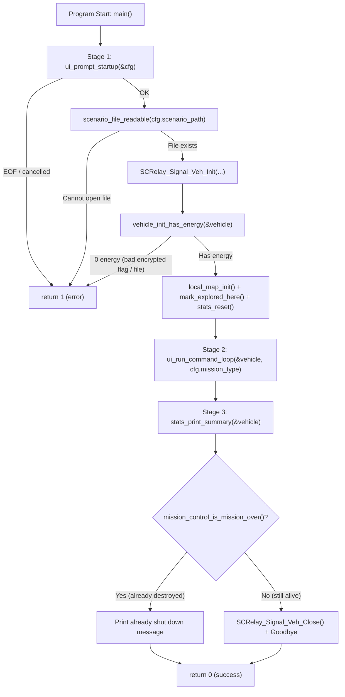

# v2 Student Deep-Dive Guide 1: `main.c` (Lines 1–83)

> [!NOTE]
> **Updated v2 Guide (`nathan` branch):** This guide matches the refactored student-style [main.c](file:///c:/Users/nathanyu/Documents/GitHub/RSE1201_Group_Project/VehExplorer/src/main.c) line-for-line (lines 1–83). Every C term (`static`, `const`, `*`, `&`, `->`, `FILE *`, `stderr`, etc.) is explained right where it appears—even when repeated—so you never need to scroll back up.

---

## 1. Big-Picture Role of `main.c`

[main.c](file:///c:/Users/nathanyu/Documents/GitHub/RSE1201_Group_Project/VehExplorer/src/main.c) is the **conductor** of the entire `VehExplorer` program. Instead of cramming input loops, map grids, or auto-pilot logic into one giant file, `main.c` runs the three milestone stages in order:



---

## 2. Line-by-Line Walkthrough (`main.c`, Lines 1–83)

### Chunk A: Header `#include` Directives ([main.c](file:///c:/Users/nathanyu/Documents/GitHub/RSE1201_Group_Project/VehExplorer/src/main.c#L1-L7))

```c
#include "SatComRelay.h"
#include "local_map.h"
#include "mission_control.h"
#include "stats.h"
#include "ui_cli.h"

#include <stdio.h>
```

#### Every Term Explained Inline
- **`#include "..."` (double quotes):** Tells the C preprocessor (Stage 1 of `gcc`) to paste in one of **our project's own header files** (searched in `VehExplorer/inc/` and `../MS_1_files/` via `-Iinc -I../MS_1_files`).
  - `"SatComRelay.h"`: Gives us the lecturer's `VehDataType` struct and `SCRelay_Signal_Veh_Init` / `SCRelay_Signal_Veh_Close` prototypes (and also pulls in `<stdbool.h>` for `bool`, `true`, `false`).
  - `"local_map.h"`: Gives us [`local_map_init`](file:///c:/Users/nathanyu/Documents/GitHub/RSE1201_Group_Project/VehExplorer/inc/local_map.h#L17) and [`local_map_mark_explored_here`](file:///c:/Users/nathanyu/Documents/GitHub/RSE1201_Group_Project/VehExplorer/inc/local_map.h#L24).
  - `"mission_control.h"`: Gives us [`mission_control_is_mission_over`](file:///c:/Users/nathanyu/Documents/GitHub/RSE1201_Group_Project/VehExplorer/inc/mission_control.h#L29).
  - `"stats.h"`: Gives us [`stats_reset`](file:///c:/Users/nathanyu/Documents/GitHub/RSE1201_Group_Project/VehExplorer/inc/stats.h#L17) and [`stats_print_summary`](file:///c:/Users/nathanyu/Documents/GitHub/RSE1201_Group_Project/VehExplorer/inc/stats.h#L36).
  - `"ui_cli.h"`: Gives us [`UiStartupConfig`](file:///c:/Users/nathanyu/Documents/GitHub/RSE1201_Group_Project/VehExplorer/inc/ui_cli.h#L11-L16), [`ui_prompt_startup`](file:///c:/Users/nathanyu/Documents/GitHub/RSE1201_Group_Project/VehExplorer/inc/ui_cli.h#L19), and [`ui_run_command_loop`](file:///c:/Users/nathanyu/Documents/GitHub/RSE1201_Group_Project/VehExplorer/inc/ui_cli.h#L28).
- **`#include <stdio.h>` (angle brackets):** Pastes in the **C Standard Input/Output library** header for `FILE`, `fopen`, `fclose`, `printf`, `fprintf`, and `stderr`.

---

### Chunk B: Private Validation Helpers ([main.c](file:///c:/Users/nathanyu/Documents/GitHub/RSE1201_Group_Project/VehExplorer/src/main.c#L9-L24))

```c
/* Check that vehicle initialization gave positive starting energy. */
static bool vehicle_init_has_energy(const VehDataType *vehicle)
{
    return vehicle->initialEnergy > 0 || vehicle->currEnergy > 0;
}

/* Check that the scenario file exists before passing it to SatComRelay. */
static bool scenario_file_readable(const char *path)
{
    FILE *fp = fopen(path, "rb");
    if (fp == NULL) {
        return false;
    }
    fclose(fp);
    return true;
}
```

#### Every Term Explained Inline
- **`static` (on a function):** Gives the function **internal linkage**—meaning [`vehicle_init_has_energy`](file:///c:/Users/nathanyu/Documents/GitHub/RSE1201_Group_Project/VehExplorer/src/main.c#L10-L13) and [`scenario_file_readable`](file:///c:/Users/nathanyu/Documents/GitHub/RSE1201_Group_Project/VehExplorer/src/main.c#L16-L24) are **private to `main.c`** and invisible to all other `.c` files.
- **`bool`:** Boolean return type (`true` or `false`) from `<stdbool.h>`.
- **`const VehDataType *vehicle`:**
  - `VehDataType *`: A **pointer** holding the memory address of a `VehDataType` struct (passing an address avoids copying the whole struct).
  - `const`: Promises the compiler this function will **only read** `vehicle` and will never modify its fields.
- **`vehicle->initialEnergy` (`->` arrow operator):** Reads a struct field through a pointer. `vehicle->initialEnergy` is shorthand for `(*vehicle).initialEnergy`.
- **`||` (logical OR):** Returns `true` if **either** `initialEnergy > 0` or `currEnergy > 0`. Uses **short-circuit evaluation** (if the left side is already `true`, C skips checking the right side). Why check energy? When `SCRelay_Signal_Veh_Init` fails (for example, if an unencrypted file was marked encrypted), it returns a zeroed-out `VehDataType` with `0` energy instead of returning an error code.
- **`const char *path`:** Pointer to the first character of a read-only C string (the scenario filename, e.g., `"../MS_1_files/arena.dat"`).
- **`FILE *fp = fopen(path, "rb");`:**
  - `FILE *`: Pointer to a standard C file-stream control object from `<stdio.h>`.
  - `fopen(path, "rb")`: Tries to open the file at `path` in **`"rb"` (read-binary)** mode. If the file doesn't exist or lacks read permission, `fopen` returns `NULL`.
- **`NULL`:** Special pointer constant meaning "points to nothing / invalid address" (`0`).
- **`fclose(fp);`:** Immediately closes the file stream so we don't leak an open file handle before `SatComRelay` opens the file itself.

---

### Chunk C: `main()` — Stage 1 Setup & Safety Checks ([main.c](file:///c:/Users/nathanyu/Documents/GitHub/RSE1201_Group_Project/VehExplorer/src/main.c#L26-L61))

```c
int main(void)
{
    UiStartupConfig cfg;
    VehDataType vehicle;

    /* Stage 1: Ask the user for scenario path, flags, and mission type */
    if (!ui_prompt_startup(&cfg)) {
        return 1;
    }

    /* Verify the scenario file can be opened before calling the library */
    if (!scenario_file_readable(cfg.scenario_path)) {
        fprintf(stderr, "Cannot open scenario file: \"%s\"\n", cfg.scenario_path);
        return 1;
    }

    /* Initialize the exploration vehicle through SatComRelay */
    vehicle = SCRelay_Signal_Veh_Init(
        cfg.scenario_path,
        cfg.file_needs_decryption,
        cfg.randomize_start,
        cfg.mission_type);

    /* Stop early if initialization failed (for example, wrong encryption flag) */
    if (!vehicle_init_has_energy(&vehicle)) {
        const char *enc_flag = "n";
        if (cfg.file_needs_decryption) {
            enc_flag = "y";
        }
        fprintf(stderr,
                "Init failed — check scenario path and encryption flag "
                "(\"%s\", encrypted=%s).\n",
                cfg.scenario_path,
                enc_flag);
        return 1;
    }
```

#### Every Term Explained Inline
- **`int main(void)`:** Standard C program entry point. `(void)` means `main` takes **zero command-line arguments**; returning `int` sends an exit status back to Linux (`0` = success, `1` = error).
- **`UiStartupConfig cfg;` and `VehDataType vehicle;`:** Two local struct variables allocated on `main`'s stack frame.
  - `cfg` will hold the user's 4 startup answers (`scenario_path`, `file_needs_decryption`, `randomize_start`, `mission_type`).
  - `vehicle` will hold the live energy and shield numbers returned by `SatComRelay`.
- **`&cfg` and `&vehicle` (`&` address-of operator):** Passes the **memory address** of `cfg` or `vehicle`. Because C passes arguments **by value** (copying them), [`ui_prompt_startup`](file:///c:/Users/nathanyu/Documents/GitHub/RSE1201_Group_Project/VehExplorer/src/ui_cli.c#L14-L73) needs `&cfg` so it can write directly into `main`'s `cfg` struct.
- **`!` (logical NOT):** Flips `true` ↔ `false`. `if (!ui_prompt_startup(&cfg))` means *"if startup prompting returned `false` (for example, `Ctrl+D` / EOF), exit immediately with error code `1`."*
- **`cfg.scenario_path` (`.` dot operator):** Accesses a field directly on a struct variable (unlike `->`, which is used on a struct pointer). Note that `cfg.scenario_path` is a `char[512]` array, which automatically **decays into a `char *` pointer** to its first character when passed to a function!
- **`fprintf(stderr, ...)`:** Formatted print sent to **`stderr`** (the standard error stream) instead of `stdout`, so error messages appear immediately even if normal output is redirected. `\"%s\"` uses `\"` to print literal quotation marks around the string `%s`.
- **`const char *enc_flag = "n";`:** Creates a pointer to the string literal `"n"`, and updates it to point to `"y"` inside `if (cfg.file_needs_decryption)` so the error message clearly shows what flag the user picked.
- **Adjacent string literals (`"Init failed ... " "(\"%s\", ...)"`):** In C, two string literals next to each other with only whitespace in between are automatically joined into one string at compile time so long lines stay tidy.

---

### Chunk D: Stage 2 Loop, Stage 3 Report & Clean Shutdown ([main.c](file:///c:/Users/nathanyu/Documents/GitHub/RSE1201_Group_Project/VehExplorer/src/main.c#L63-L83))

```c
    /* Set up the local map at spawn (0, 0) and clear statistics */
    local_map_init();
    local_map_mark_explored_here();
    stats_reset();

    /* Stage 2: Run the interactive command loop (manual + auto-pilot) */
    ui_run_command_loop(&vehicle, cfg.mission_type);

    /* Stage 3: Print final exploration report */
    stats_print_summary(&vehicle);

    /* Shut down the vehicle session if it was not already ended by destruction */
    if (mission_control_is_mission_over()) {
        printf("Vehicle already shut down by mission-over. Goodbye.\n");
    } else {
        SCRelay_Signal_Veh_Close();
        printf("Vehicle closed. Goodbye.\n");
    }

    return 0;
}
```

#### Every Term Explained Inline
- **[`local_map_init()`](file:///c:/Users/nathanyu/Documents/GitHub/RSE1201_Group_Project/VehExplorer/src/local_map.c#L155-L158):** Clears any old map state and places our relative coordinate origin at `(0, 0)` (the vehicle's spawn point).
- **[`local_map_mark_explored_here()`](file:///c:/Users/nathanyu/Documents/GitHub/RSE1201_Group_Project/VehExplorer/src/local_map.c#L177-L184):** Marks spawn `(0, 0)` as visited right away so pressing `'x'` (Explored Map) before moving already shows the vehicle on its starting tile.
- **[`stats_reset()`](file:///c:/Users/nathanyu/Documents/GitHub/RSE1201_Group_Project/VehExplorer/src/stats.c#L62-L69):** Zeroes out move/scan counters and energy tables before gameplay begins.
- **`ui_run_command_loop(&vehicle, cfg.mission_type);`:** Runs **Stage 2**. Notice `&vehicle` is passed by pointer (`VehDataType *`) because moves, scans, and shield allocations inside Stage 2 continuously update `vehicle`'s energy fields, whereas `cfg.mission_type` (`1`–`8`) is just an `int` that never changes, so it is passed by value.
- **`stats_print_summary(&vehicle);`:** Runs **Stage 3**, reading the final `vehicle` energy reserves and printing the Exploration Report.
- **`if (mission_control_is_mission_over()) { ... } else { SCRelay_Signal_Veh_Close(); ... }`:**
  - Critical safety check! If the vehicle stepped onto `'X'` (or hit hazard terrain without shields) during Stage 2, `libsatcom.so` **already** shut down the session internally. Calling `SCRelay_Signal_Veh_Close()` a second time could double-free internal library memory, so we only call `SCRelay_Signal_Veh_Close()` when [`mission_control_is_mission_over()`](file:///c:/Users/nathanyu/Documents/GitHub/RSE1201_Group_Project/VehExplorer/src/mission_control.c#L14-L17) is `false`.
- **`return 0;`:** Signals clean, normal program completion to the Linux shell.

---

## 3. Ready-to-Use Presentation Script & Likely Teacher Q&A

### 45-Second Walkthrough Script
> "`main.c` is our top-level coordinator that connects Stages 1, 2, and 3 cleanly without mixing UI or map details into `main`. In Stage 1, we call `ui_prompt_startup(&cfg)` to collect the scenario filename, encryption and random-spawn flags, and mission type. Before calling `SCRelay_Signal_Veh_Init`, `scenario_file_readable` verifies the file actually opens, and afterward `vehicle_init_has_energy` verifies the returned `VehDataType` has positive energy so a wrong encryption flag fails cleanly instead of starting a broken session. Next, we initialize our relative local map at `(0, 0)` and zero our stats, run Stage 2 inside `ui_run_command_loop`, and print the Stage 3 report with `stats_print_summary`. Finally, we check `mission_control_is_mission_over()` so we only call `SCRelay_Signal_Veh_Close()` if the library hasn't already closed the vehicle after destruction."

### Likely Questions From Your Lecturer
1. **Q: Why did you check `scenario_file_readable` before `SCRelay_Signal_Veh_Init` AND `vehicle_init_has_energy` after it?**
   - **A:** `scenario_file_readable` catches typos in the file path immediately with a clear message before calling the shared library. However, a file can exist on disk and still fail to load inside `libsatcom.so` if the user answered the `encrypted (y/n)` prompt wrongly—in that case `SCRelay_Signal_Veh_Init` returns a struct with `0` energy, which `vehicle_init_has_energy` catches.
2. **Q: Why pass `&vehicle` (with `&`) to `ui_run_command_loop`, when `SCRelay_Signal_Veh_Init` returned `vehicle` by value?**
   - **A:** C passes arguments by value. During Stage 2, every move, scan, and shield allocation changes `vehicle.currEnergy` and `vehicle.currShieldEnergy`, so passing its address `&vehicle` lets Stage 2 update `main`'s single `vehicle` variable directly, which Stage 3 then reads at the end.
