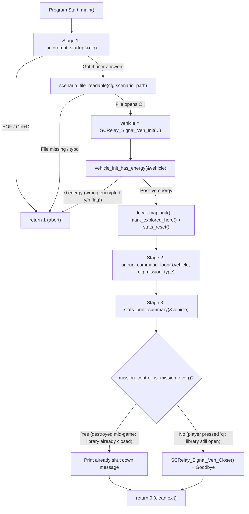
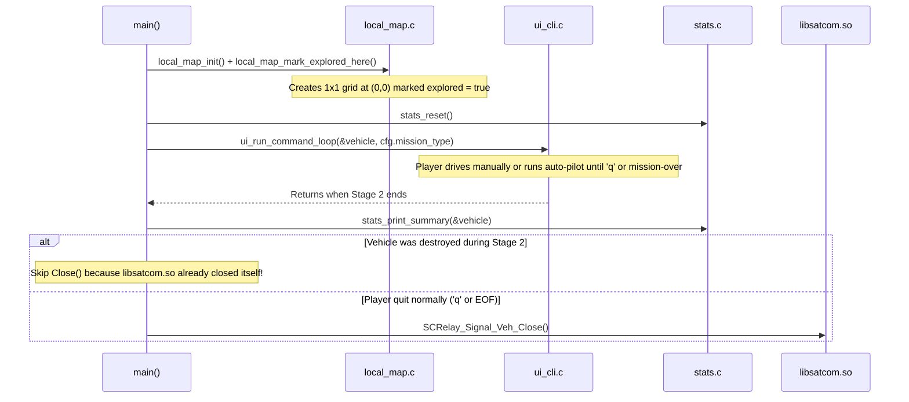

# v2 Student Deep-Dive Guide 1: `main.c` (Lines 1–83)

> [!NOTE]
> **Beginner-Friendly Visual Edition (`nathan` branch):** Covers every line of [main.c](file:///c:/Users/nathanyu/Documents/GitHub/RSE1201_Group_Project/VehExplorer/src/main.c) (lines 1–83) with **memory box diagrams**, **step-by-step flowcharts**, and **inline explanations of every C symbol** (`static`, `const`, `*`, `&`, `->`, `.`, `FILE *`, `stderr`) right where it appears—so you never need to scroll back up.

---

## 1. Mental Imagery: What Is `main.c`'s Job?

Imagine `VehExplorer` is a space rover mission. [main.c](file:///c:/Users/nathanyu/Documents/GitHub/RSE1201_Group_Project/VehExplorer/src/main.c) is the **Mission Director** standing in the control room with a 3-item checklist:
1. **Stage 1 (Pre-Launch Setup):** Ask the operator which map file and mission goal to load, verify the file actually exists on disk, and boot up the rover via `libsatcom.so`.
2. **Stage 2 (Drive & Explore):** Hand the rover controls over to `ui_cli.c` (which handles both manual `w/a/s/d` driving and `'p'` auto-pilot).
3. **Stage 3 (Post-Mission Debrief):** Print the final Exploration Report (`stats.c`) and power down `libsatcom.so` cleanly.



---

## 2. Visual Mental Model: How `cfg` and `vehicle` Live in Memory (Why `&` Matters!)

Beginners often ask: *"Why do we write `&cfg` and `&vehicle` in some calls, `cfg.mission_type` in others, and `vehicle = SCRelay_Signal_Veh_Init(...)` without `&`?"*

Picture `main()`'s **stack memory** as two physical storage boxes sitting inside `main()`:

```text
+-----------------------------------------------------------------------+
|                        main()'s Stack Memory                          |
|                                                                       |
|   Box 1: cfg (UiStartupConfig)         Box 2: vehicle (VehDataType)   |
|   Memory Address: 0x7ffc1000           Memory Address: 0x7ffc1210     |
|  +----------------------------+       +----------------------------+  |
|  | scenario_path: "input..."  |       | initialEnergy:   300000000 |  |
|  | file_needs_decryption: 1   |       | currEnergy:      299788555 |  |
|  | randomize_start:       0   |       | currShieldEnergy:     5000 |  |
|  | mission_type:          3   |       | totEnergyUsed:      211445 |  |
|  +----------------------------+       | totShieldEnergyUsed: 10005 |  |
|               ^                       +----------------------------+  |
|               |                                     ^                 |
+---------------|-------------------------------------|-----------------+
                |                                     |
     &cfg passes address 0x7ffc1000        &vehicle passes address 0x7ffc1210
     so ui_prompt_startup() can            so Stage 2 moves/scans/shields update
     FILL Box 1 directly!                  Box 2 live, and Stage 3 reads it!
```

- **In C, functions receive copies of their arguments ("pass-by-value").**
- If we passed `cfg` *without* `&`, `ui_prompt_startup` would fill a temporary photocopy and throw it away when returning—leaving `main()`'s `cfg` full of garbage!
- Passing **`&cfg`** ("the address of `cfg`") hands `ui_prompt_startup` the GPS coordinates (`0x7ffc1000`) of `main()`'s real box so it fills `main()`'s `cfg` directly.

---

## 3. Line-by-Line Walkthrough (`main.c`, Lines 1–83)

### Chunk A: Header `#include` Directives ([main.c](file:///c:/Users/nathanyu/Documents/GitHub/RSE1201_Group_Project/VehExplorer/src/main.c#L1-L7))

```c
#include "SatComRelay.h"
#include "local_map.h"
#include "mission_control.h"
#include "stats.h"
#include "ui_cli.h"

#include <stdio.h>
```

#### Every Term Explained Inline
- **`#include "..."` (double quotes):** Tells Stage 1 of `gcc` (the **Preprocessor**) to copy-paste one of **our project's own `.h` header files** before compiling (`gcc` finds them via `-Iinc -I../MS_1_files`).
  - `"SatComRelay.h"`: Declares the lecturer's `VehDataType` struct (`initialEnergy`, `currEnergy`, `currShieldEnergy`, `totEnergyUsed`, `totShieldEnergyUsed`), `SCRelay_Signal_Veh_Init`, and `SCRelay_Signal_Veh_Close` (and includes `<stdbool.h>` for `bool`, `true`, `false`).
  - `"local_map.h"`: Declares [`local_map_init`](file:///c:/Users/nathanyu/Documents/GitHub/RSE1201_Group_Project/VehExplorer/inc/local_map.h#L17) and [`local_map_mark_explored_here`](file:///c:/Users/nathanyu/Documents/GitHub/RSE1201_Group_Project/VehExplorer/inc/local_map.h#L24).
  - `"mission_control.h"`: Declares [`mission_control_is_mission_over`](file:///c:/Users/nathanyu/Documents/GitHub/RSE1201_Group_Project/VehExplorer/inc/mission_control.h#L29).
  - `"stats.h"`: Declares [`stats_reset`](file:///c:/Users/nathanyu/Documents/GitHub/RSE1201_Group_Project/VehExplorer/inc/stats.h#L17) and [`stats_print_summary`](file:///c:/Users/nathanyu/Documents/GitHub/RSE1201_Group_Project/VehExplorer/inc/stats.h#L36).
  - `"ui_cli.h"`: Declares [`UiStartupConfig`](file:///c:/Users/nathanyu/Documents/GitHub/RSE1201_Group_Project/VehExplorer/inc/ui_cli.h#L11-L16), [`ui_prompt_startup`](file:///c:/Users/nathanyu/Documents/GitHub/RSE1201_Group_Project/VehExplorer/inc/ui_cli.h#L19), and [`ui_run_command_loop`](file:///c:/Users/nathanyu/Documents/GitHub/RSE1201_Group_Project/VehExplorer/inc/ui_cli.h#L28).
- **`#include <stdio.h>` (angle brackets):** Copy-pastes the **C Standard Input/Output** system header (`FILE`, `fopen`, `fclose`, `printf`, `fprintf`, `stderr`). Angle brackets `<...>` tell `gcc` to look in Linux's standard system include folders (`/usr/include`).

---

### Chunk B: Private Safety-Check Helpers ([main.c](file:///c:/Users/nathanyu/Documents/GitHub/RSE1201_Group_Project/VehExplorer/src/main.c#L9-L24))

```c
/* Check that vehicle initialization gave positive starting energy. */
static bool vehicle_init_has_energy(const VehDataType *vehicle)
{
    return vehicle->initialEnergy > 0 || vehicle->currEnergy > 0;
}

/* Check that the scenario file exists before passing it to SatComRelay. */
static bool scenario_file_readable(const char *path)
{
    FILE *fp = fopen(path, "rb");
    if (fp == NULL) {
        return false;
    }
    fclose(fp);
    return true;
}
```

#### Every Term Explained Inline
- **`static` (before a function):** Makes the function **private to `main.c`** (*internal linkage*). No other `.c` file can see or accidentally call these two helpers.
- **`bool`:** True/false type (`true` = `1`, `false` = `0`) from `<stdbool.h>`.
- **`const VehDataType *vehicle`:**
  - `*` (pointer type): `vehicle` holds the **memory address** of a `VehDataType` struct rather than copying all 5 `long` numbers onto the stack.
  - `const`: Read-only promise—if anyone accidentally wrote `vehicle->currEnergy = 0;` inside this helper, `gcc` would refuse to compile!
- **`vehicle->initialEnergy` (`->` arrow operator):** Follows the pointer `vehicle` into the struct box and reads `initialEnergy`. Shorthand for `(*vehicle).initialEnergy`.
- **`||` (logical OR with short-circuiting):** Returns `true` as soon as the left side (`initialEnergy > 0`) is true; only checks `currEnergy > 0` if `initialEnergy <= 0`.
  - *Why do we need this check?* `SCRelay_Signal_Veh_Init` does **not** return `true`/`false`! When decryption fails (for example, the file IS encrypted so you needed `'y'`, and you typed `'n'`), `libsatcom.so` returns a zeroed-out `VehDataType` with `initialEnergy = 0` and `currEnergy = 0`. Checking energy catches that immediately!
- **`const char *path`:** Read-only pointer to the first character of the filename string (e.g., `'i'` in `"input-files/Scenario05.dat"`).
- **`FILE *fp = fopen(path, "rb");`:**
  - `FILE *`: Pointer to a C file-stream handle from `<stdio.h>`.
  - `fopen(path, "rb")`: Tries to open `path` in **read-binary (`"rb"`)** mode. If the path has a typo (like lowercase `scenario` instead of `Scenario`) or doesn't exist, `fopen` returns `NULL`.
- **`NULL`:** Built-in pointer constant (`0`) meaning *"points to no valid memory address."*
- **`fclose(fp);`:** Closes our test handle right away so `libsatcom.so` can open the file cleanly on line 43.

---

### Chunk C: `main()` — Stage 1 Startup & Two-Step Verification ([main.c](file:///c:/Users/nathanyu/Documents/GitHub/RSE1201_Group_Project/VehExplorer/src/main.c#L26-L61))

```c
int main(void)
{
    UiStartupConfig cfg;
    VehDataType vehicle;

    /* Stage 1: Ask the user for scenario path, flags, and mission type */
    if (!ui_prompt_startup(&cfg)) {
        return 1;
    }

    /* Verify the scenario file can be opened before calling the library */
    if (!scenario_file_readable(cfg.scenario_path)) {
        fprintf(stderr, "Cannot open scenario file: \"%s\"\n", cfg.scenario_path);
        return 1;
    }

    /* Initialize the exploration vehicle through SatComRelay */
    vehicle = SCRelay_Signal_Veh_Init(
        cfg.scenario_path,
        cfg.file_needs_decryption,
        cfg.randomize_start,
        cfg.mission_type);

    /* Stop early if initialization failed (for example, wrong encryption flag) */
    if (!vehicle_init_has_energy(&vehicle)) {
        const char *enc_flag = "n";
        if (cfg.file_needs_decryption) {
            enc_flag = "y";
        }
        fprintf(stderr,
                "Init failed — check scenario path and encryption flag "
                "(\"%s\", encrypted=%s).\n",
                cfg.scenario_path,
                enc_flag);
        return 1;
    }
```

#### Concrete Trace: Two Ways Stage 1 Protects You
| Mistake by User | Which Guard Catches It? | Exact Output | Exit Code |
| :--- | :--- | :--- | :---: |
| Typed `../MS_1_files/wrong_name.dat` | `scenario_file_readable` (Line 37) | `Cannot open scenario file: "../MS_1_files/wrong_name.dat"` | `1` |
| File exists, IS encrypted, user typed `n` | `vehicle_init_has_energy` (Line 50) | `Init failed — check scenario path and encryption flag ("...", encrypted=n).` | `1` |

#### Every Term Explained Inline
- **`int main(void)`:** Program starting point. `(void)` means `main` takes no command-line parameters; `int` returns an exit code to Linux (`0` = OK, `1` = error).
- **`&cfg` (`&` address-of operator):** Gives `ui_prompt_startup` the memory address of `cfg` so it can write all 4 startup answers into `cfg`.
- **`!` (logical NOT):** Flips `true` ↔ `false`. `if (!ui_prompt_startup(&cfg))` reads: *"If startup prompting failed (returned `false`), stop and return `1`."*
- **`cfg.scenario_path` (`.` dot operator):** Reads a field directly from struct variable `cfg` (we use `.` when we have the struct itself, and `->` when we have a pointer `*` to a struct). Because `cfg.scenario_path` is an array `char[512]`, C automatically passes the address of its first character (`&cfg.scenario_path[0]`) to `scenario_file_readable` and `SCRelay_Signal_Veh_Init`.
- **`fprintf(stderr, ...)`:** Prints formatted error text to **`stderr`** (Linux standard error stream, file descriptor `2`), which appears immediately on screen without waiting in output buffers. `\"` prints a literal `"` quote mark.
- **`vehicle = SCRelay_Signal_Veh_Init(...)`:** Calls `libsatcom.so` to load/decrypt the map, spawn the rover, and return the initial `VehDataType` struct by value, storing all 5 energy fields into `vehicle`.
- **`const char *enc_flag = "n";` + `if (cfg.file_needs_decryption) { enc_flag = "y"; }`:** Points `enc_flag` at `"n"` by default, or switches it to `"y"` if `file_needs_decryption` is `true`, then prints `%s` in the error message.

---

### Chunk D: Map/Stats Init, Stage 2 Loop, Stage 3 Report & Shutdown ([main.c](file:///c:/Users/nathanyu/Documents/GitHub/RSE1201_Group_Project/VehExplorer/src/main.c#L63-L83))

```c
    /* Set up the local map at spawn (0, 0) and clear statistics */
    local_map_init();
    local_map_mark_explored_here();
    stats_reset();

    /* Stage 2: Run the interactive command loop (manual + auto-pilot) */
    ui_run_command_loop(&vehicle, cfg.mission_type);

    /* Stage 3: Print final exploration report */
    stats_print_summary(&vehicle);

    /* Shut down the vehicle session if it was not already ended by destruction */
    if (mission_control_is_mission_over()) {
        printf("Vehicle already shut down by mission-over. Goodbye.\n");
    } else {
        SCRelay_Signal_Veh_Close();
        printf("Vehicle closed. Goodbye.\n");
    }

    return 0;
}
```



#### Every Term Explained Inline
- **[`local_map_init()`](file:///c:/Users/nathanyu/Documents/GitHub/RSE1201_Group_Project/VehExplorer/src/local_map.c#L155-L158) + [`local_map_mark_explored_here()`](file:///c:/Users/nathanyu/Documents/GitHub/RSE1201_Group_Project/VehExplorer/src/local_map.c#L177-L184):** Resets our vehicle's relative coordinate to `(0, 0)` and immediately stamps `(0, 0)` as `explored = true` (because the rover is already standing on its starting tile!).
- **[`stats_reset()`](file:///c:/Users/nathanyu/Documents/GitHub/RSE1201_Group_Project/VehExplorer/src/stats.c#L62-L69):** Zeroes move/scan counters and frees any old energy tables.
- **`ui_run_command_loop(&vehicle, cfg.mission_type);`:** Passes `&vehicle` (`&` address-of) so every move, scan, and shield top-up during Stage 2 updates `main`'s `vehicle` box live, and passes `cfg.mission_type` (`1..8`) by value.
- **`stats_print_summary(&vehicle);`:** Passes `&vehicle` (`const VehDataType *`) so Stage 3 prints the final remaining battery/shields alongside all command and terrain tables.
- **Why check `if (mission_control_is_mission_over())` before `SCRelay_Signal_Veh_Close()`?**
  - When a rover steps onto `'X'` (danger point) and gets `DESTROYED`, `libsatcom.so` **automatically closes itself internally** right then. Calling `SCRelay_Signal_Veh_Close()` a second time at the end of `main()` could double-free internal library memory or crash! Checking `mission_control_is_mission_over()` guarantees `SCRelay_Signal_Veh_Close()` runs **once and only once**.
- **`return 0;`:** Tells Linux the program finished cleanly.

---

## 4. Ready-to-Use Presentation Script & Likely Teacher Q&A

### 45-Second Walkthrough Script
> "`main.c` is our 83-line top-level coordinator that runs Stages 1, 2, and 3 in sequence while delegating input, map storage, stats, and library calls to dedicated modules. In Stage 1, `ui_prompt_startup(&cfg)` collects the scenario path, encryption flag, random-spawn flag, and mission type. We validate twice—first `scenario_file_readable` checks the file opens on disk, and after `SCRelay_Signal_Veh_Init`, `vehicle_init_has_energy` verifies positive energy so a wrong encryption flag stops cleanly. Then we initialize the local map at `(0, 0)` and zero stats, run Stage 2 via `ui_run_command_loop(&vehicle, cfg.mission_type)`, print the Stage 3 report via `stats_print_summary(&vehicle)`, and call `SCRelay_Signal_Veh_Close()` only if `mission_control_is_mission_over()` is false."

### Likely Questions From Your Lecturer
1. **Q: Why did you check BOTH `scenario_file_readable` AND `vehicle_init_has_energy`?**
   - **A:** `scenario_file_readable` catches missing files or filename typos before touching the shared library. However, an existing `.dat` file can still fail inside `SCRelay_Signal_Veh_Init` if the user gave the wrong `encrypted (y/n)` flag—in that case `SCRelay_Signal_Veh_Init` returns a `VehDataType` with `0` energy, which `vehicle_init_has_energy` catches.
2. **Q: Why pass `&vehicle` with `&` to `ui_run_command_loop`, when `SCRelay_Signal_Veh_Init` returned `vehicle` without a pointer?**
   - **A:** C passes arguments by value. `SCRelay_Signal_Veh_Init` returns an initial `VehDataType` struct copy once, which we assign to `vehicle`. During Stage 2, dozens of moves, scans, and shield allocations modify `vehicle`'s energy fields, so passing `&vehicle` lets Stage 2 update `main`'s struct directly in place.
