# v2 Student Deep-Dive Guide 2: `util_input.h` & `util_input.c`

> [!NOTE]
> **Beginner-Friendly Visual Edition (`nathan` branch):** Covers every single line of [util_input.h](file:///c:/Users/nathanyu/Documents/GitHub/RSE1201_Group_Project/VehExplorer/inc/util_input.h) (lines 1–42) and [util_input.c](file:///c:/Users/nathanyu/Documents/GitHub/RSE1201_Group_Project/VehExplorer/src/util_input.c) (lines 1–248), complete with **byte-by-byte character array diagrams**, **`scanf` vs `fgets` visual comparisons**, and a **concrete `sscanf` trace table**. Every C keyword and library call is re-explained inline right inside each section.

---

## 1. Visual Mental Model: Why Raw `scanf` Breaks C Programs (and How `util_input` Fixes It)

Suppose a prompt asks `"Enter 1-8 : "` and a clumsy user accidentally types `"hello"` and hits Enter. Look at what happens in `stdin` (the keyboard input queue):

```mermaid
flowchart TD
    subgraph Bad["What Raw scanf('%d', &x) Does (BROKEN)"]
        B1["stdin buffer holds: 'h' 'e' 'l' 'l' 'o' '\\n'"] --> B2["scanf sees 'h' (not a digit!) and fails"]
        B2 --> B3["'hello\\n' STAYS STUCK inside stdin!"]
        B3 --> B4["Next loop iteration reads the SAME 'h' again -> INFINITE LOOP!"]
    end

    subgraph Good["What util_input.c Does (SAFE)"]
        G1["stdin buffer holds: 'h' 'e' 'l' 'l' 'o' '\\n'"] --> G2["fgets() consumes the ENTIRE line into line[64]"]
        G2 --> G3["stdin is now 100% EMPTY and clean!"]
        G3 --> G4["trim_inplace() strips spaces + '\\n'"]
        G4 --> G5["sscanf(line, '%d%c', ...) rejects 'hello' cleanly & waits for fresh typing!"]
    end
```



That is the entire secret of `util_input`:
1. **Always swallow one full keyboard line first** using `fgets` (and drain any extra characters if someone typed > 63 characters).
2. **Clean up spaces/newlines** inside a `char` array in RAM (`trim_inplace`).
3. **Validate the cleaned string in RAM** (`y/n`, `int` range, `long`, or single command key).

---

## 2. Header Walkthrough: `util_input.h` (Lines 1–42)

### Full Header ([util_input.h](file:///c:/Users/nathanyu/Documents/GitHub/RSE1201_Group_Project/VehExplorer/inc/util_input.h#L1-L42))

```c
#ifndef UTIL_INPUT_H
#define UTIL_INPUT_H

#include <stdbool.h>
#include <stddef.h>

/* Read one line into buf (nul-terminated, no trailing newline).
 * Returns false on EOF or empty line after trim. */
bool util_read_line(char *buf, size_t buf_size);

/* Prompt until user enters y/Y or n/N. Returns true for yes. */
bool util_prompt_yes_no(const char *prompt);

/*
 * Like util_prompt_yes_no, but an empty line uses default_yes.
 * Returns false on EOF. Sets *out on success.
 */
bool util_prompt_yes_no_default(const char *prompt,
                                bool default_yes,
                                bool *out);

/*
 * Non-negative long. Empty line uses default_val.
 * Returns false on EOF. Re-prompts on junk / values < min_val.
 */
bool util_prompt_long_default(const char *prompt,
                              long min_val,
                              long default_val,
                              long *out);

/* Prompt until user enters an integer in [min_val, max_val]. */
int util_prompt_int_range(const char *prompt, int min_val, int max_val);

/* Read one long integer from a prompted line.
 * Returns false on EOF or empty line; true and sets *out on a valid parse. */
bool util_prompt_long(const char *prompt, long *out);

/* Read one command line; return first non-space char (letters lowercased).
 * Returns 0 on EOF. */
char util_read_command_char(void);

#endif /* UTIL_INPUT_H */
```

#### Quick Reference: Which Function Is Used Where?
| Function | Where Used | Loops on Bad Input? | Empty `Enter` Behaviour |
| :--- | :--- | :---: | :--- |
| `util_read_line` | Everywhere (base helper + filename) | No | Returns `false` (`buf[0] = '\0'`) |
| `util_prompt_yes_no` | Stage 1 encrypted & random spawn | Yes | Re-prompts `"Please enter y or n."` |
| `util_prompt_yes_no_default` | Auto-pilot `'o'` menu Q1–Q6 | Yes | Uses `default_yes` (`[y]` or `[n]`)! |
| `util_prompt_long_default` | Auto-pilot `'o'` menu Q7–Q13 & `a/b/c` | Yes | Uses `default_val` (`[0]` or `[1]`)! |
| `util_prompt_int_range` | Stage 1 Mission Type (`1..8`) | Yes | Re-prompts `"Please enter 1 to 8."` |
| `util_prompt_long` | Stage 2 manual shield key `'i'` | **No (asks once)** | Returns `false` (cancels shield prompt) |
| `util_read_command_char` | Stage 2 command prompt (`w/a/s/d/q...`) | No | Returns `'\0'` |

#### Every Term Explained Inline
- **`#ifndef UTIL_INPUT_H` / `#define UTIL_INPUT_H` / `#endif` (Include Guard):** `#ifndef` means *"if not defined yet."* Ensures the compiler only processes these declarations once per `.c` file even if `"util_input.h"` gets included indirectly multiple times.
- **`#include <stdbool.h>`:** Standard C header providing `bool`, `true`, and `false`.
- **`#include <stddef.h>`:** Standard C header providing `size_t` (unsigned byte-count type) and `NULL`.
- **`char *buf` vs `const char *prompt`:**
  - `char *buf` has **no `const`** because `util_read_line` *writes* characters into the caller's array.
  - `const char *prompt` **has `const`** because prompt functions only *read and print* the question text.
- **`bool *out` and `long *out` (Why use an "out-pointer"?):** A C function can only `return` **one** value. In `util_prompt_yes_no_default`, the `return` value (`bool`) tells us *"Did we get an answer (`true`), or did `stdin` close with EOF (`false`)?"*, while `*out` writes the actual answer (`true`/`false` or `long` number) into the caller's variable!

---

## 3. Source Walkthrough: `util_input.c` (Lines 1–248)

### Chunk A: `#include`s & `trim_inplace` ([util_input.c](file:///c:/Users/nathanyu/Documents/GitHub/RSE1201_Group_Project/VehExplorer/src/util_input.c#L1-L35))

```c
#include "util_input.h"

#include <ctype.h>
#include <stdio.h>
#include <string.h>

/* Remove leading and trailing whitespace characters from a string in-place. */
static void trim_inplace(char *s)
{
    char *start = s;
    char *end;
    size_t len;

    /* Advance past leading spaces or tabs */
    while (*start != '\0' && isspace((unsigned char)*start)) {
        start++;
    }

    /* Shift remaining characters to the front of the buffer */
    if (start != s) {
        memmove(s, start, strlen(start) + 1);
    }

    len = strlen(s);
    if (len == 0) {
        return;
    }

    /* Replace trailing spaces/newlines at the end with null terminators */
    end = s + len - 1;
    while (end >= s && isspace((unsigned char)*end)) {
        *end = '\0';
        end--;
    }
}
```

#### Visual Byte-by-Byte Trace: Suppose User Typed `"  500  "`

```text
1) Entry into trim_inplace(s):
   Index:   [0]  [1]  [2]  [3]  [4]  [5]  [6]  [7]
   Memory: | ' ' | ' ' | '5' | '0' | '0' | ' ' | ' ' | '\0'|
             ^
             s, start (both point to index 0)

2) After first while loop (lines 15-17) skips leading spaces:
   Memory: | ' ' | ' ' | '5' | '0' | '0' | ' ' | ' ' | '\0'|
             ^           ^
             s           start (now at index 2; strlen(start) is 5)

3) After memmove(s, start, 5 + 1) (line 21) shifts 6 bytes ('5','0','0',' ',' ','\0') left:
   Memory: | '5' | '0' | '0' | ' ' | ' ' | '\0'| ' ' | '\0'|
             ^                       ^
             s                       end = s + 5 - 1 (points to index 4)

4) After second while loop (lines 31-34) overwrites trailing spaces backward with '\0':
   Memory: | '5' | '0' | '0' | '\0'| '\0'| '\0'| ...
             ^           ^
             s           end stops here ('0' is NOT space!) -> Result: "500"!
```

#### Every Term Explained Inline
- **`static`:** Private function visible **only inside `util_input.c`**.
- **`'\0'` (Null terminator):** Byte value `0` marking where a C string stops in memory. `printf("%s", s)` and `strlen(s)` stop reading at the **first** `'\0'` they hit!
- **`*start` (`*` dereference) vs `start++` (pointer step):** `*start` inspects the `char` inside the current box; `start++` slides the pointer arrow one box to the right.
- **`isspace((unsigned char)*start)`:** `<ctype.h>` function returning true for `' '`, `'\t'`, `'\n'`, `'\r'`. Casting to `(unsigned char)` ensures bytes `128..255` are positive (`0..255`), preventing undefined behaviour in `<ctype.h>`.
- **`memmove(s, start, strlen(start) + 1)`:** Shifts bytes within the **same array** safely (unlike `memcpy`, `memmove` is guaranteed safe when source and destination overlap!). `+ 1` includes the closing `'\0'` byte.

---

### Chunk B: `util_read_line` — Safe Bounded Line Reader ([util_input.c](file:///c:/Users/nathanyu/Documents/GitHub/RSE1201_Group_Project/VehExplorer/src/util_input.c#L37-L65))

```c
/* Read one bounded line from stdin, strip newline/spaces, and flush overflow. */
bool util_read_line(char *buf, size_t buf_size)
{
    size_t len;

    if (buf == NULL || buf_size == 0) {
        return false;
    }

    /* Read up to buf_size - 1 characters safely with fgets */
    if (fgets(buf, (int)buf_size, stdin) == NULL) {
        buf[0] = '\0';
        return false;
    }

    /* Remove trailing newline, or discard extra characters if line was too long */
    len = strlen(buf);
    if (len > 0 && buf[len - 1] == '\n') {
        buf[len - 1] = '\0';
    } else {
        int ch;
        while ((ch = getchar()) != '\n' && ch != EOF) {
            /* discard leftover characters on this line */
        }
    }

    trim_inplace(buf);
    return buf[0] != '\0';
}
```

#### Visual Comparison: Normal Line vs Too-Long Line in `fgets`
```text
Case A — Normal input ("w\n" into char buf[64]):
  fgets stores:  | 'w' | '\n' | '\0' | ...
  len = 2, buf[1] == '\n'  -->  Line 55 replaces '\n' with '\0': | 'w' | '\0' |

Case B — Huge input (100 'x' letters + '\n' into char buf[64]):
  fgets stops at 63 chars + '\0':  | 'x' | 'x' | ... (63 times) ... | '\0' |
  Notice: NO '\n' at buf[62]! 37 'x' letters + '\n' are STILL sitting in stdin!
  --> Lines 57-60 call getchar() in a loop to throw away those 37 'x's + '\n'
      so they NEVER leak into the next question!
```

#### Every Term Explained Inline
- **`fgets(buf, (int)buf_size, stdin)`:** Reads at most `buf_size - 1` characters from `stdin`, always reserving 1 byte at the end for `'\0'`. Returns `NULL` on End-Of-File (`Ctrl+D` on Linux).
- **Why `int ch;` (NOT `char ch;`) for `getchar()`?** `getchar()` returns any valid byte `0..255` **plus** `EOF` (`-1`). That is `257` distinct values, which cannot fit inside a `256`-value `char`!
- **`return buf[0] != '\0';`:** After trimming spaces, if index `0` is `'\0'`, the line was blank so it returns `false`; otherwise it returns `true`.

---

### Chunk C: Yes/No Helpers (`util_prompt_yes_no` & `util_prompt_yes_no_default`) ([util_input.c](file:///c:/Users/nathanyu/Documents/GitHub/RSE1201_Group_Project/VehExplorer/src/util_input.c#L67-L137))

```c
/* Keep prompting until the user enters 'y' or 'n'. */
bool util_prompt_yes_no(const char *prompt)
{
    char line[64];

    while (true) {
        printf("%s", prompt);
        fflush(stdout);

        if (!util_read_line(line, sizeof(line))) {
            if (feof(stdin)) {
                return false;
            }
            printf("Please enter y or n.\n");
            continue;
        }

        /* Accept single-letter y/Y or n/N */
        if (strlen(line) == 1) {
            char c = (char)tolower((unsigned char)line[0]);
            if (c == 'y') {
                return true;
            }
            if (c == 'n') {
                return false;
            }
        }

        printf("Please enter y or n.\n");
    }
}

/* Prompt for y/n, using default_yes if the user presses Enter on an empty line. */
bool util_prompt_yes_no_default(const char *prompt,
                                bool default_yes,
                                bool *out)
{
    char line[64];

    if (out == NULL) {
        return false;
    }

    while (true) {
        printf("%s", prompt);
        fflush(stdout);

        /* Empty line uses default value; EOF aborts */
        if (!util_read_line(line, sizeof(line))) {
            if (feof(stdin)) {
                return false;
            }
            *out = default_yes;
            return true;
        }

        if (strlen(line) == 1) {
            char c = (char)tolower((unsigned char)line[0]);
            if (c == 'y') {
                *out = true;
                return true;
            }
            if (c == 'n') {
                *out = false;
                return true;
            }
        }

        printf("Please enter y or n (or Enter for default).\n");
    }
}
```

#### Every Term Explained Inline
- **`while (true)`:** Loops until valid input hits a `return`.
- **`fflush(stdout);`:** Pushes the prompt string out of C's `stdout` memory buffer onto the terminal screen immediately. (Normally `stdout` waits for `'\n'` before flushing—since prompts end with `": "` without `'\n'`, `fflush(stdout)` ensures the prompt always shows before waiting for typing.)
- **`sizeof(line)`:** Evaluates at compile time to `64` (the exact byte capacity of `char line[64]`).
- **How `feof(stdin)` separates "Blank Enter" from "End-Of-File":**
  - When `util_read_line` returns `false`, only two things could have happened: (1) user hit `Ctrl+D` / pipe ended (`feof(stdin)` is true), OR (2) user just hit `Enter` on an empty line (`feof(stdin)` is false).
  - In `util_prompt_yes_no`, empty `Enter` prints `"Please enter y or n."` and `continue` jumps back to the top of `while (true)`.
  - In `util_prompt_yes_no_default`, empty `Enter` sets `*out = default_yes;` (`*` writes into the caller's `bool` variable) and returns `true`! That's why hitting Enter 10 times in the `'o'` auto-pilot menu smoothly accepts every `[y]`/`[n]` default!

---

### Chunk D: Numeric Prompt Helpers (`util_prompt_long_default`, `util_prompt_int_range`, `util_prompt_long`) ([util_input.c](file:///c:/Users/nathanyu/Documents/GitHub/RSE1201_Group_Project/VehExplorer/src/util_input.c#L139-L228))

```c
/* Prompt for a whole number >= min_val, or accept default_val on empty Enter. */
bool util_prompt_long_default(const char *prompt,
                              long min_val,
                              long default_val,
                              long *out)
{
    char line[64];
    long value;
    char extra;

    if (out == NULL) {
        return false;
    }

    while (true) {
        printf("%s", prompt);
        fflush(stdout);

        if (!util_read_line(line, sizeof(line))) {
            if (feof(stdin)) {
                return false;
            }
            *out = default_val;
            return true;
        }

        /* Ensure the line contains a valid number with no trailing characters */
        if (sscanf(line, "%ld%c", &value, &extra) == 1 && value >= min_val) {
            *out = value;
            return true;
        }

        printf("Please enter a number >= %ld (or Enter for default).\n",
               min_val);
    }
}

/* Prompt until the user enters an integer between min_val and max_val. */
int util_prompt_int_range(const char *prompt, int min_val, int max_val)
{
    char line[64];
    int value;
    char extra;

    while (true) {
        printf("%s", prompt);
        fflush(stdout);

        if (!util_read_line(line, sizeof(line))) {
            if (feof(stdin)) {
                return min_val;
            }
            printf("Please enter a number from %d to %d.\n", min_val, max_val);
            continue;
        }

        if (sscanf(line, "%d%c", &value, &extra) == 1 &&
            value >= min_val && value <= max_val) {
            return value;
        }

        printf("Please enter a number from %d to %d.\n", min_val, max_val);
    }
}

/* Ask once for a long integer; return false if empty or not a valid integer. */
bool util_prompt_long(const char *prompt, long *out)
{
    char line[64];
    long value;
    char extra;

    if (out == NULL) {
        return false;
    }

    printf("%s", prompt);
    fflush(stdout);

    if (!util_read_line(line, sizeof(line))) {
        return false;
    }

    if (sscanf(line, "%ld%c", &value, &extra) != 1) {
        return false;
    }

    *out = value;
    return true;
}
```

#### Worked Trace Table: How `sscanf(line, "%ld%c", &value, &extra) == 1` Works!
`sscanf` reads from the string `line` in RAM and returns **how many `%` items matched** (`0`, `1`, or `2`). Look at why adding that sneaky `%c` (`&extra`) is pure genius:

| Cleaned `line` | `%ld` (`value`) | `%c` (`extra`) | `sscanf` Return Value | `== 1` Result |
| :--- | :--- | :--- | :---: | :--- |
| `"500"` | Matches `500` | Hits `'\0'` (fails to match!) | **`1`** | **ACCEPTED (`500`)** |
| `"-5"` | Matches `-5` | Hits `'\0'` (fails to match!) | **`1`** | Parsed `-5` (then checked vs `min_val`) |
| `"500abc"` | Matches `500` | Matches `'a'`! | **`2`** | **REJECTED (`2 != 1`)** |
| `"3.14"` | Matches `3` | Matches `'.'`! | **`2`** | **REJECTED (`2 != 1`)** |
| `"xyz"` | Fails immediately! | Not reached | **`0`** | **REJECTED (`0 != 1`)** |

#### Every Term Explained Inline
- **`&value` and `&extra` (`&` address-of):** `sscanf` needs memory addresses so it can deposit the parsed integer into `value` and any leftover character into `extra`.
- **`*out = value;` (`*` dereference):** Deposits the validated `long` number into the caller's variable.
- **Why `util_prompt_long` (lines 205–228) has NO `while (true)` loop:** When the player presses `'i'` (allocate shields) by mistake, hitting Enter on a blank line immediately returns `false` and prints `"Shield allocation cancelled"` instead of trapping them inside the shield menu!

---

### Chunk E: `util_read_command_char` ([util_input.c](file:///c:/Users/nathanyu/Documents/GitHub/RSE1201_Group_Project/VehExplorer/src/util_input.c#L230-L248))

```c
/* Read a command line and return the first non-space character in lowercase. */
char util_read_command_char(void)
{
    char line[64];
    size_t i;

    if (!util_read_line(line, sizeof(line))) {
        return '\0';
    }

    for (i = 0; line[i] != '\0'; i++) {
        unsigned char ch = (unsigned char)line[i];
        if (!isspace(ch)) {
            return (char)tolower(ch);
        }
    }

    return '\0';
}
```

#### Every Term Explained Inline
- **`(void)` parameter list:** Takes zero arguments.
- **`return '\0';`:** Returns null character `'\0'` if the line was empty or hit `EOF`.
- **`(char)tolower(ch)`:** Turns `'W'` → `'w'`, `'Q'` → `'q'`, `'P'` → `'p'` so Stage 2 keys work regardless of Caps Lock, while leaving numpad digits `'1'..'9'` untouched.

---

## 4. Ready-to-Use Presentation Script & Likely Teacher Q&A

### 45-Second Walkthrough Script
> "`util_input.c` handles all user keyboard input safely so the program never gets stuck in `scanf` infinite loops or overflows buffers. Every prompt calls `util_read_line`, which reads a bounded string with `fgets`, flushes any overflow past the buffer up to `'\n'` using `getchar()`, and trims leading and trailing whitespace in-place with `trim_inplace`. On top of that single reader, we build reusable helpers for `y/n` prompts, `1–8` integer ranges, default-enabled auto-pilot prompts where pressing Enter accepts the bracketed default, one-shot shield inputs, and Stage 2 command letters. Numbers are validated in memory with `sscanf(line, \"%ld%c\", &value, &extra) == 1` so trailing non-digits like `'50abc'` are rejected."

### Likely Questions From Your Lecturer
1. **Q: Why use `memmove` instead of `memcpy` inside `trim_inplace`?**
   - **A:** Because `s` and `start` point to overlapping regions inside the same `char` array. In the C standard, `memcpy` on overlapping memory is undefined behaviour, whereas `memmove` is guaranteed to copy overlapping bytes safely.
2. **Q: Why is `ch` declared as `int` instead of `char` when calling `getchar()`?**
   - **A:** `getchar()` returns every valid unsigned byte (`0..255`) plus `EOF` (`-1`), which is 257 possible values and requires `int` rather than a 1-byte `char`.
3. **Q: How does `util_prompt_long_default` tell the difference between a user pressing Enter on an empty line vs `Ctrl+D` (EOF)?**
   - **A:** Both make `util_read_line` return `false`, so we check `feof(stdin)`. If `feof(stdin)` is true, input ended so we return `false`; otherwise it was just an empty Enter, so we set `*out = default_val` and return `true`.
