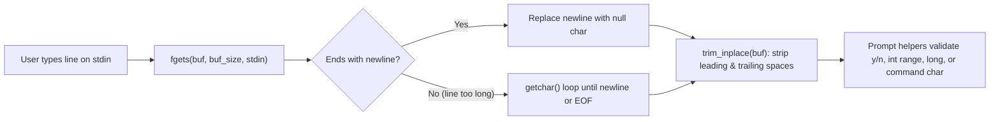

# v2 Student Deep-Dive Guide 2: `util_input.h` & `util_input.c`

> [!NOTE]
> **Updated v2 Guide (`nathan` branch):** Covers every single line of [util_input.h](file:///c:/Users/nathanyu/Documents/GitHub/RSE1201_Group_Project/VehExplorer/inc/util_input.h) (lines 1–42) and refactored [util_input.c](file:///c:/Users/nathanyu/Documents/GitHub/RSE1201_Group_Project/VehExplorer/src/util_input.c) (lines 1–248), using `while (true)` and `sizeof(...)`. Every C keyword and library call is re-explained inline right inside each section.

---

## 1. Why Does `util_input` Exist?

In C, calling raw `scanf("%d", &x)` directly on user keyboard input is notorious for causing **infinite re-prompt loops** whenever someone types letters like `"abc"` (because `"abc"` stays stuck in `stdin`) or **buffer overflows** on long lines.

`util_input` solves this once for the entire project: **every single prompt reads a bounded line with `fgets`, flushes leftover characters if the line was too long, trims spaces, and validates the string in memory with `sscanf("%d%c", ...)`**.



---

## 2. Header Walkthrough: `util_input.h` (Lines 1–42)

### Full Header ([util_input.h](file:///c:/Users/nathanyu/Documents/GitHub/RSE1201_Group_Project/VehExplorer/inc/util_input.h#L1-L42))

```c
#ifndef UTIL_INPUT_H
#define UTIL_INPUT_H

#include <stdbool.h>
#include <stddef.h>

/* Read one line into buf (nul-terminated, no trailing newline).
 * Returns false on EOF or empty line after trim. */
bool util_read_line(char *buf, size_t buf_size);

/* Prompt until user enters y/Y or n/N. Returns true for yes. */
bool util_prompt_yes_no(const char *prompt);

/*
 * Like util_prompt_yes_no, but an empty line uses default_yes.
 * Returns false on EOF. Sets *out on success.
 */
bool util_prompt_yes_no_default(const char *prompt,
                                bool default_yes,
                                bool *out);

/*
 * Non-negative long. Empty line uses default_val.
 * Returns false on EOF. Re-prompts on junk / values < min_val.
 */
bool util_prompt_long_default(const char *prompt,
                              long min_val,
                              long default_val,
                              long *out);

/* Prompt until user enters an integer in [min_val, max_val]. */
int util_prompt_int_range(const char *prompt, int min_val, int max_val);

/* Read one long integer from a prompted line.
 * Returns false on EOF or empty line; true and sets *out on a valid parse. */
bool util_prompt_long(const char *prompt, long *out);

/* Read one command line; return first non-space char (letters lowercased).
 * Returns 0 on EOF. */
char util_read_command_char(void);

#endif /* UTIL_INPUT_H */
```

#### Every Term Explained Inline
- **`#ifndef UTIL_INPUT_H` / `#define UTIL_INPUT_H` / `#endif` (Include Guard):** Prevents the compiler from seeing duplicate declarations if multiple headers `#include "util_input.h"` in the same `.c` file. The first time, `UTIL_INPUT_H` is not defined (`#ifndef` = *if not defined*), so it defines `UTIL_INPUT_H` and includes the contents; any second inclusion skips straight to `#endif`.
- **`#include <stdbool.h>`:** Standard C header providing `bool`, `true`, and `false`.
- **`#include <stddef.h>`:** Standard C header providing `size_t` and `NULL`.
- **`size_t`:** An unsigned integer type guaranteed to be large enough to represent the byte size of any array or object in memory (the type returned by `sizeof(...)` and `strlen(...)`).
- **`char *buf`:** Pointer to a caller-supplied character array where [`util_read_line`](file:///c:/Users/nathanyu/Documents/GitHub/RSE1201_Group_Project/VehExplorer/inc/util_input.h#L9) will store the typed text. Because it is **not** `const`, the function is allowed to write into `buf`.
- **`const char *prompt`:** Pointer to a read-only C string (the question printed to the user). `const` guarantees the function will not modify the prompt string.
- **`bool *out` / `long *out` (Out-parameters):** Pointers used when a function needs to return **two pieces of information**:
  1. Return value (`bool`): Did reading succeed (`true`), or did input hit EOF / cancel (`false`)?
  2. `*out`: The parsed `bool` or `long` answer written directly into the caller's variable!
- **`(void)` in `char util_read_command_char(void);`:** Explicitly declares that the function accepts **zero arguments**.

---

## 3. Source Walkthrough: `util_input.c` (Lines 1–248)

### Chunk A: `#include`s & `trim_inplace` ([util_input.c](file:///c:/Users/nathanyu/Documents/GitHub/RSE1201_Group_Project/VehExplorer/src/util_input.c#L1-L35))

```c
#include "util_input.h"

#include <ctype.h>
#include <stdio.h>
#include <string.h>

/* Remove leading and trailing whitespace characters from a string in-place. */
static void trim_inplace(char *s)
{
    char *start = s;
    char *end;
    size_t len;

    /* Advance past leading spaces or tabs */
    while (*start != '\0' && isspace((unsigned char)*start)) {
        start++;
    }

    /* Shift remaining characters to the front of the buffer */
    if (start != s) {
        memmove(s, start, strlen(start) + 1);
    }

    len = strlen(s);
    if (len == 0) {
        return;
    }

    /* Replace trailing spaces/newlines at the end with null terminators */
    end = s + len - 1;
    while (end >= s && isspace((unsigned char)*end)) {
        *end = '\0';
        end--;
    }
}
```

#### Every Term Explained Inline
- **`<ctype.h>`:** Standard character-classification header providing `isspace(...)` and `tolower(...)`.
- **`<stdio.h>`:** Standard I/O header providing `fgets`, `getchar`, `printf`, `fflush`, `sscanf`, `feof`, `stdin`, `stdout`, and `EOF`.
- **`<string.h>`:** Standard string/memory header providing `strlen` and `memmove`.
- **`static void trim_inplace(char *s)`:**
  - `static`: Private helper visible **only inside `util_input.c`**.
  - `void`: Returns nothing because it edits the character array `s` directly in memory ("in-place").
  - `char *s`: Pointer to the start of the C string buffer.
- **`'\0'` (Null terminator):** Byte value `0` that marks the end of every C string.
- **`*start` (`*` dereference operator):** Reads the single `char` currently pointed to by `start`. `start++` advances the pointer by 1 byte to the next character in the array.
- **`isspace((unsigned char)*start)`:** Returns non-zero (`true`) for `' '`, `'\t'`, `'\n'`, `'\r'`, etc. Why cast to `(unsigned char)`? In C, plain `char` can be signed (`-128..127`), and passing negative values (other than `EOF`) to `<ctype.h>` functions causes undefined behaviour—casting to `(unsigned char)` makes every byte safe (`0..255`).
- **`memmove(s, start, strlen(start) + 1)`:** Copies the trimmed text from `start` back to the front of `s`.
  - Why `memmove` instead of `memcpy`? Because `s` and `start` point inside the **same array**, so the source and destination memory regions overlap! `memmove` handles overlapping memory safely; `memcpy` does not.
  - Why `+ 1`? `strlen(start)` counts characters *before* `'\0'`, so `+ 1` copies the closing `'\0'` byte too!
- **`end = s + len - 1`:** Points `end` at the **last character** before `'\0'`. Walking backward (`end--`) while `end >= s` overwrites trailing spaces with `'\0'`, shrinking the string cleanly from the right.

---

### Chunk B: `util_read_line` — Safe Bounded Line Reader ([util_input.c](file:///c:/Users/nathanyu/Documents/GitHub/RSE1201_Group_Project/VehExplorer/src/util_input.c#L37-L65))

```c
/* Read one bounded line from stdin, strip newline/spaces, and flush overflow. */
bool util_read_line(char *buf, size_t buf_size)
{
    size_t len;

    if (buf == NULL || buf_size == 0) {
        return false;
    }

    /* Read up to buf_size - 1 characters safely with fgets */
    if (fgets(buf, (int)buf_size, stdin) == NULL) {
        buf[0] = '\0';
        return false;
    }

    /* Remove trailing newline, or discard extra characters if line was too long */
    len = strlen(buf);
    if (len > 0 && buf[len - 1] == '\n') {
        buf[len - 1] = '\0';
    } else {
        int ch;
        while ((ch = getchar()) != '\n' && ch != EOF) {
            /* discard leftover characters on this line */
        }
    }

    trim_inplace(buf);
    return buf[0] != '\0';
}
```

#### Every Term Explained Inline
- **`buf == NULL || buf_size == 0`:** Defensive guard against a null pointer (`NULL`) or zero-length buffer.
- **`fgets(buf, (int)buf_size, stdin)`:** Reads at most `buf_size - 1` characters from `stdin` (standard keyboard/pipe input), stopping at `'\n'` or `EOF`, and **always** appends `'\0'`. `(int)buf_size` casts `size_t` to `int` because `fgets`'s second parameter has type `int`. Returns `NULL` if `EOF` is hit with zero characters read.
- **`if (len > 0 && buf[len - 1] == '\n')`:** Normal case—the user's whole line fit inside `buf`, including the Enter key `'\n'`. We replace `'\n'` with `'\0'` (null terminator).
- **`else { int ch; while ((ch = getchar()) != '\n' && ch != EOF) { } }`:** Overflow case—if a user typed 200 characters into a 64-byte buffer, `fgets` read the first 63 characters and left the remaining 137 characters sitting in `stdin`! Without this loop, those leftover characters would accidentally answer the *next* prompt.
  - Why is `ch` an **`int`** instead of `char`? Because `getchar()` returns every valid byte as `0..255` **plus** `EOF` (usually `-1`), which requires wider range than a 1-byte `char`!
- **`return buf[0] != '\0';`:** After [`trim_inplace`](file:///c:/Users/nathanyu/Documents/GitHub/RSE1201_Group_Project/VehExplorer/src/util_input.c#L8-L35), if `buf[0]` is `'\0'`, the line was empty (or spaces only) so we return `false`; otherwise we return `true`.

---

### Chunk C: Yes/No Helpers (`util_prompt_yes_no` & `util_prompt_yes_no_default`) ([util_input.c](file:///c:/Users/nathanyu/Documents/GitHub/RSE1201_Group_Project/VehExplorer/src/util_input.c#L67-L137))

```c
/* Keep prompting until the user enters 'y' or 'n'. */
bool util_prompt_yes_no(const char *prompt)
{
    char line[64];

    while (true) {
        printf("%s", prompt);
        fflush(stdout);

        if (!util_read_line(line, sizeof(line))) {
            if (feof(stdin)) {
                return false;
            }
            printf("Please enter y or n.\n");
            continue;
        }

        /* Accept single-letter y/Y or n/N */
        if (strlen(line) == 1) {
            char c = (char)tolower((unsigned char)line[0]);
            if (c == 'y') {
                return true;
            }
            if (c == 'n') {
                return false;
            }
        }

        printf("Please enter y or n.\n");
    }
}

/* Prompt for y/n, using default_yes if the user presses Enter on an empty line. */
bool util_prompt_yes_no_default(const char *prompt,
                                bool default_yes,
                                bool *out)
{
    char line[64];

    if (out == NULL) {
        return false;
    }

    while (true) {
        printf("%s", prompt);
        fflush(stdout);

        /* Empty line uses default value; EOF aborts */
        if (!util_read_line(line, sizeof(line))) {
            if (feof(stdin)) {
                return false;
            }
            *out = default_yes;
            return true;
        }

        if (strlen(line) == 1) {
            char c = (char)tolower((unsigned char)line[0]);
            if (c == 'y') {
                *out = true;
                return true;
            }
            if (c == 'n') {
                *out = false;
                return true;
            }
        }

        printf("Please enter y or n (or Enter for default).\n");
    }
}
```

#### Every Term Explained Inline
- **`char line[64];`:** Stack-allocated character array of 64 bytes for reading one user answer.
- **`while (true)`:** Repeats the prompt indefinitely until a `return` exits the function.
- **`fflush(stdout);`:** Forces buffered output in `stdout` onto the screen immediately **before** waiting for input. (In C, `stdout` is normally line-buffered—because a prompt like `"Is the scenario file encrypted? (y/n) : "` does **not** end with `'\n'`, `fflush(stdout)` guarantees the prompt is visible right away, especially over pipes or remote terminals.)
- **`sizeof(line)`:** Compile-time operator returning the byte size of the `line` array (`64`).
- **`feof(stdin)`:** Returns non-zero (`true`) if `stdin` reached End-Of-File (e.g., `Ctrl+D` on Linux or end of a piped test script). Notice how we distinguish **EOF** vs **blank Enter**:
  - [`util_read_line`](file:///c:/Users/nathanyu/Documents/GitHub/RSE1201_Group_Project/VehExplorer/src/util_input.c#L38-L65) returns `false` on *both* EOF and an empty line.
  - Checking `feof(stdin)` tells them apart! In [`util_prompt_yes_no`](file:///c:/Users/nathanyu/Documents/GitHub/RSE1201_Group_Project/VehExplorer/src/util_input.c#L68-L97), a blank line prints `"Please enter y or n."` and `continue` jumps straight to the next iteration of `while (true)`. In [`util_prompt_yes_no_default`](file:///c:/Users/nathanyu/Documents/GitHub/RSE1201_Group_Project/VehExplorer/src/util_input.c#L100-L137) (used by the `'o'` auto-pilot menu), a blank line stores `*out = default_yes;` and returns `true`!
- **`*out = ...` (`*` dereference on pointer `out`):** Writes the chosen boolean (`true`, `false`, or `default_yes`) into the caller's variable.
- **`strlen(line) == 1` + `tolower((unsigned char)line[0])`:** Rejects words like `"yes"` or `"nope"` cleanly and accepts `'y'`, `'Y'`, `'n'`, or `'N'`.

---

### Chunk D: Numeric Prompt Helpers (`util_prompt_long_default`, `util_prompt_int_range`, `util_prompt_long`) ([util_input.c](file:///c:/Users/nathanyu/Documents/GitHub/RSE1201_Group_Project/VehExplorer/src/util_input.c#L139-L228))

```c
/* Prompt for a whole number >= min_val, or accept default_val on empty Enter. */
bool util_prompt_long_default(const char *prompt,
                              long min_val,
                              long default_val,
                              long *out)
{
    char line[64];
    long value;
    char extra;

    if (out == NULL) {
        return false;
    }

    while (true) {
        printf("%s", prompt);
        fflush(stdout);

        if (!util_read_line(line, sizeof(line))) {
            if (feof(stdin)) {
                return false;
            }
            *out = default_val;
            return true;
        }

        /* Ensure the line contains a valid number with no trailing characters */
        if (sscanf(line, "%ld%c", &value, &extra) == 1 && value >= min_val) {
            *out = value;
            return true;
        }

        printf("Please enter a number >= %ld (or Enter for default).\n",
               min_val);
    }
}

/* Prompt until the user enters an integer between min_val and max_val. */
int util_prompt_int_range(const char *prompt, int min_val, int max_val)
{
    char line[64];
    int value;
    char extra;

    while (true) {
        printf("%s", prompt);
        fflush(stdout);

        if (!util_read_line(line, sizeof(line))) {
            if (feof(stdin)) {
                return min_val;
            }
            printf("Please enter a number from %d to %d.\n", min_val, max_val);
            continue;
        }

        if (sscanf(line, "%d%c", &value, &extra) == 1 &&
            value >= min_val && value <= max_val) {
            return value;
        }

        printf("Please enter a number from %d to %d.\n", min_val, max_val);
    }
}

/* Ask once for a long integer; return false if empty or not a valid integer. */
bool util_prompt_long(const char *prompt, long *out)
{
    char line[64];
    long value;
    char extra;

    if (out == NULL) {
        return false;
    }

    printf("%s", prompt);
    fflush(stdout);

    if (!util_read_line(line, sizeof(line))) {
        return false;
    }

    if (sscanf(line, "%ld%c", &value, &extra) != 1) {
        return false;
    }

    *out = value;
    return true;
}
```

#### Every Term Explained Inline
- **`long` vs `int`:** `long` is a wider signed integer (64-bit on 64-bit Linux, formatted with `%ld`) matching `SatComRelay`'s `long` energy fields; `int` (`%d`) is used for small menu numbers like Mission Type `1..8`.
- **The `sscanf(line, "%ld%c", &value, &extra) == 1` validation pattern (Star Interview Trick!):**
  - `sscanf` parses from the already-trimmed string `line` in memory (NOT from `stdin`), returning **how many format specifiers matched** (`0`, `1`, or `2`).
  - `&value` and `&extra` pass the memory addresses of `value` and `extra` so `sscanf` can fill them.
  - Why include **`%c`** (`&extra`) and check **`== 1`**?
    - Input `"500"` → `%ld` reads `500`, nothing left for `%c` → returns **`1`** (accepted!).
    - Input `"500abc"` or `"3.14"` → `%ld` reads `500`/`3`, and `%c` reads `'a'`/`'.'` → returns **`2`** (rejected because `2 != 1`!).
    - Input `"hello"` → `%ld` fails immediately → returns **`0`** (rejected!).
- **Difference between the 3 numeric helpers:**
  1. [`util_prompt_long_default`](file:///c:/Users/nathanyu/Documents/GitHub/RSE1201_Group_Project/VehExplorer/src/util_input.c#L140-L174): Used in auto-pilot `'o'` config—loops on invalid input, accepts empty Enter as `default_val`, enforces `value >= min_val`.
  2. [`util_prompt_int_range`](file:///c:/Users/nathanyu/Documents/GitHub/RSE1201_Group_Project/VehExplorer/src/util_input.c#L177-L202): Used in Stage 1 Mission Type (`1`–`8`)—loops until `min_val <= value <= max_val`.
  3. [`util_prompt_long`](file:///c:/Users/nathanyu/Documents/GitHub/RSE1201_Group_Project/VehExplorer/src/util_input.c#L205-L228): Used by manual shield key `'i'`—asks **once** (no `while` loop) so pressing Enter or typing non-numbers cancels shield allocation cleanly back to the Stage 2 command prompt.

---

### Chunk E: `util_read_command_char` ([util_input.c](file:///c:/Users/nathanyu/Documents/GitHub/RSE1201_Group_Project/VehExplorer/src/util_input.c#L230-L248))

```c
/* Read a command line and return the first non-space character in lowercase. */
char util_read_command_char(void)
{
    char line[64];
    size_t i;

    if (!util_read_line(line, sizeof(line))) {
        return '\0';
    }

    for (i = 0; line[i] != '\0'; i++) {
        unsigned char ch = (unsigned char)line[i];
        if (!isspace(ch)) {
            return (char)tolower(ch);
        }
    }

    return '\0';
}
```

#### Every Term Explained Inline
- **`sizeof(line)`:** Returns `64` bytes so [`util_read_line`](file:///c:/Users/nathanyu/Documents/GitHub/RSE1201_Group_Project/VehExplorer/src/util_input.c#L38-L65) reads safely without overflowing `line`.
- **`return '\0';`:** Returns the null character (`0`) if the user pressed Enter on a blank line or hit `EOF`.
- **`for (i = 0; line[i] != '\0'; i++)`:** Walks index `i` across `line` until the null terminator `'\0'`.
- **`(char)tolower(ch)`:** Converts uppercase letters like `'W'` or `'Q'` to lowercase `'w'` or `'q'` so Stage 2 commands work even when Caps Lock is on, while leaving digits `'1'`–`'9'` unchanged.

---

## 4. Ready-to-Use Presentation Script & Likely Teacher Q&A

### 45-Second Walkthrough Script
> "`util_input.c` centralizes all keyboard input so our program never suffers from `scanf` infinite loops or buffer overflows. Everything builds on `util_read_line`, which reads a bounded line with `fgets`, drains any excess characters up to `'\n'` with `getchar()` if the user typed past the buffer limit, and strips leading and trailing spaces in-place using `trim_inplace`. On top of `util_read_line`, we provide reusable prompt functions for `y/n` questions, `1–8` integer ranges, default-able auto-pilot numbers, one-shot shield amounts, and single-key Stage 2 commands. For numbers, we validate using `sscanf(line, \"%ld%c\", &value, &extra) == 1` so inputs with trailing junk like `'12abc'` are cleanly rejected."

### Likely Questions From Your Lecturer
1. **Q: Why didn't you just use `scanf("%d", &value)`?**
   - **A:** If a user types `"abc"` into `scanf("%d", &value)`, `scanf` fails without removing `"abc"` from `stdin`, causing an infinite loop on the next iteration. Reading whole lines with `fgets` consumes the bad line completely every time.
2. **Q: Why is `int ch;` used with `getchar()` instead of `char ch;`?**
   - **A:** `getchar()` can return any valid character byte (`0..255`) *plus* the special value `EOF` (`-1`). Storing that in a 1-byte `char` could either lose `EOF` (if `char` is unsigned) or confuse byte `0xFF` with `EOF` (if `char` is signed), so C requires `int`.
3. **Q: Why does `sscanf(line, "%ld%c", &value, &extra) == 1` have a `%c` at the end?**
   - **A:** Without `%c`, `sscanf("12abc", "%ld", &value)` would return `1` and silently accept `12`! Adding `%c` catches any leftover character (`'a'`), making `sscanf` return `2` so we know the input wasn't a pure integer.
