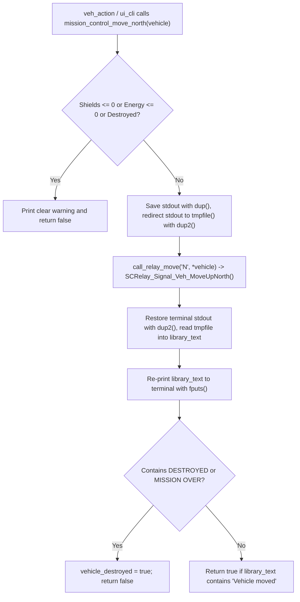

# v2 Student Deep-Dive Guide 3: `mission_control.h` & `mission_control.c`

> [!NOTE]
> **Updated v2 Guide (`nathan` branch — Nathan's Core Module!):** Covers every single line of [mission_control.h](file:///c:/Users/nathanyu/Documents/GitHub/RSE1201_Group_Project/VehExplorer/inc/mission_control.h) (lines 1–45) and refactored [mission_control.c](file:///c:/Users/nathanyu/Documents/GitHub/RSE1201_Group_Project/VehExplorer/src/mission_control.c) (lines 1–304). Notice how **all function pointers are gone**—moves and scans now use clean `switch` statements! Every C term is re-explained right inside each section.

---

## 1. Big-Picture Role: Why Do We Need `mission_control`?

`mission_control` is our **safety adapter around `libsatcom.so`** (`SatComRelay.h`). Calling the raw `SatComRelay` functions directly from the UI or auto-pilot has three big problems that `mission_control` solves cleanly:

1. **Movement functions don't return `bool`!** `SCRelay_Signal_Veh_MoveUpNorth()` returns a `VehDataType` struct, *not* true/false—it only prints `"Vehicle moved"` (or `"Blocked"` / `"DESTROYED"`) to `stdout`! Without knowing if the move succeeded, our local map wouldn't know whether to advance `(x, y)` or stay put. `mission_control` temporarily redirects `stdout` into a temporary file, runs the move, reads what `SatComRelay` printed, reprints it to the screen, and checks for `"Vehicle moved"` or `"DESTROYED"`.
2. **Pre-flight shield & battery guards:** Moving onto damaging terrain with `0` shields destroys the vehicle and tears down library state, so `mission_control` blocks moves when `currShieldEnergy <= 0` or `currEnergy <= 0`.
3. **16 separate scan functions:** `SatComRelay.h` has 8 radius-1 scan functions (`ScanNorth`, ...) and 8 radius-2 scan functions (`ScanNorth2`, ...). `mission_control` tracks `scan_radius` (`1` or `2`) and dispatches all 16 functions cleanly through `if (scan_radius == 2)` + `switch (dir)`.



---

## 2. Header Walkthrough: `mission_control.h` (Lines 1–45)

### Full Header ([mission_control.h](file:///c:/Users/nathanyu/Documents/GitHub/RSE1201_Group_Project/VehExplorer/inc/mission_control.h#L1-L45))

```c
#ifndef MISSION_CONTROL_H
#define MISSION_CONTROL_H

#include "SatComRelay.h"

#include <stdbool.h>

/* Eight compass directions matching the numpad scan layout. */
typedef enum {
    MISSION_CONTROL_DIR_NORTHWEST = 0,
    MISSION_CONTROL_DIR_NORTH,
    MISSION_CONTROL_DIR_NORTHEAST,
    MISSION_CONTROL_DIR_WEST,
    MISSION_CONTROL_DIR_EAST,
    MISSION_CONTROL_DIR_SOUTHWEST,
    MISSION_CONTROL_DIR_SOUTH,
    MISSION_CONTROL_DIR_SOUTHEAST,
    MISSION_CONTROL_DIR_COUNT
} MissionControlScanDir;

/* Move the vehicle in one cardinal direction and update *vehicle.
 * Returns true only when SatComRelay reports "Vehicle moved". */
bool mission_control_move_north(VehDataType *vehicle);
bool mission_control_move_south(VehDataType *vehicle);
bool mission_control_move_east(VehDataType *vehicle);
bool mission_control_move_west(VehDataType *vehicle);

/* Returns true once SatComRelay reports DESTROYED or MISSION OVER. */
bool mission_control_is_mission_over(void);

/* Check that 1 <= amount <= currEnergy, then transfer energy to shields. */
bool mission_control_allocate_shield(VehDataType *vehicle, long amount);

/* Read, toggle (1 <-> 2), or set the active scan radius. */
int mission_control_get_scan_radius(void);
int mission_control_toggle_scan_radius(void);
int mission_control_set_scan_radius(int radius);

/* Scan in direction dir at the active scan radius; returns '\0' on failure. */
char mission_control_scan(VehDataType *vehicle, MissionControlScanDir dir);

/* Compute relative grid offset (dx, dy) for dir at the active scan radius. */
void mission_control_scan_offset(MissionControlScanDir dir, int *dx, int *dy);

#endif /* MISSION_CONTROL_H */
```

#### Every Term Explained Inline
- **`#ifndef MISSION_CONTROL_H` / `#define MISSION_CONTROL_H` / `#endif`:** Include guard preventing duplicate type and function declarations when multiple `.c` files include `"mission_control.h"`.
- **`typedef enum { ... } MissionControlScanDir;`:**
  - `enum` (enumeration): Assigns readable constant names to integers starting at `0` (`NORTHWEST = 0`, `NORTH = 1`, ..., `SOUTHEAST = 7`).
  - `MISSION_CONTROL_DIR_COUNT`: Automatically gets the value **`8`** because it comes right after `7`! That gives us the exact number of directions without hardcoding magic number `8`.
  - `typedef ... MissionControlScanDir;`: Lets us write `MissionControlScanDir dir` instead of `enum ... dir`.
- **`VehDataType *vehicle`:** Pointer to the live `VehDataType` struct in `main()`, allowing moves, shield allocations, and scans to update energy values directly in place.
- **`int *dx, int *dy` (Out-parameters):** Pointers to two caller `int` variables so [`mission_control_scan_offset`](file:///c:/Users/nathanyu/Documents/GitHub/RSE1201_Group_Project/VehExplorer/inc/mission_control.h#L43) can output *both* the horizontal step `dx` and vertical step `dy` at the same time.

---

## 3. Source Walkthrough: `mission_control.c` (Lines 1–304)

### Chunk A: Feature Macro, `#include`s, Private State & Destruction Check ([mission_control.c](file:///c:/Users/nathanyu/Documents/GitHub/RSE1201_Group_Project/VehExplorer/src/mission_control.c#L1-L32))

```c
#define _DEFAULT_SOURCE

#include "mission_control.h"

#include <stdio.h>
#include <stdlib.h>
#include <string.h>
#include <unistd.h>

/* Current scan radius (1 or 2) and mission-ended flag for this session. */
static int scan_radius = 1;
static bool vehicle_destroyed = false;

bool mission_control_is_mission_over(void)
{
    return vehicle_destroyed;
}

/* Check whether captured SatComRelay text indicates the mission has ended. */
static bool library_text_says_destroyed(const char *library_text)
{
    if (library_text == NULL) {
        return false;
    }
    if (strstr(library_text, "DESTROYED") != NULL) {
        return true;
    }
    if (strstr(library_text, "MISSION OVER") != NULL) {
        return true;
    }
    return false;
}
```

#### Every Term Explained Inline
- **`#define _DEFAULT_SOURCE`:** Tells Linux's `<stdio.h>` header to expose POSIX helper `fileno(...)` even when compiled with strict C standards flags. Must appear *before* `#include <stdio.h>`.
- **`#include <unistd.h>`:** Linux/POSIX system-call header providing `dup`, `dup2`, `close`, and `STDOUT_FILENO` (`1`, the file descriptor number for standard output).
- **`static int scan_radius = 1;` and `static bool vehicle_destroyed = false;`:**
  - `static` at **file scope** (outside any function) gives these variables **static storage duration** (they keep their values for the entire run of the program) and **internal linkage** (only code inside `mission_control.c` can read or modify them directly—other modules must call getter/setter functions).
- **`const char *library_text`:** Pointer to a read-only C string holding whatever `libsatcom.so` printed during a move.
- **`strstr(library_text, "DESTROYED")`:** Standard `<string.h>` substring search! Searches `library_text` for `"DESTROYED"`; returns a pointer to the match if found, or `NULL` if not found. Checking `!= NULL` tells us whether `"DESTROYED"` or `"MISSION OVER"` appeared anywhere in the message.

---

### Chunk B: `call_relay_move` — Simple `switch` Dispatch ([mission_control.c](file:///c:/Users/nathanyu/Documents/GitHub/RSE1201_Group_Project/VehExplorer/src/mission_control.c#L34-L49))

```c
/* Call the matching SatComRelay movement function for 'N', 'S', 'E', or 'W'. */
static VehDataType call_relay_move(char direction, VehDataType fallback)
{
    switch (direction) {
    case 'N':
        return SCRelay_Signal_Veh_MoveUpNorth();
    case 'S':
        return SCRelay_Signal_Veh_MoveDownSouth();
    case 'E':
        return SCRelay_Signal_Veh_MoveRightEast();
    case 'W':
        return SCRelay_Signal_Veh_MoveLeftWest();
    default:
        return fallback;
    }
}
```

#### Every Term Explained Inline
- **`static`:** Private helper function visible only inside `mission_control.c`.
- **`char direction`:** Single character (`'N'`, `'S'`, `'E'`, or `'W'`) selecting which cardinal direction to move.
- **`VehDataType fallback`:** Copy of the current `VehDataType` returned unchanged if an unexpected character ever hits `default:`.
- **`switch (direction)` / `case '...'` / `default:`:** Standard C multi-way branch (Lecture 3). Note that `return ...;` exits the entire function immediately, so no extra `break;` is needed after a `return`.

---

### Chunk C: `capture_move_and_reprint` — Capturing `libsatcom.so` Output ([mission_control.c](file:///c:/Users/nathanyu/Documents/GitHub/RSE1201_Group_Project/VehExplorer/src/mission_control.c#L51-L146))

```c
/* Run a SatComRelay move while capturing its printed message into a temp file
 * so we can check whether the move succeeded or ended the mission, then print
 * the captured text back to the terminal. */
static bool capture_move_and_reprint(VehDataType *vehicle, char direction)
{
    int saved_stdout = -1;
    FILE *captured_output = NULL;
    char read_chunk[512];
    size_t n;
    char library_text[4096];
    size_t captured_len = 0;

    if (vehicle == NULL) {
        return false;
    }

    if (vehicle_destroyed) {
        printf("Mission already over — move ignored.\n");
        return false;
    }

    /* Block moving when shields are at 0 so hazardous tiles cannot crash state */
    if (vehicle->currShieldEnergy <= 0) {
        printf("Cannot move: shields are down (allocate with 'i' first). "
               "Moving onto damaging terrain would destroy the vehicle.\n");
        return false;
    }

    /* Block moving when main battery reserves are already empty */
    if (vehicle->currEnergy <= 0) {
        printf("Cannot move: energy reserves are depleted. "
               "Status/maps/quit still available.\n");
        return false;
    }

    /* Open a temporary file to hold the text SatComRelay prints during the move */
    library_text[0] = '\0';
    captured_output = tmpfile();
    if (captured_output == NULL) {
        *vehicle = call_relay_move(direction, *vehicle);
        return false;
    }

    /* Save current terminal stdout and redirect stdout to captured_output */
    fflush(stdout);
    saved_stdout = dup(STDOUT_FILENO);
    if (saved_stdout < 0) {
        fclose(captured_output);
        *vehicle = call_relay_move(direction, *vehicle);
        return false;
    }

    if (dup2(fileno(captured_output), STDOUT_FILENO) < 0) {
        close(saved_stdout);
        fclose(captured_output);
        *vehicle = call_relay_move(direction, *vehicle);
        return false;
    }

    /* Perform the move while stdout points to the temporary file */
    *vehicle = call_relay_move(direction, *vehicle);
    fflush(stdout);
    fflush(captured_output);

    /* Restore stdout back to the real terminal */
    if (dup2(saved_stdout, STDOUT_FILENO) < 0) {
        /* Keep going so we still close handles and read captured text */
    }
    close(saved_stdout);

    /* Read captured message back into library_text buffer */
    rewind(captured_output);
    while ((n = fread(read_chunk, 1, sizeof(read_chunk), captured_output)) > 0) {
        if (captured_len + n < sizeof(library_text)) {
            memcpy(library_text + captured_len, read_chunk, n);
            captured_len += n;
            library_text[captured_len] = '\0';
        }
    }
    fclose(captured_output);

    /* Re-print the library's output so the user still sees it on screen */
    if (captured_len > 0) {
        fputs(library_text, stdout);
        fflush(stdout);
    }

    /* Flag mission over if the library reported vehicle destruction */
    if (library_text_says_destroyed(library_text)) {
        vehicle_destroyed = true;
        return false;
    }

    /* A move succeeded only if SatComRelay printed "Vehicle moved" */
    return strstr(library_text, "Vehicle moved") != NULL;
}
```

#### Every Term Explained Inline (Step-by-Step!)
- **`VehDataType *vehicle` and `vehicle->currShieldEnergy`:** `vehicle` is a pointer to `main`'s struct; `->` reads fields through that pointer, and `*vehicle = ...` writes the updated struct returned by `SatComRelay` back into `main`'s variable!
- **`size_t`:** Unsigned size integer type used for byte counts (`n` and `captured_len`).
- **`tmpfile()`:** Standard `<stdio.h>` function that creates an unnamed temporary file in read/write mode that Linux **automatically deletes** the moment `fclose(captured_output)` is called!
- **`fflush(stdout)`:** Empties any pending text sitting in `stdout`'s C buffer *before* we swap file descriptors (and again right after the move so `SatComRelay`'s text is flushed into the temp file before we switch back).
- **`STDOUT_FILENO` (`1`), `dup`, `fileno`, `dup2`, `close` (How Linux Output Redirection Works):**
  1. In Linux, terminal output goes to **file descriptor `1` (`STDOUT_FILENO`)**.
  2. `saved_stdout = dup(STDOUT_FILENO);` makes a **backup copy** of the real terminal descriptor (e.g., descriptor `4`) so we don't lose the screen!
  3. `fileno(captured_output)` gets the Linux integer file descriptor inside the `FILE *` temp file.
  4. `dup2(fileno(captured_output), STDOUT_FILENO);` points descriptor `1` at our temporary file! Now, when `SCRelay_Signal_Veh_MoveUpNorth()` calls `printf(...)` inside `libsatcom.so`, its words go into `captured_output` instead of vanishing straight onto the terminal!
  5. After `call_relay_move`, `dup2(saved_stdout, STDOUT_FILENO);` restores descriptor `1` back to the real terminal, and `close(saved_stdout);` closes the backup copy.
- **`rewind(captured_output);`:** Moves the temp file's read cursor back to byte `0` (the start of the file) so we can read what was just written.
- **`fread(read_chunk, 1, sizeof(read_chunk), captured_output)`:** Reads up to `512` (`sizeof(read_chunk)`) 1-byte characters at a time into `read_chunk`, returning `n` (number of bytes read, or `0` at end-of-file).
- **`memcpy(library_text + captured_len, read_chunk, n)`:** Copies those `n` bytes onto the end of `library_text` and appends `'\0'` (null terminator) so `library_text` is always a valid C string.
- **`fputs(library_text, stdout);`:** Prints the exact captured message back to the real terminal so the player still sees `libsatcom.so`'s normal output!
- **`strstr(library_text, "Vehicle moved") != NULL`:** Returns `true` **only** if `libsatcom.so` confirmed the vehicle actually moved (returns `false` if blocked by a `'#'` wall or map edge!).

---

### Chunk D: Public Move Wrappers, Shield Allocation & Scan Radius Controls ([mission_control.c](file:///c:/Users/nathanyu/Documents/GitHub/RSE1201_Group_Project/VehExplorer/src/mission_control.c#L148-L221))

```c
bool mission_control_move_north(VehDataType *vehicle)
{
    return capture_move_and_reprint(vehicle, 'N');
}

bool mission_control_move_south(VehDataType *vehicle)
{
    return capture_move_and_reprint(vehicle, 'S');
}

bool mission_control_move_east(VehDataType *vehicle)
{
    return capture_move_and_reprint(vehicle, 'E');
}

bool mission_control_move_west(VehDataType *vehicle)
{
    return capture_move_and_reprint(vehicle, 'W');
}

/* Validate requested energy amount and divert it from battery into shields. */
bool mission_control_allocate_shield(VehDataType *vehicle, long amount)
{
    if (vehicle == NULL) {
        return false;
    }

    if (vehicle_destroyed) {
        printf("Mission already over — shield allocate ignored.\n");
        return false;
    }

    if (amount <= 0) {
        printf("Error: Invalid energy qty '%ld' for shield allocation!\n",
               amount);
        return false;
    }

    if (amount > vehicle->currEnergy) {
        printf("Error: Insufficient energy reserves. Try reducing the "
               "quantity allocated to shield!\n");
        return false;
    }

    *vehicle = SCRelay_Signal_Veh_AllocateToShield(amount);
    return true;
}

int mission_control_get_scan_radius(void)
{
    return scan_radius;
}

/* Flip scan radius between 1 and 2 terrain units. */
int mission_control_toggle_scan_radius(void)
{
    if (scan_radius == 1) {
        scan_radius = 2;
    } else {
        scan_radius = 1;
    }
    return scan_radius;
}

/* Explicitly set scan radius to 1 or 2. */
int mission_control_set_scan_radius(int radius)
{
    if (radius == 2) {
        scan_radius = 2;
    } else {
        scan_radius = 1;
    }
    return scan_radius;
}
```

#### Every Term Explained Inline
- **4 Public Move Functions (`move_north` .. `move_west`):** Clean one-line wrappers passing `'N'`, `'S'`, `'E'`, `'W'` to [`capture_move_and_reprint`](file:///c:/Users/nathanyu/Documents/GitHub/RSE1201_Group_Project/VehExplorer/src/mission_control.c#L54-L146). Notice they do **not** have `static` because they are public functions declared in `mission_control.h`!
- **`long amount` and `%ld`:** Signed long integer matching `SCRelay_Signal_Veh_AllocateToShield(long amountOfEnergy)`.
- **Shield Validation Guards:** Checks `vehicle == NULL`, `vehicle_destroyed`, `amount <= 0`, and `amount > vehicle->currEnergy` (`->` arrow operator reads `currEnergy` through pointer `vehicle`) before calling `*vehicle = SCRelay_Signal_Veh_AllocateToShield(amount);` (`*vehicle` dereferences the pointer to overwrite `main`'s struct with the updated energy numbers).
- **Radius Get / Toggle / Set:** Encapsulates the private `static int scan_radius` variable so it can **only ever** hold `1` or `2`.

---

### Chunk E: `mission_control_scan` & `mission_control_scan_offset` ([mission_control.c](file:///c:/Users/nathanyu/Documents/GitHub/RSE1201_Group_Project/VehExplorer/src/mission_control.c#L223-L304))

```c
/* Call the matching radius-1 or radius-2 SatComRelay scan function for dir. */
char mission_control_scan(VehDataType *vehicle, MissionControlScanDir dir)
{
    if (vehicle == NULL || dir < 0 || dir >= MISSION_CONTROL_DIR_COUNT) {
        return '\0';
    }

    if (vehicle_destroyed) {
        printf("Mission already over — scan ignored.\n");
        return '\0';
    }

    if (vehicle->currEnergy <= 0) {
        printf("Cannot scan: energy reserves are depleted. "
               "Status/maps/quit still available.\n");
        return '\0';
    }

    /* Dispatch to the radius-2 or radius-1 scan API for the chosen direction */
    if (scan_radius == 2) {
        switch (dir) {
        case MISSION_CONTROL_DIR_NORTHWEST:
            return SCRelay_Signal_Veh_ScanNorthWest2(vehicle);
        case MISSION_CONTROL_DIR_NORTH:
            return SCRelay_Signal_Veh_ScanNorth2(vehicle);
        case MISSION_CONTROL_DIR_NORTHEAST:
            return SCRelay_Signal_Veh_ScanNorthEast2(vehicle);
        case MISSION_CONTROL_DIR_WEST:
            return SCRelay_Signal_Veh_ScanWest2(vehicle);
        case MISSION_CONTROL_DIR_EAST:
            return SCRelay_Signal_Veh_ScanEast2(vehicle);
        case MISSION_CONTROL_DIR_SOUTHWEST:
            return SCRelay_Signal_Veh_ScanSouthWest2(vehicle);
        case MISSION_CONTROL_DIR_SOUTH:
            return SCRelay_Signal_Veh_ScanSouth2(vehicle);
        case MISSION_CONTROL_DIR_SOUTHEAST:
            return SCRelay_Signal_Veh_ScanSouthEast2(vehicle);
        default:
            return '\0';
        }
    } else {
        switch (dir) {
        case MISSION_CONTROL_DIR_NORTHWEST:
            return SCRelay_Signal_Veh_ScanNorthWest(vehicle);
        case MISSION_CONTROL_DIR_NORTH:
            return SCRelay_Signal_Veh_ScanNorth(vehicle);
        case MISSION_CONTROL_DIR_NORTHEAST:
            return SCRelay_Signal_Veh_ScanNorthEast(vehicle);
        case MISSION_CONTROL_DIR_WEST:
            return SCRelay_Signal_Veh_ScanWest(vehicle);
        case MISSION_CONTROL_DIR_EAST:
            return SCRelay_Signal_Veh_ScanEast(vehicle);
        case MISSION_CONTROL_DIR_SOUTHWEST:
            return SCRelay_Signal_Veh_ScanSouthWest(vehicle);
        case MISSION_CONTROL_DIR_SOUTH:
            return SCRelay_Signal_Veh_ScanSouth(vehicle);
        case MISSION_CONTROL_DIR_SOUTHEAST:
            return SCRelay_Signal_Veh_ScanSouthEast(vehicle);
        default:
            return '\0';
        }
    }
}

/* Convert scan direction and current radius into relative grid offsets (dx, dy). */
void mission_control_scan_offset(MissionControlScanDir dir, int *dx, int *dy)
{
    static const int base_dx[MISSION_CONTROL_DIR_COUNT] = {
        -1, 0, 1, -1, 1, -1, 0, 1,
    };
    static const int base_dy[MISSION_CONTROL_DIR_COUNT] = {
        -1, -1, -1, 0, 0, 1, 1, 1,
    };
    int radius = scan_radius;

    if (dx == NULL || dy == NULL || dir < 0 || dir >= MISSION_CONTROL_DIR_COUNT) {
        return;
    }

    *dx = base_dx[dir] * radius;
    *dy = base_dy[dir] * radius;
}
```

#### Every Term Explained Inline
- **`'\0'` (Null character):** Returned on failed or out-of-bounds scans, matching `SatComRelay.h`'s own convention (`Returns '\0' if unsuccessful`).
- **`if (scan_radius == 2) { switch (dir) ... } else { switch (dir) ... }`:** Super clear two-branch `if-else` + `switch` calling the exact `SCRelay_Signal_Veh_Scan*2(vehicle)` (for radius 2) or `SCRelay_Signal_Veh_Scan*(vehicle)` (for radius 1) API function! Notice `SatComRelay`'s scan functions take `VehDataType *` directly (unlike move functions, which return `VehDataType` by value).
- **`static const int base_dx[8]` and `base_dy[8]`:**
  - `static` inside a function: Allocates these lookup arrays **once** in static memory rather than rebuilding them on the stack every scan.
  - `const`: Read-only table.
  - Coordinate convention: **East = `+x`**, **West = `-x`**, **North = `-y`** (higher row on terminal screen), **South = `+y`** (lower row on terminal screen).
  - Multiplying `base_dx[dir] * radius` and `base_dy[dir] * radius` automatically turns North `(-1)` at radius `2` into `(0, -2)` and SouthEast `(1, 1)` at radius `2` into `(2, 2)`!
  - `*dx = ...` and `*dy = ...`: Dereferences the caller's pointers `dx` and `dy` to store both calculated offsets.

---

## 4. Ready-to-Use Presentation Script & Likely Teacher Q&A

### 45-Second Walkthrough Script
> "`mission_control` wraps `SatComRelay` so the rest of our program has clean boolean statuses and safety guards. First, for movement, `SatComRelay`'s move functions return `VehDataType` without a boolean status—they only print `'Vehicle moved'` or `'DESTROYED'` to `stdout`. In `capture_move_and_reprint`, we first check that shields and battery are above zero so the player doesn't accidentally destroy the vehicle, then use `dup` and `dup2` with `tmpfile()` to capture the library's `stdout` text, reprint it back to the terminal, set `vehicle_destroyed` if `'DESTROYED'` appeared, and return `true` only if `'Vehicle moved'` appeared. Second, `mission_control_allocate_shield` validates `1 <= amount <= currEnergy`. Third, `mission_control_scan` and `mission_control_scan_offset` manage scan radius `1` or `2` and use a `switch` on `MissionControlScanDir` to call the matching `SatComRelay` scan function and compute `(dx, dy)`."

### Likely Questions From Your Lecturer
1. **Q: Why did you use `dup`, `dup2`, and `tmpfile()` inside `mission_control.c`?**
   - **A:** Because `SCRelay_Signal_Veh_MoveUpNorth()` doesn't return whether a move succeeded or hit a wall `'#'`—and hitting a wall can even cost `0` energy on some configurations, so energy delta alone isn't guaranteed to distinguish a blocked move. Capturing `stdout` into `tmpfile()` lets us inspect the exact `"Vehicle moved"` / `"DESTROYED"` message from `libsatcom.so` and still reprint every character to the screen.
2. **Q: Why is `North` `dy = -1` and `South` `dy = +1` in `base_dy`?**
   - **A:** Terminal output prints from top row to bottom row (`y` increases downward). Making North `-1` and South `+1` means printing rows from `min_y` to `max_y` naturally puts North at the top of the screen!
3. **Q: Why are `scan_radius` and `vehicle_destroyed` marked `static` at the top of `mission_control.c`?**
   - **A:** `static` at file scope hides them inside `mission_control.c` (encapsulation), so no other `.c` file can accidentally set `scan_radius = 99` or overwrite `vehicle_destroyed` without going through our functions.
