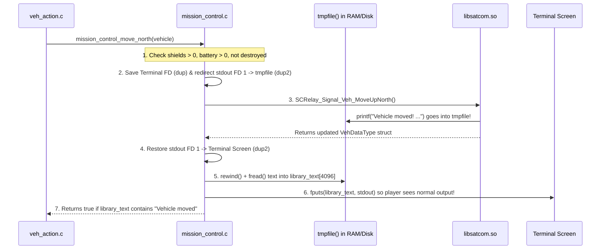

# v2 Student Deep-Dive Guide 3: `mission_control.h` & `mission_control.c`

> [!NOTE]
> **Beginner-Friendly Visual Edition (`nathan` branch — Nathan's Core Module!):** Covers every single line of [mission_control.h](file:///c:/Users/nathanyu/Documents/GitHub/RSE1201_Group_Project/VehExplorer/inc/mission_control.h) (lines 1–45) and [mission_control.c](file:///c:/Users/nathanyu/Documents/GitHub/RSE1201_Group_Project/VehExplorer/src/mission_control.c) (lines 1–304), with **4-step visual diagrams of `dup` / `dup2` output capture**, a **5×5 radar offset coordinate map**, and **inline explanations of every C keyword and pointer operator** right inside each section.

---

## 1. Mental Imagery: What Problem Does `mission_control` Solve?

Think of `libsatcom.so` (`SatComRelay.h`) as a **sealed black-box radio transceiver** built by your lecturer. We cannot edit `libsatcom.so`'s source code, and it has three quirks that would make the rest of our program painful if we called it directly:

1. **Quirk 1 — Move functions don't return `true`/`false`!**
   When you call `SCRelay_Signal_Veh_MoveUpNorth()`, it returns an updated `VehDataType` struct, **NOT** a `bool`! The *only* way it tells you whether the vehicle actually moved, hit an impassable `'#'` wall, or blew up (`DESTROYED`) is by **printing words straight to `stdout` (the screen)**!
2. **Quirk 2 — Moving with `0` shields onto damaging terrain destroys the rover!**
   So `mission_control` acts as a **safety seatbelt**, blocking moves whenever `currShieldEnergy <= 0` or `currEnergy <= 0`.
3. **Quirk 3 — 16 separate scan functions!**
   `SatComRelay.h` has 8 radius-1 functions (`ScanNorth`, ...) and 8 radius-2 functions (`ScanNorth2`, ...). `mission_control` remembers `scan_radius` (`1` or `2`) and routes all 16 functions cleanly with `if (scan_radius == 2)` + `switch (dir)`.



---

## 2. Visual Mental Model: How `dup` & `dup2` Catch `libsatcom.so`'s Printed Text!

This is the coolest trick in `mission_control.c` (lines 88–136). In Linux, every running program has a numbered **File Descriptor Table** where **Slot `1` (`STDOUT_FILENO`)** is wherever `printf` sends text!

Watch the 4 steps like unplugging and re-plugging a speaker cable:

```text
STEP 1 — Normal State (Before Move):
  +-----------------------+
  | FD 0 (STDIN_FILENO)   | ---> Keyboard
  | FD 1 (STDOUT_FILENO)  | ---> Terminal Screen
  | FD 3 (captured_output)| ---> Temporary File (tmpfile)
  +-----------------------+

STEP 2 — Backup Terminal Cable:  saved_stdout = dup(STDOUT_FILENO);
  +-----------------------+
  | FD 1 (STDOUT_FILENO)  | ---> Terminal Screen
  | FD 3 (captured_output)| ---> Temporary File (tmpfile)
  | FD 4 (saved_stdout)   | ---> Terminal Screen   <-- Backup copy of Screen!
  +-----------------------+

STEP 3 — Aim Slot 1 at Temp File:  dup2(fileno(captured_output), STDOUT_FILENO);
  +-----------------------+
  | FD 1 (STDOUT_FILENO)  | ---> Temporary File (tmpfile)  <-- libsatcom.so prints HERE!
  | FD 3 (captured_output)| ---> Temporary File (tmpfile)
  | FD 4 (saved_stdout)   | ---> Terminal Screen
  +-----------------------+
  (Now call_relay_move() runs! libsatcom.so thinks it's printing to FD 1 as usual,
   so its message "Vehicle moved..." lands safely inside Temporary File!)

STEP 4 — Restore Slot 1 to Screen:  dup2(saved_stdout, STDOUT_FILENO); close(saved_stdout);
  +-----------------------+
  | FD 1 (STDOUT_FILENO)  | ---> Terminal Screen   <-- Restored!
  | FD 3 (captured_output)| ---> Temporary File (rewind & fread into library_text[],
  +-----------------------+                      then fputs() to Screen & fclose!)
```

Once you picture that 4-box cable swap, lines 88–136 become 100% intuitive!

---

## 3. Header Walkthrough: `mission_control.h` (Lines 1–45)

### Full Header ([mission_control.h](file:///c:/Users/nathanyu/Documents/GitHub/RSE1201_Group_Project/VehExplorer/inc/mission_control.h#L1-L45))

```c
#ifndef MISSION_CONTROL_H
#define MISSION_CONTROL_H

#include "SatComRelay.h"

#include <stdbool.h>

/* Eight compass directions matching the numpad scan layout. */
typedef enum {
    MISSION_CONTROL_DIR_NORTHWEST = 0,
    MISSION_CONTROL_DIR_NORTH,
    MISSION_CONTROL_DIR_NORTHEAST,
    MISSION_CONTROL_DIR_WEST,
    MISSION_CONTROL_DIR_EAST,
    MISSION_CONTROL_DIR_SOUTHWEST,
    MISSION_CONTROL_DIR_SOUTH,
    MISSION_CONTROL_DIR_SOUTHEAST,
    MISSION_CONTROL_DIR_COUNT
} MissionControlScanDir;

/* Move the vehicle in one cardinal direction and update *vehicle.
 * Returns true only when SatComRelay reports "Vehicle moved". */
bool mission_control_move_north(VehDataType *vehicle);
bool mission_control_move_south(VehDataType *vehicle);
bool mission_control_move_east(VehDataType *vehicle);
bool mission_control_move_west(VehDataType *vehicle);

/* Returns true once SatComRelay reports DESTROYED or MISSION OVER. */
bool mission_control_is_mission_over(void);

/* Check that 1 <= amount <= currEnergy, then transfer energy to shields. */
bool mission_control_allocate_shield(VehDataType *vehicle, long amount);

/* Read, toggle (1 <-> 2), or set the active scan radius. */
int mission_control_get_scan_radius(void);
int mission_control_toggle_scan_radius(void);
int mission_control_set_scan_radius(int radius);

/* Scan in direction dir at the active scan radius; returns '\0' on failure. */
char mission_control_scan(VehDataType *vehicle, MissionControlScanDir dir);

/* Compute relative grid offset (dx, dy) for dir at the active scan radius. */
void mission_control_scan_offset(MissionControlScanDir dir, int *dx, int *dy);

#endif /* MISSION_CONTROL_H */
```

#### Every Term Explained Inline
- **`#ifndef MISSION_CONTROL_H` / `#define MISSION_CONTROL_H` / `#endif` (Include Guard):** Prevents `"redefinition"` compiler errors if multiple headers include `"mission_control.h"` inside the same `.c` file.
- **`typedef enum { ... } MissionControlScanDir;`:**
  - `enum` (enumeration): Gives friendly names to integer numbers `0` through `7`:
    `NW=0, N=1, NE=2, W=3, E=4, SW=5, S=6, SE=7`.
  - `MISSION_CONTROL_DIR_COUNT`: Automatically equals **`8`** (one past `7`), giving us the exact size for 8-direction arrays without magic numbers!
  - `typedef`: Creates the clean type alias `MissionControlScanDir`.
- **`VehDataType *vehicle`:** Pointer (`*`) to `main()`'s `VehDataType` struct so moves, shield allocations, and scans update energy fields directly.
- **`int *dx, int *dy` (Out-pointers):** Two integer pointers so `mission_control_scan_offset` can write **both** the horizontal offset (`*dx`) and vertical offset (`*dy`) back to the caller.

---

## 4. Source Walkthrough: `mission_control.c` (Lines 1–304)

### Chunk A: Feature Macro, `#include`s, Private State & Destruction Check ([mission_control.c](file:///c:/Users/nathanyu/Documents/GitHub/RSE1201_Group_Project/VehExplorer/src/mission_control.c#L1-L32))

```c
#define _DEFAULT_SOURCE

#include "mission_control.h"

#include <stdio.h>
#include <stdlib.h>
#include <string.h>
#include <unistd.h>

/* Current scan radius (1 or 2) and mission-ended flag for this session. */
static int scan_radius = 1;
static bool vehicle_destroyed = false;

bool mission_control_is_mission_over(void)
{
    return vehicle_destroyed;
}

/* Check whether captured SatComRelay text indicates the mission has ended. */
static bool library_text_says_destroyed(const char *library_text)
{
    if (library_text == NULL) {
        return false;
    }
    if (strstr(library_text, "DESTROYED") != NULL) {
        return true;
    }
    if (strstr(library_text, "MISSION OVER") != NULL) {
        return true;
    }
    return false;
}
```

#### Every Term Explained Inline
- **`#define _DEFAULT_SOURCE`:** Unlocks POSIX function `fileno(...)` inside Linux's `<stdio.h>`. Must sit at the very top before `#include <stdio.h>`.
- **`#include <unistd.h>`:** Linux POSIX header providing `dup`, `dup2`, `close`, and `STDOUT_FILENO` (`1`).
- **`static int scan_radius = 1;` & `static bool vehicle_destroyed = false;`:**
  - `static` **outside** any function = **private module memory**: (1) lives for the entire duration of the program, and (2) hidden inside `mission_control.c` so other files cannot corrupt `scan_radius` or `vehicle_destroyed` directly!
- **`strstr(library_text, "DESTROYED")`:** `<string.h>` "string-in-string" finder! Searches `library_text` for the exact word `"DESTROYED"`. Returns a pointer to where `"DESTROYED"` starts if found, or `NULL` if absent.

---

### Chunk B: `call_relay_move` — Simple `switch` Dispatch ([mission_control.c](file:///c:/Users/nathanyu/Documents/GitHub/RSE1201_Group_Project/VehExplorer/src/mission_control.c#L34-L49))

```c
/* Call the matching SatComRelay movement function for 'N', 'S', 'E', or 'W'. */
static VehDataType call_relay_move(char direction, VehDataType fallback)
{
    switch (direction) {
    case 'N':
        return SCRelay_Signal_Veh_MoveUpNorth();
    case 'S':
        return SCRelay_Signal_Veh_MoveDownSouth();
    case 'E':
        return SCRelay_Signal_Veh_MoveRightEast();
    case 'W':
        return SCRelay_Signal_Veh_MoveLeftWest();
    default:
        return fallback;
    }
}
```

#### Every Term Explained Inline
- **`static`:** Private helper inside `mission_control.c`.
- **`switch (direction)`:** Checks the character `'N'`, `'S'`, `'E'`, or `'W'` and calls the matching `SatComRelay.h` function, returning the updated `VehDataType` struct. If an invalid character were ever passed, `default:` safely returns `fallback` unchanged.

---

### Chunk C: `capture_move_and_reprint` — Safety Guards + Output Capture ([mission_control.c](file:///c:/Users/nathanyu/Documents/GitHub/RSE1201_Group_Project/VehExplorer/src/mission_control.c#L51-L146))

```c
/* Run a SatComRelay move while capturing its printed message into a temp file
 * so we can check whether the move succeeded or ended the mission, then print
 * the captured text back to the terminal. */
static bool capture_move_and_reprint(VehDataType *vehicle, char direction)
{
    int saved_stdout = -1;
    FILE *captured_output = NULL;
    char read_chunk[512];
    size_t n;
    char library_text[4096];
    size_t captured_len = 0;

    if (vehicle == NULL) {
        return false;
    }

    if (vehicle_destroyed) {
        printf("Mission already over — move ignored.\n");
        return false;
    }

    /* Block moving when shields are at 0 so hazardous tiles cannot crash state */
    if (vehicle->currShieldEnergy <= 0) {
        printf("Cannot move: shields are down (allocate with 'i' first). "
               "Moving onto damaging terrain would destroy the vehicle.\n");
        return false;
    }

    /* Block moving when main battery reserves are already empty */
    if (vehicle->currEnergy <= 0) {
        printf("Cannot move: energy reserves are depleted. "
               "Status/maps/quit still available.\n");
        return false;
    }

    /* Open a temporary file to hold the text SatComRelay prints during the move */
    library_text[0] = '\0';
    captured_output = tmpfile();
    if (captured_output == NULL) {
        *vehicle = call_relay_move(direction, *vehicle);
        return false;
    }

    /* Save current terminal stdout and redirect stdout to captured_output */
    fflush(stdout);
    saved_stdout = dup(STDOUT_FILENO);
    if (saved_stdout < 0) {
        fclose(captured_output);
        *vehicle = call_relay_move(direction, *vehicle);
        return false;
    }

    if (dup2(fileno(captured_output), STDOUT_FILENO) < 0) {
        close(saved_stdout);
        fclose(captured_output);
        *vehicle = call_relay_move(direction, *vehicle);
        return false;
    }

    /* Perform the move while stdout points to the temporary file */
    *vehicle = call_relay_move(direction, *vehicle);
    fflush(stdout);
    fflush(captured_output);

    /* Restore stdout back to the real terminal */
    if (dup2(saved_stdout, STDOUT_FILENO) < 0) {
        /* Keep going so we still close handles and read captured text */
    }
    close(saved_stdout);

    /* Read captured message back into library_text buffer */
    rewind(captured_output);
    while ((n = fread(read_chunk, 1, sizeof(read_chunk), captured_output)) > 0) {
        if (captured_len + n < sizeof(library_text)) {
            memcpy(library_text + captured_len, read_chunk, n);
            captured_len += n;
            library_text[captured_len] = '\0';
        }
    }
    fclose(captured_output);

    /* Re-print the library's output so the user still sees it on screen */
    if (captured_len > 0) {
        fputs(library_text, stdout);
        fflush(stdout);
    }

    /* Flag mission over if the library reported vehicle destruction */
    if (library_text_says_destroyed(library_text)) {
        vehicle_destroyed = true;
        return false;
    }

    /* A move succeeded only if SatComRelay printed "Vehicle moved" */
    return strstr(library_text, "Vehicle moved") != NULL;
}
```

#### Every Term Explained Inline
- **`vehicle->currShieldEnergy` (`->` arrow) vs `*vehicle = ...` (`*` dereference):** `vehicle->currShieldEnergy` reads one field inside `main()`'s struct; `*vehicle = call_relay_move(...)` overwrites the entire struct in `main()` with the updated energy numbers returned by `libsatcom.so`!
- **`tmpfile()`:** Creates an anonymous temporary `FILE *` stream that **auto-deletes itself** when `fclose(captured_output)` runs.
- **`fflush(stdout);`:** Pushes any buffered text out *before* redirecting `STDOUT_FILENO`, and again *right after* `call_relay_move` so `libsatcom.so`'s output finishes writing into `captured_output` before we restore the terminal.
- **`dup(STDOUT_FILENO)` / `fileno(captured_output)` / `dup2(src, dst)` / `close(saved_stdout)`:** Performs the 4-step file-descriptor swap illustrated in Section 2 above (`< 0` checks catch rare OS errors).
- **`rewind(captured_output)` + `fread(...)` + `memcpy(...)`:** Moves the file cursor back to byte `0`, reads 512-byte chunks into `library_text[4096]`, and keeps `library_text` null-terminated with `'\0'`.
- **`fputs(library_text, stdout)`:** Prints the captured `libsatcom.so` message back onto the real screen so nothing is hidden from the user.
- **`strstr(library_text, "Vehicle moved") != NULL`:** Returns `true` **only** when `libsatcom.so` confirmed the vehicle moved (returns `false` when blocked by `'#'`, out-of-bounds, or destroyed!).

---

### Chunk D: Public Move Wrappers, Shield Allocation & Scan Radius Controls ([mission_control.c](file:///c:/Users/nathanyu/Documents/GitHub/RSE1201_Group_Project/VehExplorer/src/mission_control.c#L148-L221))

```c
bool mission_control_move_north(VehDataType *vehicle)
{
    return capture_move_and_reprint(vehicle, 'N');
}

bool mission_control_move_south(VehDataType *vehicle)
{
    return capture_move_and_reprint(vehicle, 'S');
}

bool mission_control_move_east(VehDataType *vehicle)
{
    return capture_move_and_reprint(vehicle, 'E');
}

bool mission_control_move_west(VehDataType *vehicle)
{
    return capture_move_and_reprint(vehicle, 'W');
}

/* Validate requested energy amount and divert it from battery into shields. */
bool mission_control_allocate_shield(VehDataType *vehicle, long amount)
{
    if (vehicle == NULL) {
        return false;
    }

    if (vehicle_destroyed) {
        printf("Mission already over — shield allocate ignored.\n");
        return false;
    }

    if (amount <= 0) {
        printf("Error: Invalid energy qty '%ld' for shield allocation!\n",
               amount);
        return false;
    }

    if (amount > vehicle->currEnergy) {
        printf("Error: Insufficient energy reserves. Try reducing the "
               "quantity allocated to shield!\n");
        return false;
    }

    *vehicle = SCRelay_Signal_Veh_AllocateToShield(amount);
    return true;
}

int mission_control_get_scan_radius(void)
{
    return scan_radius;
}

/* Flip scan radius between 1 and 2 terrain units. */
int mission_control_toggle_scan_radius(void)
{
    if (scan_radius == 1) {
        scan_radius = 2;
    } else {
        scan_radius = 1;
    }
    return scan_radius;
}

/* Explicitly set scan radius to 1 or 2. */
int mission_control_set_scan_radius(int radius)
{
    if (radius == 2) {
        scan_radius = 2;
    } else {
        scan_radius = 1;
    }
    return scan_radius;
}
```

#### Every Term Explained Inline
- **No `static` keyword here:** Because these 8 functions are declared in `mission_control.h` for `veh_action.c`, `ui_cli.c`, `autopilot.c`, and `main.c` to call!
- **Shield Transfer Mental Picture (`SCRelay_Signal_Veh_AllocateToShield`):**
  ```text
  Before allocating 5000:   currEnergy: 300,000   |   currShieldEnergy:     0
  After  allocating 5000:   currEnergy: 295,000   |   currShieldEnergy: 5,000
  ```
  *(Note: When you later step onto rough/hazardous terrain like swamp, hill, or mountain, your shields absorb terrain damage—so `currShieldEnergy` goes down and `totShieldEnergyUsed` goes up!)*

---

### Chunk E: `mission_control_scan` & `mission_control_scan_offset` ([mission_control.c](file:///c:/Users/nathanyu/Documents/GitHub/RSE1201_Group_Project/VehExplorer/src/mission_control.c#L223-L304))

```c
/* Call the matching radius-1 or radius-2 SatComRelay scan function for dir. */
char mission_control_scan(VehDataType *vehicle, MissionControlScanDir dir)
{
    if (vehicle == NULL || dir < 0 || dir >= MISSION_CONTROL_DIR_COUNT) {
        return '\0';
    }

    if (vehicle_destroyed) {
        printf("Mission already over — scan ignored.\n");
        return '\0';
    }

    if (vehicle->currEnergy <= 0) {
        printf("Cannot scan: energy reserves are depleted. "
               "Status/maps/quit still available.\n");
        return '\0';
    }

    /* Dispatch to the radius-2 or radius-1 scan API for the chosen direction */
    if (scan_radius == 2) {
        switch (dir) {
        case MISSION_CONTROL_DIR_NORTHWEST:
            return SCRelay_Signal_Veh_ScanNorthWest2(vehicle);
        case MISSION_CONTROL_DIR_NORTH:
            return SCRelay_Signal_Veh_ScanNorth2(vehicle);
        case MISSION_CONTROL_DIR_NORTHEAST:
            return SCRelay_Signal_Veh_ScanNorthEast2(vehicle);
        case MISSION_CONTROL_DIR_WEST:
            return SCRelay_Signal_Veh_ScanWest2(vehicle);
        case MISSION_CONTROL_DIR_EAST:
            return SCRelay_Signal_Veh_ScanEast2(vehicle);
        case MISSION_CONTROL_DIR_SOUTHWEST:
            return SCRelay_Signal_Veh_ScanSouthWest2(vehicle);
        case MISSION_CONTROL_DIR_SOUTH:
            return SCRelay_Signal_Veh_ScanSouth2(vehicle);
        case MISSION_CONTROL_DIR_SOUTHEAST:
            return SCRelay_Signal_Veh_ScanSouthEast2(vehicle);
        default:
            return '\0';
        }
    } else {
        switch (dir) {
        case MISSION_CONTROL_DIR_NORTHWEST:
            return SCRelay_Signal_Veh_ScanNorthWest(vehicle);
        case MISSION_CONTROL_DIR_NORTH:
            return SCRelay_Signal_Veh_ScanNorth(vehicle);
        case MISSION_CONTROL_DIR_NORTHEAST:
            return SCRelay_Signal_Veh_ScanNorthEast(vehicle);
        case MISSION_CONTROL_DIR_WEST:
            return SCRelay_Signal_Veh_ScanWest(vehicle);
        case MISSION_CONTROL_DIR_EAST:
            return SCRelay_Signal_Veh_ScanEast(vehicle);
        case MISSION_CONTROL_DIR_SOUTHWEST:
            return SCRelay_Signal_Veh_ScanSouthWest(vehicle);
        case MISSION_CONTROL_DIR_SOUTH:
            return SCRelay_Signal_Veh_ScanSouth(vehicle);
        case MISSION_CONTROL_DIR_SOUTHEAST:
            return SCRelay_Signal_Veh_ScanSouthEast(vehicle);
        default:
            return '\0';
        }
    }
}

/* Convert scan direction and current radius into relative grid offsets (dx, dy). */
void mission_control_scan_offset(MissionControlScanDir dir, int *dx, int *dy)
{
    static const int base_dx[MISSION_CONTROL_DIR_COUNT] = {
        -1, 0, 1, -1, 1, -1, 0, 1,
    };
    static const int base_dy[MISSION_CONTROL_DIR_COUNT] = {
        -1, -1, -1, 0, 0, 1, 1, 1,
    };
    int radius = scan_radius;

    if (dx == NULL || dy == NULL || dir < 0 || dir >= MISSION_CONTROL_DIR_COUNT) {
        return;
    }

    *dx = base_dx[dir] * radius;
    *dy = base_dy[dir] * radius;
}
```

#### Visual 5×5 Radar Grid: How `base_dx * radius` & `base_dy * radius` Work!

Notice why **North is `dy = -1`** and **South is `dy = +1`**: on a computer screen, rows print from top (`y = -2, -1`) downward (`y = 0, +1, +2`)!

```text
          x = -2         x = -1          x = 0          x = +1         x = +2
      +--------------+--------------+--------------+--------------+--------------+
y=-2  | NW2 (-2, -2) |              |  N2 ( 0, -2) |              | NE2 (+2, -2) |  <-- Radius 2
      +--------------+--------------+--------------+--------------+--------------+
y=-1  |              |  NW (-1, -1) |   N ( 0, -1) |  NE (+1, -1) |              |  <-- Radius 1
      +--------------+--------------+--------------+--------------+--------------+
y= 0  |  W2 (-2,  0) |   W (-1,  0) | [ VEHICLE ]  |   E (+1,  0) |  E2 (+2,  0) |
      +--------------+--------------+--------------+--------------+--------------+
y=+1  |              |  SW (-1, +1) |   S ( 0, +1) |  SE (+1, +1) |              |  <-- Radius 1
      +--------------+--------------+--------------+--------------+--------------+
y=+2  | SW2 (-2, +2) |              |  S2 ( 0, +2) |              | SE2 (+2, +2) |  <-- Radius 2
      +--------------+--------------+--------------+--------------+--------------+
```

#### Every Term Explained Inline
- **`return '\0';`:** Returns null character `'\0'` whenever a scan is invalid or out-of-bounds (matching `SatComRelay.h`: *"Returns `'\0'` if unsuccessful"*).
- **`static const int base_dx[8]` and `base_dy[8]`:**
  - `static` inside a function keeps one permanent read-only table in memory instead of re-creating the 8-element array on every call.
  - Multiplying by `radius` (`1` or `2`) automatically scales `(-1, -1)` (NW radius 1) into `(-2, -2)` (NW radius 2)!
- **`*dx = ...` and `*dy = ...`:** Dereferences the two output pointers to hand both offsets back to `veh_action.c` or `autopilot.c`.

---

## 5. Ready-to-Use Presentation Script & Likely Teacher Q&A

### 45-Second Walkthrough Script
> "`mission_control.c` is our safety and translation wrapper around `libsatcom.so`. First, `SatComRelay`'s movement functions return `VehDataType` without a boolean return value—they only print `'Vehicle moved'` or `'DESTROYED'` to `stdout`. In `capture_move_and_reprint`, we first guard against `0` shields or `0` battery so the rover isn't accidentally destroyed, then temporarily redirect `STDOUT_FILENO` into `tmpfile()` using `dup` and `dup2`, run `call_relay_move`, restore terminal `stdout`, reprint the captured text with `fputs`, flag `vehicle_destroyed` if `'DESTROYED'` appeared, and return `true` only if `'Vehicle moved'` appeared. Second, `mission_control_allocate_shield` validates `1 <= amount <= currEnergy`. Third, `mission_control_scan` and `mission_control_scan_offset` track `scan_radius` (`1` or `2`), dispatch all 16 scan calls with an `if-else` and `switch`, and scale `base_dx` and `base_dy` by `scan_radius`."

### Likely Questions From Your Lecturer
1. **Q: Why couldn't you just check whether `currEnergy` changed to tell if a move succeeded, instead of capturing `stdout` with `dup2`?**
   - **A:** Because in `libsatcom.so`, even a failed move into an impassable `'#'` wall still deducts movement energy! And if a move onto `'X'` destroys the vehicle, we also need to detect `"DESTROYED"` so `main()` knows not to call `SCRelay_Signal_Veh_Close()` twice. Inspecting the captured message solves both reliably.
2. **Q: Why didn't `mission_control_scan` need `dup2` output capture like `capture_move_and_reprint` did?**
   - **A:** Because `SatComRelay`'s scan functions already have a clear return value: they return the terrain `char` (`'.'`, `'#'`, `'E'`, `'X'`, etc.) on success and `'\0'` when out-of-bounds!
3. **Q: Why is `North` `dy = -1` instead of `+1`?**
   - **A:** Terminal grids print from top row to bottom row, so row `y` increases going South (downward) and decreases going North (upward).
