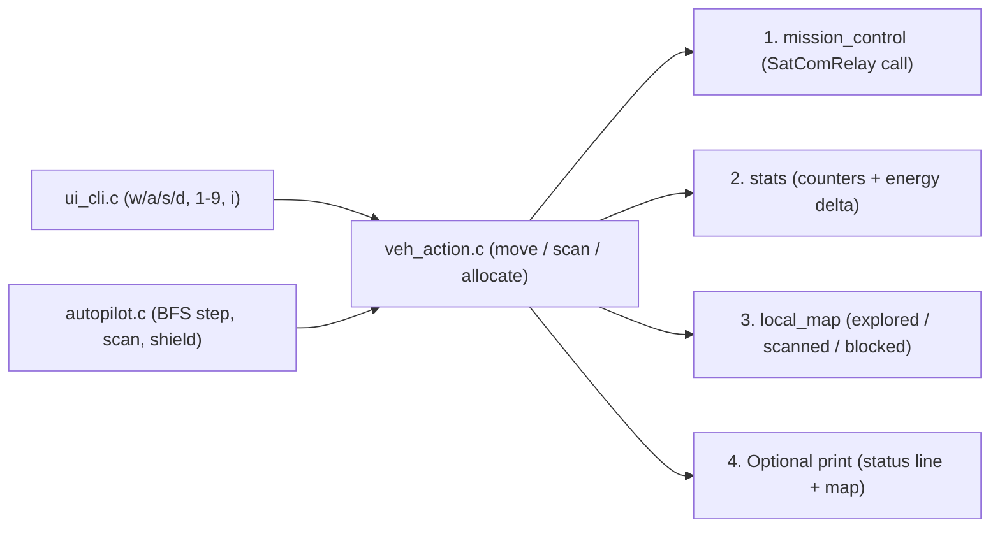

# v2 Student Deep-Dive Guide 4: `veh_action.h` & `veh_action.c`

> [!NOTE]
> **Updated v2 Guide (`nathan` branch):** Covers every single line of refactored [veh_action.h](file:///c:/Users/nathanyu/Documents/GitHub/RSE1201_Group_Project/VehExplorer/inc/veh_action.h) (lines 1–27) and [veh_action.c](file:///c:/Users/nathanyu/Documents/GitHub/RSE1201_Group_Project/VehExplorer/src/veh_action.c) (lines 1–155). Notice [`veh_action_move`](file:///c:/Users/nathanyu/Documents/GitHub/RSE1201_Group_Project/VehExplorer/src/veh_action.c#L10-L80) now takes a plain `char direction` (`'N'`, `'S'`, `'E'`, `'W'`) instead of a function pointer! Every C term is re-explained inline in each section.

---

## 1. Big-Picture Role: Why Does `veh_action` Exist?

Both **manual keyboard play** ([ui_cli.c](file:///c:/Users/nathanyu/Documents/GitHub/RSE1201_Group_Project/VehExplorer/src/ui_cli.c)) and **autonomous play** ([autopilot.c](file:///c:/Users/nathanyu/Documents/GitHub/RSE1201_Group_Project/VehExplorer/src/autopilot.c)) need to perform the exact same 3 vehicle actions: **Move**, **Scan**, and **Allocate Shield**.

Without `veh_action`, we would have had to copy-paste all the bookkeeping—snapshotting `before` energy, calling `mission_control`, counting stats, calculating energy spent, updating `local_map`, and printing maps—into both `ui_cli.c` and `autopilot.c`! Putting that shared pipeline in `veh_action.c` guarantees manual and auto-pilot actions always record stats and update maps identically.



---

## 2. Header Walkthrough: `veh_action.h` (Lines 1–27)

### Full Header ([veh_action.h](file:///c:/Users/nathanyu/Documents/GitHub/RSE1201_Group_Project/VehExplorer/inc/veh_action.h#L1-L27))

```c
#ifndef VEH_ACTION_H
#define VEH_ACTION_H

#include "SatComRelay.h"
#include "mission_control.h"

#include <stdbool.h>

/* Shared move, scan, and shield actions used by manual keys and auto-pilot.
 * Print flags let auto-pilot skip printing the status line or map when disabled. */

void veh_action_move(VehDataType *vehicle,
                     char direction,
                     int dx,
                     int dy,
                     bool print_stats,
                     bool print_travelled_map);

void veh_action_scan(VehDataType *vehicle,
                     MissionControlScanDir dir,
                     const char *scan_direction_name,
                     bool print_stats,
                     bool print_scanned_map);

bool veh_action_allocate(VehDataType *vehicle, long amount, bool print_stats);

#endif /* VEH_ACTION_H */
```

#### Every Term Explained Inline
- **`#ifndef VEH_ACTION_H` / `#define VEH_ACTION_H` / `#endif`:** Include guard preventing duplicate declarations if `"veh_action.h"` is included more than once.
- **`VehDataType *vehicle`:** Pointer to `main`'s live `VehDataType` struct so actions update energy and shield fields directly.
- **`char direction`:** Single character `'N'`, `'S'`, `'E'`, or `'W'` telling [`veh_action_move`](file:///c:/Users/nathanyu/Documents/GitHub/RSE1201_Group_Project/VehExplorer/inc/veh_action.h#L12-L17) which cardinal move function to call.
- **`int dx, int dy`:** Relative step on our local map (`(0, -1)` North, `(0, 1)` South, `(-1, 0)` West, `(1, 0)` East).
- **`bool print_stats`, `bool print_travelled_map`, `bool print_scanned_map`:** Boolean display switches!
  - Manual keys in `ui_cli.c` always pass `true, true` so the player sees energy + map after every keypress.
  - Auto-pilot passes whatever flags the user chose in the `'o'` configuration menu!
- **`const char *scan_direction_name`:** Read-only string label like `"NW"` or `"E"` for printing clear error messages if a scan fails out-of-bounds.

---

## 3. Source Walkthrough: `veh_action.c` (Lines 1–155)

### Chunk A: `#include`s & `veh_action_move` ([veh_action.c](file:///c:/Users/nathanyu/Documents/GitHub/RSE1201_Group_Project/VehExplorer/src/veh_action.c#L1-L80))

```c
#include "veh_action.h"

#include "local_map.h"
#include "stats.h"
#include "ui_cli.h"

#include <stdio.h>

/* Move the vehicle in one direction ('N', 'S', 'E', 'W') and update stats and map. */
void veh_action_move(VehDataType *vehicle,
                     char direction,
                     int dx,
                     int dy,
                     bool print_stats,
                     bool print_travelled_map)
{
    VehDataType before;
    char dest_terrain;
    bool ok = false;

    if (vehicle == NULL) {
        return;
    }

    /* Save energy values before moving so we can calculate the cost of this step */
    before = *vehicle;

    /* Check what terrain we previously scanned at the target cell (or '?') */
    dest_terrain = local_map_peek_terrain_at_offset(dx, dy);

    /* Call the matching movement function for the chosen direction */
    switch (direction) {
    case 'N':
    case 'n':
        ok = mission_control_move_north(vehicle);
        break;
    case 'S':
    case 's':
        ok = mission_control_move_south(vehicle);
        break;
    case 'E':
    case 'e':
        ok = mission_control_move_east(vehicle);
        break;
    case 'W':
    case 'w':
        ok = mission_control_move_west(vehicle);
        break;
    default:
        ok = false;
        break;
    }

    /* Update move counters */
    stats_count_move(ok);

    /* Stop immediately if the move ended the mission or destroyed the vehicle */
    if (mission_control_is_mission_over()) {
        return;
    }

    /* Record energy used on a successful move, or mark an unknown wall as blocked */
    if (ok) {
        long move_e = vehicle->totEnergyUsed - before.totEnergyUsed;
        long shld_e = vehicle->totShieldEnergyUsed - before.totShieldEnergyUsed;

        stats_add_move_energy(dest_terrain, move_e, shld_e);
        local_map_move_success(dx, dy);
    } else if (dest_terrain == LOCAL_MAP_TERRAIN_UNKNOWN) {
        local_map_mark_blocked_at_offset(dx, dy);
    }

    /* Print energy line and travelled map when enabled */
    if (print_stats) {
        ui_print_veh_data(vehicle);
    }
    if (print_travelled_map) {
        local_map_print_explored();
    }
}
```

#### Every Term Explained Inline
- **`before = *vehicle;` (Struct copy via dereference `*`):** Dereferences pointer `vehicle` and copies all 5 `long` energy fields into local variable `before` **before** the move happens! Why? Because `SatComRelay` only reports cumulative `totEnergyUsed`—subtracting `vehicle->totEnergyUsed - before.totEnergyUsed` after the move gives us the **exact energy cost of this single step**!
- **`dest_terrain = local_map_peek_terrain_at_offset(dx, dy);`:** Looks up what terrain symbol we previously scanned at `(x + dx, y + dy)` *before* moving onto it (returns `'?'` if the player moved blindly without scanning first).
- **`switch (direction)` with stacked `case 'N': case 'n':`:** Matches either uppercase `'N'` or lowercase `'n'` (fall-through between two `case` labels), calls [`mission_control_move_north(vehicle)`](file:///c:/Users/nathanyu/Documents/GitHub/RSE1201_Group_Project/VehExplorer/src/mission_control.c#L148-L151), stores the boolean result in `ok`, and exits the `switch` with `break;`.
- **`stats_count_move(ok);`:** Increments `moves_issued` (always) and `moves_succeeded` (if `ok` is `true`).
- **`if (mission_control_is_mission_over()) { return; }`:** If stepping onto `'X'` destroyed the vehicle, exit immediately so we don't print normal post-move maps over the destruction screen.
- **`vehicle->totEnergyUsed - before.totEnergyUsed` (`->` vs `.`):** Notice why `vehicle` uses `->` while `before` uses `.`! `vehicle` is a **pointer** (`VehDataType *`), so it uses `->`; `before` is a **direct struct value** (`VehDataType`), so it uses `.`!
- **`else if (dest_terrain == LOCAL_MAP_TERRAIN_UNKNOWN)`:** Smart learning! If a move failed (`!ok`) when shields and energy were fine, and the target tile hadn't been scanned yet (`'?'`), it must be an impassable wall `'#'` or out-of-bounds edge—so we mark `(dx, dy)` blocked on our local map!

---

### Chunk B: `veh_action_scan` & `veh_action_allocate` ([veh_action.c](file:///c:/Users/nathanyu/Documents/GitHub/RSE1201_Group_Project/VehExplorer/src/veh_action.c#L82-L155))

```c
/* Scan one cell in the given direction at the current scan radius (1 or 2). */
void veh_action_scan(VehDataType *vehicle,
                     MissionControlScanDir dir,
                     const char *scan_direction_name,
                     bool print_stats,
                     bool print_scanned_map)
{
    VehDataType before;
    char terrain;
    int dx;
    int dy;
    int radius;
    bool ok;
    long scan_e;
    long shld_e;

    if (vehicle == NULL) {
        return;
    }

    /* Snapshot energy before scanning, then run the scan */
    before = *vehicle;
    radius = mission_control_get_scan_radius();
    terrain = mission_control_scan(vehicle, dir);
    ok = (terrain != '\0');
    stats_count_scan(ok);

    /* Log any energy or shield cost spent on this scan attempt */
    scan_e = vehicle->totEnergyUsed - before.totEnergyUsed;
    shld_e = vehicle->totShieldEnergyUsed - before.totShieldEnergyUsed;
    if (scan_e != 0 || shld_e != 0) {
        stats_add_scan_energy(dir, radius, scan_e, shld_e);
    }

    /* Out-of-bounds scan failed: mark cell blocked so auto-pilot skips it next time */
    if (!ok) {
        mission_control_scan_offset(dir, &dx, &dy);
        local_map_mark_blocked_at_offset(dx, dy);
        printf("Scan %s (radius %d) failed.\n", scan_direction_name, radius);
        if (print_stats) {
            ui_print_veh_data(vehicle);
        }
        return;
    }

    /* Save scanned terrain character into the local map */
    mission_control_scan_offset(dir, &dx, &dy);
    local_map_record_scan(dx, dy, terrain);

    /* Print scanned symbol, plus energy status and scanned map when enabled */
    printf("Returned (scanned) terrain symbol is : '%c'\n", terrain);
    if (print_stats) {
        ui_print_veh_data(vehicle);
    }
    if (print_scanned_map) {
        local_map_print_scanned();
    }
}

/* Transfer energy from main reserves to shields and optionally print status. */
bool veh_action_allocate(VehDataType *vehicle, long amount, bool print_stats)
{
    bool ok;

    if (vehicle == NULL) {
        return false;
    }

    ok = mission_control_allocate_shield(vehicle, amount);
    if (ok && print_stats) {
        ui_print_veh_data(vehicle);
    }
    return ok;
}
```

#### Every Term Explained Inline
- **`ok = (terrain != '\0');`:** `mission_control_scan` returns `'\0'` (null character) when a scan fails (for example, scanning past the outer edge of the arena). Any non-null character (`'.'`, `'#'`, `'E'`, `'X'`, `'h'`, etc.) means the scan succeeded!
- **Why record `stats_add_scan_energy` BEFORE `if (!ok)`?** Even an out-of-bounds scan outside the map border still consumes battery energy inside `libsatcom.so`! Recording `scan_e` before returning on `!ok` ensures our Stage 3 energy table accounts for every unit of scan energy spent.
- **`mission_control_scan_offset(dir, &dx, &dy);`:** Passes the addresses `&dx` and `&dy` (`&` address-of operator) so `mission_control_scan_offset` fills `dx` and `dy` with the relative offset (e.g., `(-2, -2)` for `NW` at radius `2`).
- **`local_map_mark_blocked_at_offset(dx, dy);` on failed scan (`!ok`):** Crucial for auto-pilot! When scanning beyond the arena edge returns `'\0'`, marking `(x + dx, y + dy)` blocked tells auto-pilot *"that coordinate is outside the arena—don't keep scanning it forever!"*
- **`veh_action_allocate`:** Calls [`mission_control_allocate_shield(vehicle, amount)`](file:///c:/Users/nathanyu/Documents/GitHub/RSE1201_Group_Project/VehExplorer/src/mission_control.c#L169-L194) and prints the vehicle status line only when `ok && print_stats` is true (`&&` short-circuit AND).

---

## 4. Ready-to-Use Presentation Script & Likely Teacher Q&A

### 45-Second Walkthrough Script
> "`veh_action.c` is the shared action layer used by both manual keys in `ui_cli.c` and autonomous decisions in `autopilot.c`, avoiding duplicate code. Before each move or scan, we save a copy `before = *vehicle` so afterward we can subtract `vehicle->totEnergyUsed - before.totEnergyUsed` to measure the exact battery and shield cost of that single step for our Stage 3 tables. `veh_action_move` dispatches `'N'`, `'S'`, `'E'`, or `'W'` via a `switch`, updates stats and the explored map on success, and marks unknown walls as blocked. `veh_action_scan` records the returned terrain symbol on our local map—or marks out-of-bounds cells blocked if a scan returns `'\0'` so auto-pilot never re-scans past map edges. Boolean print flags let manual mode always show maps while auto-pilot obeys the user's `'o'` display settings."

### Likely Questions From Your Lecturer
1. **Q: Why does `before` use `before.totEnergyUsed` (a dot `.`) while `vehicle` uses `vehicle->totEnergyUsed` (an arrow `->`)?**
   - **A:** `vehicle` is a struct pointer (`VehDataType *`), so C uses `->` to dereference and read a member. `before` is a local struct copy (`VehDataType`), so C uses `.` directly.
2. **Q: What happens in `veh_action_scan` when the player scans outside the boundary of the map?**
   - **A:** `SatComRelay` returns `'\0'`, so `ok` is `false`. We still log any energy the scan consumed, then call `local_map_mark_blocked_at_offset(dx, dy)` so auto-pilot remembers that tile is out-of-bounds and won't waste energy scanning it again.
