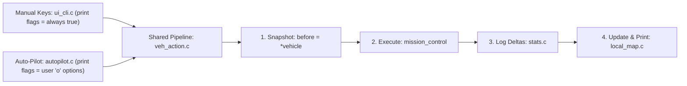
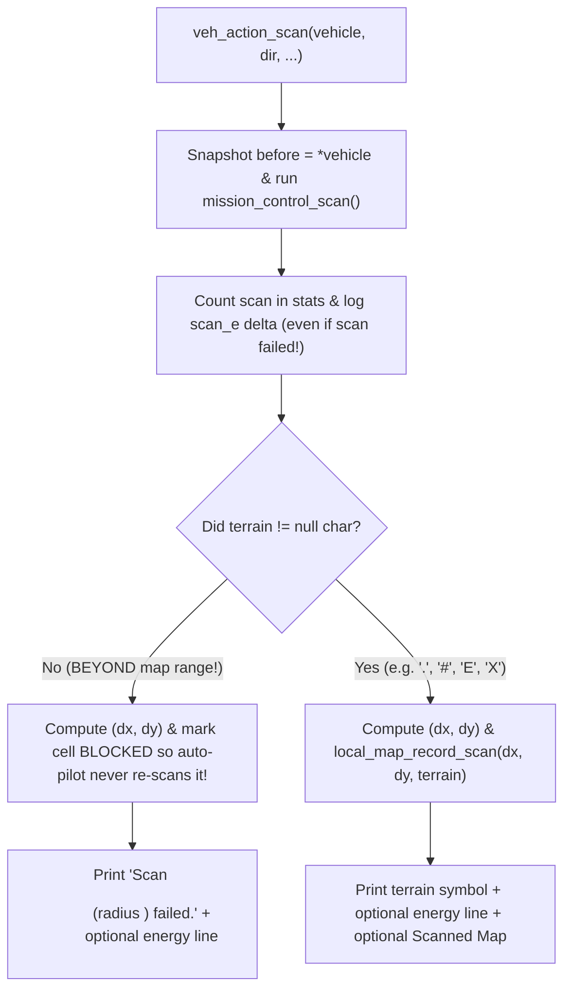

# v2 Student Deep-Dive Guide 4: `veh_action.h` & `veh_action.c`

> [!NOTE]
> **Beginner-Friendly Visual Edition (`nathan` branch):** Covers every single line of [veh_action.h](file:///c:/Users/nathanyu/Documents/GitHub/RSE1201_Group_Project/VehExplorer/inc/veh_action.h) (lines 1–27) and [veh_action.c](file:///c:/Users/nathanyu/Documents/GitHub/RSE1201_Group_Project/VehExplorer/src/veh_action.c) (lines 1–155), with **before/after energy snapshot diagrams**, a **peek-before-move timeline**, and a **scan flowchart**. Every C term is re-explained inline right inside each section.

---

## 1. Mental Imagery: Why Does `veh_action` Sit Between UI/Auto-Pilot and the Backends?

Suppose you press `'w'` manually in `ui_cli.c`, OR auto-pilot decides to move North in `autopilot.c`. In **both** cases, one single move has to coordinate **4 different modules** in exact order:
1. Ask `local_map` what terrain is at the target cell *before* stepping onto it.
2. Tell `mission_control` to move the physical rover via `libsatcom.so`.
3. Tell `stats` whether the move succeeded and how much battery + shield energy that step burned.
4. Tell `local_map` to move the `'_'` rover marker (or mark a wall blocked) and optionally print the status line + map!



Without `veh_action.c`, we would have had to copy-paste all 4 steps into both `ui_cli.c` and `autopilot.c`!

---

## 2. Visual Mental Model: How `before = *vehicle` Measures One Action's Energy Cost

`libsatcom.so` never tells you *"that move cost 560 battery and 814 shield energy."* Instead, `VehDataType` only stores **running lifetime totals** (`totEnergyUsed` and `totShieldEnergyUsed`).

So `veh_action` takes a **"Before Photo"** of `*vehicle` right before the action, and subtracts it from the **"After Photo"** right after!

```text
BEFORE Move (before = *vehicle; on Line 26 — independent struct copy!):
  +--------------------------------------+
  | before (VehDataType copy on stack)   |
  |   totEnergyUsed:        210,000      |
  |   totShieldEnergyUsed:    9,000      |
  +--------------------------------------+

... mission_control_move_north(vehicle) steps onto hilly terrain 'h' ...

AFTER Move (*vehicle updated in place by libsatcom.so!):
  +--------------------------------------+
  | *vehicle (live struct in main)       |
  |   totEnergyUsed:        210,596      |
  |   totShieldEnergyUsed:   11,043      |
  +--------------------------------------+

SUBTRACT (Lines 64-65):
  move_e = 210,596 - 210,000 =   596  battery energy spent on 'h'!
  shld_e =  11,043 -   9,000 = 2,043  shield energy spent on 'h'!
  --> stats_add_move_energy('h', 596, 2043);
```

---

## 3. Header Walkthrough: `veh_action.h` (Lines 1–27)

### Full Header ([veh_action.h](file:///c:/Users/nathanyu/Documents/GitHub/RSE1201_Group_Project/VehExplorer/inc/veh_action.h#L1-L27))

```c
#ifndef VEH_ACTION_H
#define VEH_ACTION_H

#include "SatComRelay.h"
#include "mission_control.h"

#include <stdbool.h>

/* Shared move, scan, and shield actions used by manual keys and auto-pilot.
 * Print flags let auto-pilot skip printing the status line or map when disabled. */

void veh_action_move(VehDataType *vehicle,
                     char direction,
                     int dx,
                     int dy,
                     bool print_stats,
                     bool print_travelled_map);

void veh_action_scan(VehDataType *vehicle,
                     MissionControlScanDir dir,
                     const char *scan_direction_name,
                     bool print_stats,
                     bool print_scanned_map);

bool veh_action_allocate(VehDataType *vehicle, long amount, bool print_stats);

#endif /* VEH_ACTION_H */
```

#### Every Term Explained Inline
- **`#ifndef VEH_ACTION_H` / `#define VEH_ACTION_H` / `#endif`:** Include guard preventing duplicate declarations.
- **`VehDataType *vehicle`:** Pointer (`*`) to `main()`'s live `VehDataType` struct.
- **`char direction`:** Single character `'N'`, `'S'`, `'E'`, or `'W'` telling `veh_action_move` which direction to drive.
- **`int dx, int dy`:** Relative grid step (`(0, -1)` North, `(0, 1)` South, `(-1, 0)` West, `(1, 0)` East).
- **`bool print_stats`, `bool print_travelled_map`, `bool print_scanned_map`:** Let manual mode pass `true, true` (always show feedback) while auto-pilot passes whatever flags the player picked in `'o'`!
- **`const char *scan_direction_name`:** Read-only short text like `"NW"` or `"S"` for printing `"Scan W (radius 2) failed."` when a scan goes beyond map boundaries.

---

## 4. Source Walkthrough: `veh_action.c` (Lines 1–155)

### Chunk A: `#include`s & `veh_action_move` ([veh_action.c](file:///c:/Users/nathanyu/Documents/GitHub/RSE1201_Group_Project/VehExplorer/src/veh_action.c#L1-L80))

```c
#include "veh_action.h"

#include "local_map.h"
#include "stats.h"
#include "ui_cli.h"

#include <stdio.h>

/* Move the vehicle in one direction ('N', 'S', 'E', 'W') and update stats and map. */
void veh_action_move(VehDataType *vehicle,
                     char direction,
                     int dx,
                     int dy,
                     bool print_stats,
                     bool print_travelled_map)
{
    VehDataType before;
    char dest_terrain;
    bool ok = false;

    if (vehicle == NULL) {
        return;
    }

    /* Save energy values before moving so we can calculate the cost of this step */
    before = *vehicle;

    /* Check what terrain we previously scanned at the target cell (or '?') */
    dest_terrain = local_map_peek_terrain_at_offset(dx, dy);

    /* Call the matching movement function for the chosen direction */
    switch (direction) {
    case 'N':
    case 'n':
        ok = mission_control_move_north(vehicle);
        break;
    case 'S':
    case 's':
        ok = mission_control_move_south(vehicle);
        break;
    case 'E':
    case 'e':
        ok = mission_control_move_east(vehicle);
        break;
    case 'W':
    case 'w':
        ok = mission_control_move_west(vehicle);
        break;
    default:
        ok = false;
        break;
    }

    /* Update move counters */
    stats_count_move(ok);

    /* Stop immediately if the move ended the mission or destroyed the vehicle */
    if (mission_control_is_mission_over()) {
        return;
    }

    /* Record energy used on a successful move, or mark an unknown wall as blocked */
    if (ok) {
        long move_e = vehicle->totEnergyUsed - before.totEnergyUsed;
        long shld_e = vehicle->totShieldEnergyUsed - before.totShieldEnergyUsed;

        stats_add_move_energy(dest_terrain, move_e, shld_e);
        local_map_move_success(dx, dy);
    } else if (dest_terrain == LOCAL_MAP_TERRAIN_UNKNOWN) {
        local_map_mark_blocked_at_offset(dx, dy);
    }

    /* Print energy line and travelled map when enabled */
    if (print_stats) {
        ui_print_veh_data(vehicle);
    }
    if (print_travelled_map) {
        local_map_print_explored();
    }
}
```

#### Why Must Line 29 (`local_map_peek_terrain_at_offset`) Run *Before* Moving?
```text
Vehicle starts at (0, 0). Tile North at (0, -1) was previously scanned as 'h' (Hill).
  1) Line 29: peek offset (0, -1) from (0, 0)  -->  dest_terrain = 'h'!
  2) Line 35: mission_control_move_north(vehicle) succeeds (ok = true).
  3) Line 67: stats_add_move_energy('h', move_e, shld_e) logs cost under 'h'.
  4) Line 68: local_map_move_success(0, -1) updates vehicle coordinates to (0, -1)!
(If we had moved local_map FIRST and then peeked offset (0, -1), we would have
 accidentally peeked (0, -2) one tile too far North!)
```

#### Every Term Explained Inline
- **`before = *vehicle;` vs `vehicle->totEnergyUsed`:**
  - `vehicle` is a **pointer** (`VehDataType *`), so `*vehicle` dereferences it to copy the whole struct into local variable `before`.
  - Later on line 64, `vehicle->totEnergyUsed` uses `->` (because `vehicle` is a pointer) while `before.totEnergyUsed` uses `.` (because `before` is a plain struct variable)!
- **Stacked `case 'N': case 'n':` in `switch (direction)`:** Handles both uppercase and lowercase direction characters cleanly and exits the `switch` with `break;`.
- **Smart Wall Memory (`else if (dest_terrain == LOCAL_MAP_TERRAIN_UNKNOWN)` on Line 69):** Wait—what if the move failed (`ok == false`)?Wait: why check `dest_terrain == '?'`?
  - Remember `mission_control` also returns `false` when **shields are `0`**! If you already scanned `'h'` (a passable hill) and tried to walk onto `'h'` with `0` shields, `'h'` is NOT a wall—your shields were just down!
  - Only when `dest_terrain` was unscanned (`'?'`) and the move failed (while shields/battery were positive) could it be a hidden `'#'` wall, or if shields were down it stays unscanned until scanned. Even better, in auto-pilot shields are always topped up first and tiles are always scanned before moving!

---

### Chunk B: `veh_action_scan` & `veh_action_allocate` ([veh_action.c](file:///c:/Users/nathanyu/Documents/GitHub/RSE1201_Group_Project/VehExplorer/src/veh_action.c#L82-L155))

```c
/* Scan one cell in the given direction at the current scan radius (1 or 2). */
void veh_action_scan(VehDataType *vehicle,
                     MissionControlScanDir dir,
                     const char *scan_direction_name,
                     bool print_stats,
                     bool print_scanned_map)
{
    VehDataType before;
    char terrain;
    int dx;
    int dy;
    int radius;
    bool ok;
    long scan_e;
    long shld_e;

    if (vehicle == NULL) {
        return;
    }

    /* Snapshot energy before scanning, then run the scan */
    before = *vehicle;
    radius = mission_control_get_scan_radius();
    terrain = mission_control_scan(vehicle, dir);
    ok = (terrain != '\0');
    stats_count_scan(ok);

    /* Log any energy or shield cost spent on this scan attempt */
    scan_e = vehicle->totEnergyUsed - before.totEnergyUsed;
    shld_e = vehicle->totShieldEnergyUsed - before.totShieldEnergyUsed;
    if (scan_e != 0 || shld_e != 0) {
        stats_add_scan_energy(dir, radius, scan_e, shld_e);
    }

    /* Out-of-bounds scan failed: mark cell blocked so auto-pilot skips it next time */
    if (!ok) {
        mission_control_scan_offset(dir, &dx, &dy);
        local_map_mark_blocked_at_offset(dx, dy);
        printf("Scan %s (radius %d) failed.\n", scan_direction_name, radius);
        if (print_stats) {
            ui_print_veh_data(vehicle);
        }
        return;
    }

    /* Save scanned terrain character into the local map */
    mission_control_scan_offset(dir, &dx, &dy);
    local_map_record_scan(dx, dy, terrain);

    /* Print scanned symbol, plus energy status and scanned map when enabled */
    printf("Returned (scanned) terrain symbol is : '%c'\n", terrain);
    if (print_stats) {
        ui_print_veh_data(vehicle);
    }
    if (print_scanned_map) {
        local_map_print_scanned();
    }
}

/* Transfer energy from main reserves to shields and optionally print status. */
bool veh_action_allocate(VehDataType *vehicle, long amount, bool print_stats)
{
    bool ok;

    if (vehicle == NULL) {
        return false;
    }

    ok = mission_control_allocate_shield(vehicle, amount);
    if (ok && print_stats) {
        ui_print_veh_data(vehicle);
    }
    return ok;
}
```



#### Every Term Explained Inline
- **`ok = (terrain != '\0');`:** `'\0'` is the null character returned when a scan goes beyond the map's outer edge (like scanning West at radius 2 when standing right next to the West wall!).
- **`mission_control_scan_offset(dir, &dx, &dy);`:** Passes `&dx` and `&dy` (`&` address-of) so `dx` and `dy` get filled with the target tile's relative offset (e.g. `dx = -2, dy = 0`).
- **Why mark failed scans blocked (`local_map_mark_blocked_at_offset(dx, dy)`)?** Imagine auto-pilot is standing next to the West border wall `'#'`. Radius-1 West is `'#'`, and Radius-2 West (`dx = -2`) is *outside the arena*! When scanning `(-2, 0)` returns `'\0'`, marking `(-2, 0)` **blocked** teaches auto-pilot *"that coordinate doesn't exist—never waste energy scanning `(-2, 0)` again!"*
- **`if (ok && print_stats)` in `veh_action_allocate`:** `&&` (logical AND) prints the updated energy summary after auto-pilot allocates shields whenever `print_stats` is enabled.

---

## 5. Ready-to-Use Presentation Script & Likely Teacher Q&A

### 45-Second Walkthrough Script
> "`veh_action.c` is the shared execution layer called by both manual commands in `ui_cli.c` and autonomous actions in `autopilot.c`, ensuring statistics and map updates never get out of sync. Before every move or scan, we copy `before = *vehicle` so afterward we can subtract `vehicle->totEnergyUsed - before.totEnergyUsed` to get the exact battery and shield cost of that single action. `veh_action_move` peeks the destination terrain first, dispatches `'N'`, `'S'`, `'E'`, or `'W'` via a `switch`, logs per-terrain energy and advances `(x, y)` on success, and prints optional status and map views. `veh_action_scan` saves scanned terrain symbols into `local_map`—and if an out-of-bounds scan returns `'\0'`, it marks that offset blocked so auto-pilot never repeats out-of-range scans."

### Likely Questions From Your Lecturer
1. **Q: Why do you log `stats_add_scan_energy` *before* checking `if (!ok)` in `veh_action_scan`?**
   - **A:** Because in `libsatcom.so`, attempting a scan beyond map boundaries still consumes radar energy (`totEnergyUsed` increases even though `terrain` is `'\0'`). Logging the delta before returning on `!ok` ensures our Stage 3 scan energy table matches `totEnergyUsed` accurately.
2. **Q: Why does `veh_action_move` peek `dest_terrain` *before* calling `mission_control_move_*`?**
   - **A:** `local_map_peek_terrain_at_offset(dx, dy)` adds `(dx, dy)` to the vehicle's *current* coordinates. Once `local_map_move_success(dx, dy)` runs, the vehicle is already standing at the new coordinates! Peeking beforehand grabs the symbol at the destination cell cleanly.
