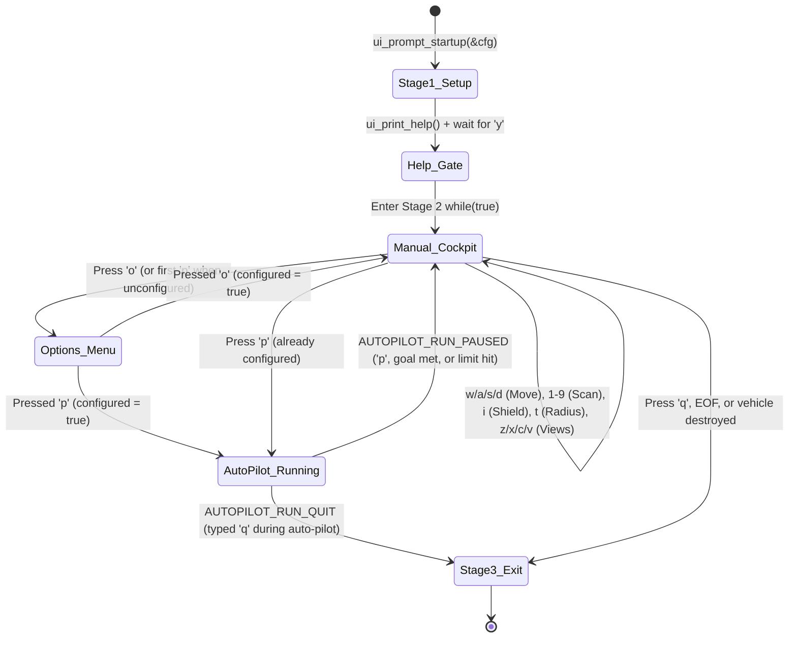

# v2 Student Deep-Dive Guide 5: `ui_cli.h` & `ui_cli.c`

> [!NOTE]
> **Beginner-Friendly Visual Edition (`nathan` branch):** Covers every single line (zero lines skipped!) of [ui_cli.h](file:///c:/Users/nathanyu/Documents/GitHub/RSE1201_Group_Project/VehExplorer/inc/ui_cli.h) (lines 1–30) and [ui_cli.c](file:///c:/Users/nathanyu/Documents/GitHub/RSE1201_Group_Project/VehExplorer/src/ui_cli.c) (lines 1–301), with **visual WASD + Numpad keyboard diagrams**, a **Stage 1–3 state machine diagram**, and a **`sizeof(*cfg)` vs `sizeof(cfg)` memory diagram**. Every C term is re-explained inline right inside each section.

---

## 1. Mental Imagery: The Cockpit Dashboard (`ui_cli`)

`ui_cli` ("User Interface — Command-Line Interface") is the **cockpit dashboard** that talks directly to the human player:
- **Stage 1 (`ui_prompt_startup`):** Collects the 4 pre-mission settings into `UiStartupConfig`.
- **Stage 2 (`ui_run_command_loop`):** Displays the controls, waits for `'y'`, and runs the interactive cockpit loop switching cleanly between **Manual Driving**, **Option Menu (`'o'`)**, and **Auto-Pilot (`'p'`)**:



### Visual Keyboard Map: Why Move Uses `W/A/S/D` & Scan Uses Numpad `1–9`!

```text
   LEFT HAND: CARDINAL MOVE                 RIGHT HAND: 8-DIRECTION RADAR SCAN
     (Steps 1 tile onto terrain)             (Peeks 1 or 2 tiles away safely!)

             +-------+                            +-------+-------+-------+
             |   W   |                            |   7   |   8   |   9   |
             | North |                            |  NW   |   N   |  NE   |
             | (0,-1)|                            |(-1,-1)| (0,-1)|(+1,-1)|
     +-------+-------+-------+                    +-------+-------+-------+
     |   A   |   S   |   D   |                    |   4   |  [5]  |   6   |
     | West  | South | East  |                    |   W   | ROVER |   E   |
     | (-1,0)| (0,+1)| (+1,0)|                    | (-1,0)|invalid| (+1,0)|
     +-------+-------+-------+                    +-------+-------+-------+
                                                  |   1   |   2   |   3   |
                                                  |  SW   |   S   |  SE   |
                                                  |(-1,+1)| (0,+1)|(+1,+1)|
                                                  +-------+-------+-------+
```

Look at key `[5]` in the middle of the numpad: `[5]` is where the rover is already standing! That's why pressing `'5'` prints `Invalid Command : '5', please try again!`.

---

## 2. Header Walkthrough: `ui_cli.h` (Lines 1–30)

### Full Header ([ui_cli.h](file:///c:/Users/nathanyu/Documents/GitHub/RSE1201_Group_Project/VehExplorer/inc/ui_cli.h#L1-L30))

```c
#ifndef UI_CLI_H
#define UI_CLI_H

#include "SatComRelay.h"

#include <stdbool.h>

#define UI_SCENARIO_PATH_MAX 512

/* Stores Stage 1 setup choices entered by the user at startup. */
typedef struct {
    char scenario_path[UI_SCENARIO_PATH_MAX];
    bool file_needs_decryption;
    bool randomize_start;
    int mission_type;
} UiStartupConfig;

/* Stage 1 prompts. Returns false on EOF before setup finishes. */
bool ui_prompt_startup(UiStartupConfig *cfg);

/* Print one-line vehicle energy summary. */
void ui_print_veh_data(const VehDataType *vehicle);

/* Print Stage 2 control instructions. */
void ui_print_help(void);

/* Stage 2 main command loop (manual controls and auto-pilot). */
void ui_run_command_loop(VehDataType *vehicle, int mission_type);

#endif /* UI_CLI_H */
```

#### Every Term Explained Inline
- **`#ifndef UI_CLI_H` / `#define UI_CLI_H` / `#endif`:** Include guard preventing duplicate declarations.
- **`#define UI_SCENARIO_PATH_MAX 512`:** Preprocessor constant setting the filename buffer capacity to `512` bytes.
- **`typedef struct { ... } UiStartupConfig;`:** Packages all 4 startup answers into one struct type so `main()` can pass a single pointer `UiStartupConfig *cfg` to `ui_prompt_startup`.
- **`const VehDataType *vehicle` vs `VehDataType *vehicle`:** `ui_print_veh_data` uses `const` (read-only printing); `ui_run_command_loop` has no `const` because gameplay actions update `*vehicle`.

---

## 3. Source Walkthrough: `ui_cli.c` (Lines 1–301, Complete!)

### Chunk A: `#include`s & Stage 1 `ui_prompt_startup` ([ui_cli.c](file:///c:/Users/nathanyu/Documents/GitHub/RSE1201_Group_Project/VehExplorer/src/ui_cli.c#L1-L73))

```c
#include "ui_cli.h"

#include "autopilot.h"
#include "local_map.h"
#include "mission_control.h"
#include "stats.h"
#include "util_input.h"
#include "veh_action.h"

#include <stdio.h>
#include <string.h>

/* Ask the 4 Stage 1 startup questions and fill *cfg. */
bool ui_prompt_startup(UiStartupConfig *cfg)
{
    int encrypted_num = 0;
    int random_start_num = 0;

    if (cfg == NULL) {
        return false;
    }

    memset(cfg, 0, sizeof(*cfg));

    /* Keep asking until a non-empty scenario file path is entered */
    while (true) {
        printf("Please enter the scenario file's name : ");
        fflush(stdout);

        if (!util_read_line(cfg->scenario_path, sizeof(cfg->scenario_path))) {
            if (feof(stdin)) {
                fprintf(stderr, "No scenario path provided.\n");
                return false;
            }
            printf("Path cannot be empty.\n");
            continue;
        }
        break;
    }

    /* Prompt for encryption flag, randomized spawn, and mission type (1-8) */
    cfg->file_needs_decryption =
        util_prompt_yes_no("Is the scenario file encrypted? (y/n) : ");
    cfg->randomize_start =
        util_prompt_yes_no("Do you wish to randomize start position? (y/n) : ");
    cfg->mission_type = util_prompt_int_range(
        "Please select Mission Type :\n"
        "  1) Casual Explore\n"
        "  2) Find 1 End Point\n"
        "  3) Reach 1 End Point\n"
        "  4) Find ALL End Points\n"
        "  5) Reach ALL End Points\n"
        "  6) Find ALL Danger Points\n"
        "  7) Find Map Boundaries\n"
        "  8) Explore Everything\n"
        "Enter 1-8 : ",
        1,
        8);

    if (cfg->file_needs_decryption) {
        encrypted_num = 1;
    }
    if (cfg->randomize_start) {
        random_start_num = 1;
    }

    printf("fileName : %s, isFileEncrypted : %d, randomizeStartPosition : %d\n",
           cfg->scenario_path,
           encrypted_num,
           random_start_num);

    return true;
}
```

#### Visual Trap Alert: `sizeof(cfg)` vs `sizeof(*cfg)` on Line 23!
```text
   cfg (Pointer variable)              *cfg (The actual UiStartupConfig struct!)
  +----------------------+            +------------------------------------------+
  | 0x7ffc1000 (8 bytes) | ---------> | scenario_path[512] + bools + int         |
  +----------------------+            | (~520 bytes total!)                      |
   sizeof(cfg) == 8  (WRONG!)         +------------------------------------------+
                                       sizeof(*cfg) == 520  (WIPES WHOLE STRUCT!)
```

#### Every Term Explained Inline
- **`memset(cfg, 0, sizeof(*cfg));`:** Fills every byte of `*cfg` with `0` before asking questions so no leftover stack garbage remains.
- **`while (true)` + `continue` + `break` (Lines 26–39):** If the user hits Enter on an empty filename, prints `"Path cannot be empty."` and `continue` jumps back to ask again; as soon as a valid non-empty path is typed, `break` exits the `while` loop to ask Question 2!
- **`cfg->scenario_path` (`->` arrow):** Follows pointer `cfg` to access the `scenario_path` array; `sizeof(cfg->scenario_path)` evaluates to `512`.
- **`encrypted_num` & `random_start_num`:** Convert `bool` (`false`/`true`) into `0` or `1` using simple `if` statements for the Stage 1 summary `printf`.

---

### Chunk B: Status, Full Help Table, `'y'` Gate, Shield & Radius Handlers ([ui_cli.c](file:///c:/Users/nathanyu/Documents/GitHub/RSE1201_Group_Project/VehExplorer/src/ui_cli.c#L75-L177))

```c
/* Print the one-line summary of vehicle battery and shield energy. */
void ui_print_veh_data(const VehDataType *vehicle)
{
    if (vehicle == NULL) {
        return;
    }

    printf("\nInitial Enrg : %ld, Tot Enrg Used : %ld, Tot Shld Enrg Used : %ld, "
           "Engy Left : %ld, Shld Enrg Left : %ld\n",
           vehicle->initialEnergy,
           vehicle->totEnergyUsed,
           vehicle->totShieldEnergyUsed,
           vehicle->currEnergy,
           vehicle->currShieldEnergy);
}

/* Print total moves and scans issued vs succeeded for the 'z' status view. */
static void ui_print_command_stats(void)
{
    StatsCounters s = stats_get();

    printf("Moves issued : %lu, Successful moves : %lu\n",
           s.moves_issued,
           s.moves_succeeded);
    printf("Scans issued : %lu, Successful scans : %lu\n",
           s.scans_issued,
           s.scans_succeeded);
}

/* Print the command keybinding table. */
void ui_print_help(void)
{
    printf("\n*** Welcome to VehExplorer ! ***\n\n");
    printf("[ Usage Instructions ]\n");
    printf("-------------------------------------\n");
    printf("Enter 'q' to Quit\n");
    printf("Enter 'v' to show this help\n");
    printf("'w', 's', 'a', 'd' keys to MOVE vehicle North, South, West & East\n");
    printf("'t' key = Toggle Scan Radius (betw. 1-2)\n");
    printf("NumPad keys to SCAN : SW (1), S (2), SE (3), W (4), E (6), "
           "NW (7), N (8), NE (9) respectively\n");
    printf("'i' = Increase / divert energy to shield\n");
    printf("'z' key = Info on Vehicle Status\n");
    printf("'c' key = Map of terrain scanned by Vehicle\n");
    printf("'x' key = Map of terrain travelled by Vehicle\n");
    printf("'o' key = Configure auto-pilot options\n");
    printf("'p' key = Toggle auto-pilot on / off\n");
    printf("In map display, '_' underline indicates curr. veh. location!\n");
}

/* Wait until the user enters 'y' before starting the command loop. */
static void ui_wait_continue(void)
{
    while (true) {
        printf("\nPress 'y' key and hit Enter to continue! ");
        fflush(stdout);

        if (util_read_command_char() == 'y') {
            return;
        }
        if (feof(stdin)) {
            return;
        }
        printf("Please press 'y' then Enter.\n");
    }
}

/* Handle 'i': prompt for energy amount and transfer it to shields. */
static void handle_allocate_shield(VehDataType *vehicle)
{
    long amount;
    char prompt[128];

    if (vehicle == NULL) {
        return;
    }

    if (vehicle->currEnergy < 1) {
        printf("Error: Insufficient energy reserves. Try reducing the "
               "quantity allocated to shield!\n");
        return;
    }

    snprintf(prompt,
             sizeof(prompt),
             "Enter amt. of energy to increase / allocate to shields "
             "(1 - %ld) : ",
             vehicle->currEnergy);

    if (!util_prompt_long(prompt, &amount)) {
        printf("Shield allocation cancelled (need a whole number).\n");
        return;
    }

    mission_control_allocate_shield(vehicle, amount);
}

/* Handle 't': flip scan radius between 1 and 2 and print the new setting. */
static void handle_toggle_scan_radius(void)
{
    int radius = mission_control_toggle_scan_radius();
    printf("Toggle Scan Radius => now set to %d terrain units!\n", radius);
}
```

#### Every Term Explained Inline
- **`%ld` vs `%lu`:** `%ld` formats signed `long` (`VehDataType` energies); `%lu` formats `unsigned long` (`StatsCounters` counts).
- **`static` on internal helpers (`ui_print_command_stats`, `ui_wait_continue`, `handle_allocate_shield`, `handle_toggle_scan_radius`):** Keeps these 4 helpers private inside `ui_cli.c` so other files only see the 4 clean public functions in `ui_cli.h`.
- **`snprintf(prompt, sizeof(prompt), "...", vehicle->currEnergy)`:** Builds the custom prompt string (e.g., `"Enter amt. of energy ... (1 - 299788555) : "`) inside `prompt[128]`, safely capped at `128` bytes (`sizeof(prompt)`) so it can never overflow!

---

### Chunk C: Stage 2 `ui_run_command_loop` ([ui_cli.c](file:///c:/Users/nathanyu/Documents/GitHub/RSE1201_Group_Project/VehExplorer/src/ui_cli.c#L179-L301))

```c
/* Stage 2 interactive loop: read single-letter commands and dispatch actions. */
void ui_run_command_loop(VehDataType *vehicle, int mission_type)
{
    AutopilotOptions autopilot_options;

    /* Set default auto-pilot options, show help screen, and wait for 'y' */
    autopilot_options_set_defaults(&autopilot_options);

    ui_print_help();
    ui_wait_continue();
    putchar('\n');

    while (true) {
        char cmd;

        printf("Enter your command (q to quit) : ");
        fflush(stdout);

        /* Read command character; re-prompt on blank line, exit on EOF */
        cmd = util_read_command_char();
        if (cmd == '\0') {
            if (feof(stdin)) {
                printf("\nEOF — leaving command loop.\n");
                return;
            }
            continue;
        }

        /* Dispatch user command to the matching module */
        switch (cmd) {
        case 'v':
            ui_print_help();
            break;
        case 'z':
            printf("\nVehicle Status / Statistics :\n");
            ui_print_veh_data(vehicle);
            ui_print_command_stats();
            break;
        case 'x':
            printf("\nCurrently Explored Terrain Layout :\n");
            local_map_print_explored();
            break;
        case 'c':
            printf("\nCurrently Scanned Terrain Layout :\n");
            local_map_print_scanned();
            break;
        case 'i':
            handle_allocate_shield(vehicle);
            break;
        case 't':
            handle_toggle_scan_radius();
            break;
        case 'o':
            autopilot_prompt_options(&autopilot_options);
            break;
        case 'p':
            /* Configure auto-pilot first if the user hasn't run 'o' yet */
            if (!autopilot_options.configured) {
                if (!autopilot_prompt_options(&autopilot_options)) {
                    break;
                }
            }
            if (autopilot_run(vehicle, mission_type, &autopilot_options) == AUTOPILOT_RUN_QUIT) {
                return;
            }
            break;
        /* Cardinal movement keys (w/s/a/d) */
        case 'w':
            veh_action_move(vehicle, 'N', 0, -1, true, true);
            break;
        case 's':
            veh_action_move(vehicle, 'S', 0, 1, true, true);
            break;
        case 'a':
            veh_action_move(vehicle, 'W', -1, 0, true, true);
            break;
        case 'd':
            veh_action_move(vehicle, 'E', 1, 0, true, true);
            break;
        /* Numpad 8-direction scan keys (1-9 except center '5') */
        case '7':
            veh_action_scan(vehicle, MISSION_CONTROL_DIR_NORTHWEST, "NW", true, true);
            break;
        case '8':
            veh_action_scan(vehicle, MISSION_CONTROL_DIR_NORTH, "N", true, true);
            break;
        case '9':
            veh_action_scan(vehicle, MISSION_CONTROL_DIR_NORTHEAST, "NE", true, true);
            break;
        case '4':
            veh_action_scan(vehicle, MISSION_CONTROL_DIR_WEST, "W", true, true);
            break;
        case '6':
            veh_action_scan(vehicle, MISSION_CONTROL_DIR_EAST, "E", true, true);
            break;
        case '1':
            veh_action_scan(vehicle, MISSION_CONTROL_DIR_SOUTHWEST, "SW", true, true);
            break;
        case '2':
            veh_action_scan(vehicle, MISSION_CONTROL_DIR_SOUTH, "S", true, true);
            break;
        case '3':
            veh_action_scan(vehicle, MISSION_CONTROL_DIR_SOUTHEAST, "SE", true, true);
            break;
        case '5':
            printf("Invalid Command : '5', please try again!\n");
            break;
        case 'q':
            return;
        default:
            printf("Invalid Command : '%c', please try again!\n", cmd);
            break;
        }

        /* Exit loop if the latest action ended the mission */
        if (mission_control_is_mission_over()) {
            printf("\nLeaving manual control after mission end.\n");
            return;
        }

        putchar('\n');
    }
}
```

#### Every Term Explained Inline
- **Where `autopilot_options` lives:** Declared once at the top of `ui_run_command_loop` (line 182), *outside* `while (true)`, so your `'o'` settings stay remembered every time you pause and re-start auto-pilot with `'p'`!
- **First-Time `'p'` Check (`if (!autopilot_options.configured)`):** If you press `'p'` right away without pressing `'o'` first, `configured` is `false`, so it runs `autopilot_prompt_options` once (which sets `configured = true`) and immediately launches `autopilot_run`!
- **`return;` vs `break;` inside `switch (cmd)`:**
  - `break;` exits *only* the `switch` statement and stays inside `while (true)` to ask for the next command.
  - `return;` (on `'q'`, `EOF`, `AUTOPILOT_RUN_QUIT`, or `mission_control_is_mission_over()`) exits `ui_run_command_loop` completely, handing control back to `main()` for Stage 3!

---

## 4. Ready-to-Use Presentation Script & Likely Teacher Q&A

### 45-Second Walkthrough Script
> "`ui_cli.c` manages Stage 1 startup configuration and the Stage 2 interactive command loop. In `ui_prompt_startup`, we zero a `UiStartupConfig` struct with `memset(cfg, 0, sizeof(*cfg))` and collect the scenario filename, encryption and random-spawn flags, and mission type `1` to `8`. In `ui_run_command_loop`, we set default `AutopilotOptions`, print the help instructions, wait for `'y'`, and run a `while (true)` command loop. A single `switch` routes `w/a/s/d` moves and numpad `1–9` scans through `veh_action`, `'i'` and `'t'` to shield and scan-radius helpers, `'z/x/c/v'` to status and map displays, and `'o/p'` to auto-pilot—automatically prompting for options on the first `'p'` if `'o'` wasn't run yet."

### Likely Questions From Your Lecturer
1. **Q: What is the difference between `break;` and `return;` inside `switch (cmd)`?**
   - **A:** `break;` only leaves the `switch` block so the `while (true)` loop prompts for the next command. `return;` leaves `ui_run_command_loop` completely, moving the program from Stage 2 to Stage 3 in `main()`.
2. **Q: Why is `AutopilotOptions autopilot_options;` declared before `while (true)` instead of inside `while (true)`?**
   - **A:** So the user's configuration persists across commands! If it were re-initialized inside `while (true)`, pressing `'o'` to set options would be wiped out before the user pressed `'p'` on the next prompt.
