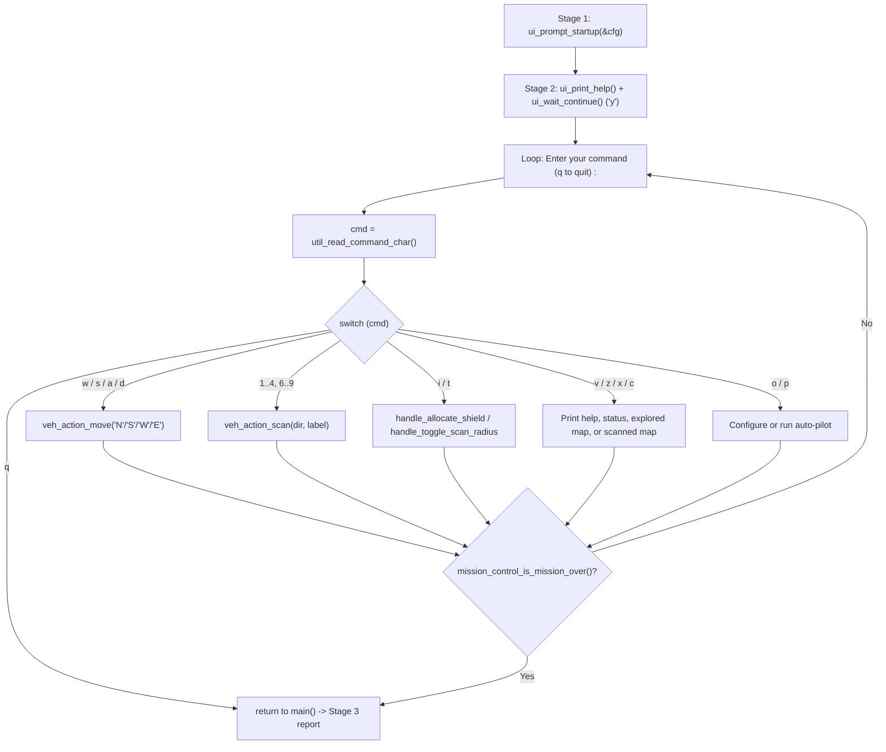

# v2 Student Deep-Dive Guide 5: `ui_cli.h` & `ui_cli.c`

> [!NOTE]
> **Updated v2 Guide (`nathan` branch):** Covers every single line of [ui_cli.h](file:///c:/Users/nathanyu/Documents/GitHub/RSE1201_Group_Project/VehExplorer/inc/ui_cli.h) (lines 1–30) and refactored [ui_cli.c](file:///c:/Users/nathanyu/Documents/GitHub/RSE1201_Group_Project/VehExplorer/src/ui_cli.c) (lines 1–301), including `while (true)` loops, `if`-based flag formatting, and `'N'`/`'S'`/`'W'`/`'E'` movement calls. Every C term is re-explained inline right inside each section.

---

## 1. Big-Picture Role of `ui_cli`

`ui_cli` ("User Interface — Command-Line Interface") handles all **direct player interaction**:
1. **Stage 1 (`ui_prompt_startup`):** Asks the 4 startup setup questions (scenario filename, encrypted `y/n`, randomize start `y/n`, and mission type `1–8`).
2. **Stage 2 (`ui_run_command_loop`):** Shows the `[ Usage Instructions ]` table, waits for `'y'`, and runs the interactive `while (true)` loop dispatching `'w'/'a'/'s'/'d'`, numpad `'1'–'9'`, `'i'`, `'t'`, `'z'`, `'x'`, `'c'`, `'v'`, `'o'`, `'p'`, and `'q'`.



---

## 2. Header Walkthrough: `ui_cli.h` (Lines 1–30)

### Full Header ([ui_cli.h](file:///c:/Users/nathanyu/Documents/GitHub/RSE1201_Group_Project/VehExplorer/inc/ui_cli.h#L1-L30))

```c
#ifndef UI_CLI_H
#define UI_CLI_H

#include "SatComRelay.h"

#include <stdbool.h>

#define UI_SCENARIO_PATH_MAX 512

/* Stores Stage 1 setup choices entered by the user at startup. */
typedef struct {
    char scenario_path[UI_SCENARIO_PATH_MAX];
    bool file_needs_decryption;
    bool randomize_start;
    int mission_type;
} UiStartupConfig;

/* Stage 1 prompts. Returns false on EOF before setup finishes. */
bool ui_prompt_startup(UiStartupConfig *cfg);

/* Print one-line vehicle energy summary. */
void ui_print_veh_data(const VehDataType *vehicle);

/* Print Stage 2 control instructions. */
void ui_print_help(void);

/* Stage 2 main command loop (manual controls and auto-pilot). */
void ui_run_command_loop(VehDataType *vehicle, int mission_type);

#endif /* UI_CLI_H */
```

#### Every Term Explained Inline
- **`#ifndef UI_CLI_H` / `#define UI_CLI_H` / `#endif`:** Include guard preventing duplicate struct/function definitions.
- **`#define UI_SCENARIO_PATH_MAX 512`:** Preprocessor constant defining the maximum length (`512` bytes, including `'\0'`) of the scenario file path buffer.
- **`typedef struct { ... } UiStartupConfig;`:** Bundles all 4 Stage 1 answers into one neat struct type named `UiStartupConfig` so [`ui_prompt_startup`](file:///c:/Users/nathanyu/Documents/GitHub/RSE1201_Group_Project/VehExplorer/inc/ui_cli.h#L19) can fill them via a single pointer `UiStartupConfig *cfg`.
- **`const VehDataType *vehicle` vs `VehDataType *vehicle`:** Notice [`ui_print_veh_data`](file:///c:/Users/nathanyu/Documents/GitHub/RSE1201_Group_Project/VehExplorer/inc/ui_cli.h#L22) marks `vehicle` as `const` because printing never changes energy, whereas [`ui_run_command_loop`](file:///c:/Users/nathanyu/Documents/GitHub/RSE1201_Group_Project/VehExplorer/inc/ui_cli.h#L28) omits `const` because moves/scans/shields update `*vehicle`.

---

## 3. Source Walkthrough: `ui_cli.c` (Lines 1–301)

### Chunk A: `#include`s & Stage 1 `ui_prompt_startup` ([ui_cli.c](file:///c:/Users/nathanyu/Documents/GitHub/RSE1201_Group_Project/VehExplorer/src/ui_cli.c#L1-L73))

```c
#include "ui_cli.h"

#include "autopilot.h"
#include "local_map.h"
#include "mission_control.h"
#include "stats.h"
#include "util_input.h"
#include "veh_action.h"

#include <stdio.h>
#include <string.h>

/* Ask the 4 Stage 1 startup questions and fill *cfg. */
bool ui_prompt_startup(UiStartupConfig *cfg)
{
    int encrypted_num = 0;
    int random_start_num = 0;

    if (cfg == NULL) {
        return false;
    }

    memset(cfg, 0, sizeof(*cfg));

    /* Keep asking until a non-empty scenario file path is entered */
    while (true) {
        printf("Please enter the scenario file's name : ");
        fflush(stdout);

        if (!util_read_line(cfg->scenario_path, sizeof(cfg->scenario_path))) {
            if (feof(stdin)) {
                fprintf(stderr, "No scenario path provided.\n");
                return false;
            }
            printf("Path cannot be empty.\n");
            continue;
        }
        break;
    }

    /* Prompt for encryption flag, randomized spawn, and mission type (1-8) */
    cfg->file_needs_decryption =
        util_prompt_yes_no("Is the scenario file encrypted? (y/n) : ");
    cfg->randomize_start =
        util_prompt_yes_no("Do you wish to randomize start position? (y/n) : ");
    cfg->mission_type = util_prompt_int_range(
        "Please select Mission Type :\n"
        "  1) Casual Explore\n"
        "  2) Find 1 End Point\n"
        "  3) Reach 1 End Point\n"
        "  4) Find ALL End Points\n"
        "  5) Reach ALL End Points\n"
        "  6) Find ALL Danger Points\n"
        "  7) Find Map Boundaries\n"
        "  8) Explore Everything\n"
        "Enter 1-8 : ",
        1,
        8);

    if (cfg->file_needs_decryption) {
        encrypted_num = 1;
    }
    if (cfg->randomize_start) {
        random_start_num = 1;
    }

    printf("fileName : %s, isFileEncrypted : %d, randomizeStartPosition : %d\n",
           cfg->scenario_path,
           encrypted_num,
           random_start_num);

    return true;
}
```

#### Every Term Explained Inline
- **`memset(cfg, 0, sizeof(*cfg));`:**
  - `memset`: Standard `<string.h>` function that fills a block of memory with byte `0`.
  - `sizeof(*cfg)`: Dereferences the type of `cfg` at compile time to get the exact byte size of the entire `UiStartupConfig` struct! Writing `sizeof(*cfg)` instead of `sizeof(cfg)` is super important: `sizeof(cfg)` would only be `8` bytes (the size of a pointer!), whereas `sizeof(*cfg)` is the full struct size.
- **`while (true)` + `continue` + `break`:** Keeps asking for the scenario path if the user hits Enter on an empty line (`continue` restarts the loop), aborts with `return false` on `feof(stdin)` (EOF), and exits the loop with `break` as soon as a non-empty filename is entered.
- **`fflush(stdout);`:** Flushes the prompt text without a trailing newline straight to the terminal before waiting for input.
- **`cfg->scenario_path` (`->` arrow operator):** Accesses fields of `UiStartupConfig` through pointer `cfg`. `sizeof(cfg->scenario_path)` evaluates to `512`.
- **`encrypted_num` and `random_start_num`:** Plain `0`/`1` integers set with `if` statements so the confirmation line prints `isFileEncrypted : 0` or `1`.

---

### Chunk B: Status, Help, Wait-for-`'y'`, Shield & Radius Helpers ([ui_cli.c](file:///c:/Users/nathanyu/Documents/GitHub/RSE1201_Group_Project/VehExplorer/src/ui_cli.c#L75-L177))

```c
/* Print the one-line summary of vehicle battery and shield energy. */
void ui_print_veh_data(const VehDataType *vehicle)
{
    if (vehicle == NULL) {
        return;
    }

    printf("\nInitial Enrg : %ld, Tot Enrg Used : %ld, Tot Shld Enrg Used : %ld, "
           "Engy Left : %ld, Shld Enrg Left : %ld\n",
           vehicle->initialEnergy,
           vehicle->totEnergyUsed,
           vehicle->totShieldEnergyUsed,
           vehicle->currEnergy,
           vehicle->currShieldEnergy);
}

/* Print total moves and scans issued vs succeeded for the 'z' status view. */
static void ui_print_command_stats(void)
{
    StatsCounters s = stats_get();

    printf("Moves issued : %lu, Successful moves : %lu\n",
           s.moves_issued,
           s.moves_succeeded);
    printf("Scans issued : %lu, Successful scans : %lu\n",
           s.scans_issued,
           s.scans_succeeded);
}

/* Print the command keybinding table. */
void ui_print_help(void)
{
    printf("\n*** Welcome to VehExplorer ! ***\n\n");
    printf("[ Usage Instructions ]\n");
    /* ... lines 109-122 print each keybinding ... */
    printf("In map display, '_' underline indicates curr. veh. location!\n");
}

/* Wait until the user enters 'y' before starting the command loop. */
static void ui_wait_continue(void)
{
    while (true) {
        printf("\nPress 'y' key and hit Enter to continue! ");
        fflush(stdout);

        if (util_read_command_char() == 'y') {
            return;
        }
        if (feof(stdin)) {
            return;
        }
        printf("Please press 'y' then Enter.\n");
    }
}

/* Handle 'i': prompt for energy amount and transfer it to shields. */
static void handle_allocate_shield(VehDataType *vehicle)
{
    long amount;
    char prompt[128];

    if (vehicle == NULL) {
        return;
    }

    if (vehicle->currEnergy < 1) {
        printf("Error: Insufficient energy reserves. Try reducing the "
               "quantity allocated to shield!\n");
        return;
    }

    snprintf(prompt,
             sizeof(prompt),
             "Enter amt. of energy to increase / allocate to shields "
             "(1 - %ld) : ",
             vehicle->currEnergy);

    if (!util_prompt_long(prompt, &amount)) {
        printf("Shield allocation cancelled (need a whole number).\n");
        return;
    }

    mission_control_allocate_shield(vehicle, amount);
}

/* Handle 't': flip scan radius between 1 and 2 and print the new setting. */
static void handle_toggle_scan_radius(void)
{
    int radius = mission_control_toggle_scan_radius();
    printf("Toggle Scan Radius => now set to %d terrain units!\n", radius);
}
```

#### Every Term Explained Inline
- **`%ld` vs `%lu`:** `%ld` prints signed `long` (`VehDataType` energy fields); `%lu` prints `unsigned long` (`StatsCounters` command counts, which can never be negative).
- **`static` on `ui_print_command_stats`, `ui_wait_continue`, `handle_allocate_shield`, `handle_toggle_scan_radius`:** Marks these four helpers **private to `ui_cli.c`** (internal linkage), keeping `ui_cli.h` minimal and clean.
- **`snprintf(prompt, sizeof(prompt), "...", vehicle->currEnergy)`:** Safe formatted string builder from `<stdio.h>`! Writes the dynamic prompt showing the player's exact current battery (`1 - 4850`, for example) into `prompt[128]`, guaranteed never to write past `sizeof(prompt)` (`128` bytes).
- **`util_prompt_long(prompt, &amount)`:** Passes `&amount` (`&` address-of operator) so `util_prompt_long` writes the typed number into `amount`, or returns `false` if the user pressed Enter / typed letters to cancel.

---

### Chunk C: Stage 2 `ui_run_command_loop` ([ui_cli.c](file:///c:/Users/nathanyu/Documents/GitHub/RSE1201_Group_Project/VehExplorer/src/ui_cli.c#L179-L301))

```c
/* Stage 2 interactive loop: read single-letter commands and dispatch actions. */
void ui_run_command_loop(VehDataType *vehicle, int mission_type)
{
    AutopilotOptions autopilot_options;

    /* Set default auto-pilot options, show help screen, and wait for 'y' */
    autopilot_options_set_defaults(&autopilot_options);

    ui_print_help();
    ui_wait_continue();
    putchar('\n');

    while (true) {
        char cmd;

        printf("Enter your command (q to quit) : ");
        fflush(stdout);

        /* Read command character; re-prompt on blank line, exit on EOF */
        cmd = util_read_command_char();
        if (cmd == '\0') {
            if (feof(stdin)) {
                printf("\nEOF — leaving command loop.\n");
                return;
            }
            continue;
        }

        /* Dispatch user command to the matching module */
        switch (cmd) {
        case 'v':
            ui_print_help();
            break;
        case 'z':
            printf("\nVehicle Status / Statistics :\n");
            ui_print_veh_data(vehicle);
            ui_print_command_stats();
            break;
        case 'x':
            printf("\nCurrently Explored Terrain Layout :\n");
            local_map_print_explored();
            break;
        case 'c':
            printf("\nCurrently Scanned Terrain Layout :\n");
            local_map_print_scanned();
            break;
        case 'i':
            handle_allocate_shield(vehicle);
            break;
        case 't':
            handle_toggle_scan_radius();
            break;
        case 'o':
            autopilot_prompt_options(&autopilot_options);
            break;
        case 'p':
            /* Configure auto-pilot first if the user hasn't run 'o' yet */
            if (!autopilot_options.configured) {
                if (!autopilot_prompt_options(&autopilot_options)) {
                    break;
                }
            }
            if (autopilot_run(vehicle, mission_type, &autopilot_options) == AUTOPILOT_RUN_QUIT) {
                return;
            }
            break;
        /* Cardinal movement keys (w/s/a/d) */
        case 'w':
            veh_action_move(vehicle, 'N', 0, -1, true, true);
            break;
        case 's':
            veh_action_move(vehicle, 'S', 0, 1, true, true);
            break;
        case 'a':
            veh_action_move(vehicle, 'W', -1, 0, true, true);
            break;
        case 'd':
            veh_action_move(vehicle, 'E', 1, 0, true, true);
            break;
        /* Numpad 8-direction scan keys (1-9 except center '5') */
        case '7':
            veh_action_scan(vehicle, MISSION_CONTROL_DIR_NORTHWEST, "NW", true, true);
            break;
        case '8':
            veh_action_scan(vehicle, MISSION_CONTROL_DIR_NORTH, "N", true, true);
            break;
        case '9':
            veh_action_scan(vehicle, MISSION_CONTROL_DIR_NORTHEAST, "NE", true, true);
            break;
        case '4':
            veh_action_scan(vehicle, MISSION_CONTROL_DIR_WEST, "W", true, true);
            break;
        case '6':
            veh_action_scan(vehicle, MISSION_CONTROL_DIR_EAST, "E", true, true);
            break;
        case '1':
            veh_action_scan(vehicle, MISSION_CONTROL_DIR_SOUTHWEST, "SW", true, true);
            break;
        case '2':
            veh_action_scan(vehicle, MISSION_CONTROL_DIR_SOUTH, "S", true, true);
            break;
        case '3':
            veh_action_scan(vehicle, MISSION_CONTROL_DIR_SOUTHEAST, "SE", true, true);
            break;
        case '5':
            printf("Invalid Command : '5', please try again!\n");
            break;
        case 'q':
            return;
        default:
            printf("Invalid Command : '%c', please try again!\n", cmd);
            break;
        }

        /* Exit loop if the latest action ended the mission */
        if (mission_control_is_mission_over()) {
            printf("\nLeaving manual control after mission end.\n");
            return;
        }

        putchar('\n');
    }
}
```

#### Every Term Explained Inline
- **`AutopilotOptions autopilot_options;`:** Local struct living in `ui_run_command_loop`'s stack frame so settings entered via `'o'` stay remembered whenever the player pauses and resumes auto-pilot with `'p'`!
- **`putchar('\n');`:** Lightweight `<stdio.h>` call that outputs a single newline character.
- **Why `'p'` checks `if (!autopilot_options.configured)`:** Matches the milestone specification! If the user presses `'p'` to launch auto-pilot *before* ever pressing `'o'`, it automatically runs [`autopilot_prompt_options(&autopilot_options)`](file:///c:/Users/nathanyu/Documents/GitHub/RSE1201_Group_Project/VehExplorer/src/autopilot.c#L293-L395) once first. Next time they press `'p'`, `configured` is `true`, so it launches straight away using their saved options!
- **`AUTOPILOT_RUN_QUIT` vs `AUTOPILOT_RUN_PAUSED`:** If the player typed `'q'` *during* auto-pilot, `autopilot_run` returns `AUTOPILOT_RUN_QUIT` and `return;` exits Stage 2 straight to the Stage 3 report. If auto-pilot paused (`'p'`, goal achieved, or energy cap reached), `break;` drops peacefully back into manual control!
- **Numpad Layout (`7 8 9` top row, `4 _ 6` middle row, `1 2 3` bottom row):** Matches a physical keyboard numpad—`'7'`=NW, `'8'`=N, `'9'`=NE, `'4'`=W, `'6'`=E, `'1'`=SW, `'2'`=S, `'3'`=SE, while `'5'` is the vehicle's own center tile (`Invalid Command : '5'`).

---

## 4. Ready-to-Use Presentation Script & Likely Teacher Q&A

### 45-Second Walkthrough Script
> "`ui_cli.c` handles Stage 1 setup and the Stage 2 interactive command loop. In `ui_prompt_startup`, we zero-initialize a `UiStartupConfig` struct and use `util_input` helpers to safely collect the scenario filename, encryption and random-start booleans, and mission type `1` to `8`. In `ui_run_command_loop`, we initialize default `AutopilotOptions`, display the keybinding instructions, wait for `'y'`, and run a `while (true)` loop reading commands with `util_read_command_char()`. A single `switch` dispatches `'w/a/s/d'` moves and numpad `'1–9'` scans through `veh_action`, `'i'` and `'t'` to shield and scan-radius handlers, `'z/x/c/v'` to status and map views, and `'o/p'` to auto-pilot—automatically prompting for options on the first `'p'` if `'o'` wasn't used yet."

### Likely Questions From Your Lecturer
1. **Q: Why did you write `memset(cfg, 0, sizeof(*cfg))` instead of `sizeof(cfg)`?**
   - **A:** `cfg` is a pointer (`UiStartupConfig *`), so `sizeof(cfg)` would only zero the first 8 bytes! Dereferencing inside `sizeof(*cfg)` gives the byte size of the entire `UiStartupConfig` struct.
2. **Q: Why does `'5'` have its own `case '5':` if `default:` prints the exact same message?**
   - **A:** Making `case '5':` explicit documents clearly for anyone reading the code that `'5'` is the center of the numpad (where the vehicle already stands) rather than an accidentally forgotten scan direction!
