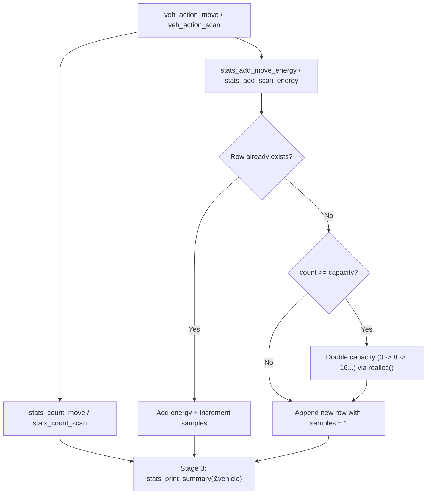

# v2 Student Deep-Dive Guide 6: `stats.h` & `stats.c`

> [!NOTE]
> **Updated v2 Guide (`nathan` branch):** Covers every single line of [stats.h](file:///c:/Users/nathanyu/Documents/GitHub/RSE1201_Group_Project/VehExplorer/inc/stats.h) (lines 1–38) and refactored [stats.c](file:///c:/Users/nathanyu/Documents/GitHub/RSE1201_Group_Project/VehExplorer/src/stats.c) (lines 1–315), including `if-else` capacity doubling, `sizeof(*grown)`, `sizeof(counts) / sizeof(counts[0])`, and current variable names (`move_scan_counts`, `terrain_energy_rows`, `scan_energy_rows`). Every C term is re-explained inline right inside each section.

---

## 1. Big-Picture Role of `stats`

`stats` acts as the **flight recorder** for the entire exploration mission:
1. **Command Counters (`move_scan_counts`):** Counts how many moves and scans were *attempted* vs *succeeded* (used live by `'z'`, checked by auto-pilot action caps, and printed in Stage 3).
2. **Per-Terrain Move Energy Table (`terrain_energy_rows`):** Dynamically records how much battery and shield energy each terrain symbol (`'.'`, `'h'`, `'s'`, `'w'`, `'?'`, etc.) consumed across successful moves.
3. **Per-Direction/Radius Scan Energy Table (`scan_energy_rows`):** Dynamically records scan energy grouped by `(direction, radius)`.
4. **Stage 3 Exploration Report (`stats_print_summary`):** Prints the complete formatted summary before program exit.



---

## 2. Header Walkthrough: `stats.h` (Lines 1–38)

### Full Header ([stats.h](file:///c:/Users/nathanyu/Documents/GitHub/RSE1201_Group_Project/VehExplorer/inc/stats.h#L1-L38))

```c
#ifndef STATS_H
#define STATS_H

#include "SatComRelay.h"
#include "mission_control.h"

#include <stdbool.h>

/* Running totals of move and scan commands attempted vs succeeded. */
typedef struct {
    unsigned long moves_issued;
    unsigned long moves_succeeded;
    unsigned long scans_issued;
    unsigned long scans_succeeded;
} StatsCounters;

void stats_reset(void);

void stats_count_move(bool success);
void stats_count_scan(bool success);

/* Record energy and shield deltas from a successful move onto terrain. */
void stats_add_move_energy(char terrain,
                           long move_energy,
                           long shield_energy);

/* Record energy and shield deltas from a scan attempt at (dir, radius). */
void stats_add_scan_energy(MissionControlScanDir dir,
                           int radius,
                           long scan_energy,
                           long shield_energy);

StatsCounters stats_get(void);

/* Stage 3 summary: final vehicle reserves, terrain counts, and energy tables. */
void stats_print_summary(const VehDataType *vehicle);

#endif /* STATS_H */
```

#### Every Term Explained Inline
- **`#ifndef STATS_H` / `#define STATS_H` / `#endif`:** Include guard preventing duplicate definitions across compilation units.
- **`typedef struct { ... } StatsCounters;`:** Groups the 4 command counters into one small struct. `unsigned long` is used because counts start at `0` and can never go negative, and [`stats_get(void)`](file:///c:/Users/nathanyu/Documents/GitHub/RSE1201_Group_Project/VehExplorer/inc/stats.h#L33) can return a safe read-only **copy** of `StatsCounters` by value so callers cannot tamper with `stats.c`'s internal counters!
- **`const VehDataType *vehicle`:** Read-only pointer (`const`) to the vehicle's final energy struct for Stage 3 printing.

---

## 3. Source Walkthrough: `stats.c` (Lines 1–315)

### Chunk A: Private Row Structs, Module State & Cleanup ([stats.c](file:///c:/Users/nathanyu/Documents/GitHub/RSE1201_Group_Project/VehExplorer/src/stats.c#L1-L87))

```c
#include "stats.h"

#include "local_map.h"

#include <stdio.h>
#include <stdlib.h>
#include <string.h>

/* One row in the per-terrain movement energy table. */
typedef struct {
    char terrain;
    long move_energy;
    long shield_energy;
    unsigned long samples;
} TerrainEnergyRow;

/* One row in the per-direction/radius scan energy table. */
typedef struct {
    MissionControlScanDir dir;
    int radius;
    long scan_energy;
    long shield_energy;
    unsigned long samples;
} ScanEnergyRow;

/* Module state: command counters and dynamic energy tables. */
static StatsCounters move_scan_counts;
static TerrainEnergyRow *terrain_energy_rows;
static size_t terrain_energy_count;
static size_t terrain_energy_capacity;
static ScanEnergyRow *scan_energy_rows;
static size_t scan_energy_count;
static size_t scan_energy_capacity;

/* Convert a scan direction enum into its short compass label. */
static const char *scan_direction_name(MissionControlScanDir dir)
{
    static const char *names[MISSION_CONTROL_DIR_COUNT] = {
        "NW", "N", "NE", "W", "E", "SW", "S", "SE",
    };

    if (dir < 0 || dir >= MISSION_CONTROL_DIR_COUNT) {
        return "?";
    }
    return names[dir];
}

/* Free both dynamically allocated energy tables and reset their sizes. */
static void free_energy_tables(void)
{
    free(terrain_energy_rows);
    free(scan_energy_rows);
    terrain_energy_rows = NULL;
    scan_energy_rows = NULL;
    terrain_energy_count = 0;
    terrain_energy_capacity = 0;
    scan_energy_count = 0;
    scan_energy_capacity = 0;
}

/* Clear all counters and energy tables at session start. */
void stats_reset(void)
{
    free_energy_tables();
    move_scan_counts.moves_issued = 0;
    move_scan_counts.moves_succeeded = 0;
    move_scan_counts.scans_issued = 0;
    move_scan_counts.scans_succeeded = 0;
}

/* Increment move counters after a move attempt. */
void stats_count_move(bool success)
{
    move_scan_counts.moves_issued++;
    if (success) {
        move_scan_counts.moves_succeeded++;
    }
}

/* Increment scan counters after a scan attempt. */
void stats_count_scan(bool success)
{
    move_scan_counts.scans_issued++;
    if (success) {
        move_scan_counts.scans_succeeded++;
    }
}
```

#### Every Term Explained Inline
- **`#include <stdlib.h>`:** Standard library header providing heap memory functions `realloc(...)` and `free(...)`.
- **`TerrainEnergyRow` & `ScanEnergyRow`:** Private struct types defined inside `stats.c` (not exposed in `stats.h` because nobody outside `stats.c` needs to know how rows are stored).
- **File-scope `static` variables (`move_scan_counts`, `terrain_energy_rows`, etc.):**
  - `static` outside any function means two things: (1) **private** to `stats.c`, and (2) **automatically zero-initialized** at program startup (`0` for numbers, `NULL` for pointers)!
  - **`count` vs `capacity` (`size_t`):** Standard dynamic-array pair! `terrain_energy_capacity` is how many slots are currently allocated on the heap; `terrain_energy_count` is how many of those slots actually contain rows right now (`count <= capacity`).
- **`free(terrain_energy_rows);` + `= NULL;`:** Releases heap memory back to the OS (`free(NULL)` is defined by the C standard to safely do nothing!) and resets the pointer to `NULL` so we never keep a dangling pointer.

---

### Chunk B: Dynamic Table Growth (`stats_add_move_energy` & `stats_add_scan_energy`) ([stats.c](file:///c:/Users/nathanyu/Documents/GitHub/RSE1201_Group_Project/VehExplorer/src/stats.c#L89-L196))

```c
/* Add observed movement energy cost to the matching terrain row (or append one). */
void stats_add_move_energy(char terrain, long move_energy, long shield_energy)
{
    size_t i;
    TerrainEnergyRow *row;

    if (terrain == '\0') {
        terrain = LOCAL_MAP_TERRAIN_UNKNOWN;
    }

    /* Update existing row if we have already stepped on this terrain symbol */
    for (i = 0; i < terrain_energy_count; i++) {
        if (terrain_energy_rows[i].terrain == terrain) {
            terrain_energy_rows[i].move_energy += move_energy;
            terrain_energy_rows[i].shield_energy += shield_energy;
            terrain_energy_rows[i].samples++;
            return;
        }
    }

    /* Grow table capacity when full */
    if (terrain_energy_count >= terrain_energy_capacity) {
        size_t new_cap;
        TerrainEnergyRow *grown;

        if (terrain_energy_capacity == 0) {
            new_cap = 8;
        } else {
            new_cap = terrain_energy_capacity * 2;
        }

        grown = realloc(terrain_energy_rows, new_cap * sizeof(*grown));
        if (grown == NULL) {
            fprintf(stderr, "stats: out of memory\n");
            return;
        }
        terrain_energy_rows = grown;
        terrain_energy_capacity = new_cap;
    }

    /* Append a new row for this newly seen terrain symbol */
    row = &terrain_energy_rows[terrain_energy_count++];
    row->terrain = terrain;
    row->move_energy = move_energy;
    row->shield_energy = shield_energy;
    row->samples = 1;
}
```
*(Lines 138–190 `stats_add_scan_energy` use the exact same pattern keyed by `(dir, radius)`, and lines 193–196 `stats_get` return `move_scan_counts` by value.)*

#### Every Term Explained Inline
- **Linear Search (`for (i = 0; i < terrain_energy_count; i++)`):** Checks if we already have a row for `terrain`. If found, `+=` adds the new energy delta and `samples++` increments the visit count, returning immediately.
- **Capacity Doubling (`0` → `8` → `16` → `32`):** When `count >= capacity`, we start at `8` rows and double whenever full so `realloc` is almost never called.
- **`grown = realloc(terrain_energy_rows, new_cap * sizeof(*grown));`:**
  - `realloc(ptr, bytes)`: Resizes an existing heap block (preserving all existing rows!)—and when `ptr` is `NULL` on the very first call, `realloc(NULL, bytes)` behaves identically to `malloc(bytes)`!
  - `sizeof(*grown)`: Gives the exact byte size of one `TerrainEnergyRow` struct (`ScanEnergyRow` in `stats_add_scan_energy`).
  - **Why assign to temporary pointer `grown` first?** If `realloc` fails out of memory, it returns `NULL` **without freeing the original `terrain_energy_rows` block**! Writing `terrain_energy_rows = realloc(...)` directly would overwrite our original pointer with `NULL` and leak memory; checking `if (grown == NULL)` first is safe C practice.
- **`row = &terrain_energy_rows[terrain_energy_count++];`:**
  - `terrain_energy_count++` (**post-increment**): Uses the current `count` as the index of the new slot *first*, and then adds `1` to `terrain_energy_count`!
  - `&` (**address-of**): Takes a pointer `row` to that newly claimed slot so `row->terrain = ...` (`->` arrow operator) fills its 4 fields cleanly.

---

### Chunk C: Formatted Tables & Stage 3 `stats_print_summary` ([stats.c](file:///c:/Users/nathanyu/Documents/GitHub/RSE1201_Group_Project/VehExplorer/src/stats.c#L198-L315))

```c
/* Print how many cells of each terrain symbol were scanned and explored. */
static void print_terrain_counts(void)
{
    LocalMapTerrainCount counts[64];
    unsigned max_entries = (unsigned)(sizeof(counts) / sizeof(counts[0]));
    unsigned n;
    unsigned i;

    printf("\n[ Terrain Types Scanned / Explored ]\n");
    n = local_map_terrain_counts(counts, max_entries);
    if (n == 0) {
        printf("(none recorded)\n");
        return;
    }

    printf("%-8s %10s %10s\n", "Terrain", "Scanned", "Explored");
    for (i = 0; i < n; i++) {
        printf("  '%c'    %10u %10u\n",
               counts[i].terrain,
               counts[i].scanned,
               counts[i].explored);
    }
}
```
*(Followed by `print_move_energy_by_terrain` at L234–256, `print_scan_energy` at L259–283, and `stats_print_summary` at L286–315.)*

#### Every Term Explained Inline
- **`sizeof(counts) / sizeof(counts[0])` (Classic Lecture 4 Array-Length Idiom!):** Total bytes of the `counts[64]` array divided by the byte size of 1 element (`counts[0]`) = **`64`**! If anyone ever changes `counts[64]` to `counts[128]`, `max_entries` updates automatically.
- **`printf` Column Alignment Flags (Lecture 2.2!):**
  - **`%-8s`:** `-` means **left-align** the string inside an 8-character-wide column (`"Terrain "`).
  - **`%10s`, `%10u`, `%12ld`, `%8lu`:** Positive width without `-` means **right-align** strings (`%s`), `unsigned int` (`%u`), `long` (`%ld`), and `unsigned long` (`%lu`) so numbers line up neatly down the right edge!
- **`stats_print_summary(const VehDataType *vehicle)` (L286–315):** Prints the `-- Exploration Report --` banner, total successful scans and steps, `[ Energy Report ]` (guarded by `if (vehicle != NULL)`), `[ Command Counters ]`, and all three breakdown tables.

---

## 4. Ready-to-Use Presentation Script & Likely Teacher Q&A

### 45-Second Walkthrough Script
> "`stats.c` records all mission metrics and prints the Stage 3 Exploration Report. It tracks four command counters in `move_scan_counts`—moves and scans issued versus succeeded—plus two dynamically resized heap arrays, `terrain_energy_rows` and `scan_energy_rows`, that accumulate observed battery and shield costs per terrain symbol and per `(direction, radius)` pair. When a new terrain symbol or scan setting appears and the array is full, we double capacity starting from `8` using `realloc` via a temporary pointer `grown`. At Stage 3, `stats_print_summary` combines final `VehDataType` reserves, command counters, `local_map_terrain_counts`, and our two energy tables using aligned `printf` width specifiers."

### Likely Questions From Your Lecturer
1. **Q: Why use `grown = realloc(...)` instead of `terrain_energy_rows = realloc(...)`?**
   - **A:** If `realloc` fails and returns `NULL`, the old memory block is *not* freed. Assigning directly to `terrain_energy_rows` would lose the pointer to the old data and cause a memory leak. Checking `grown == NULL` first keeps existing data intact.
2. **Q: What does `%-8s` vs `%12ld` do in `printf`?**
   - **A:** `%12ld` right-aligns a `long` integer in a 12-character field, while the `-` flag in `%-8s` left-aligns a text label in an 8-character field so table columns stay lined up.
