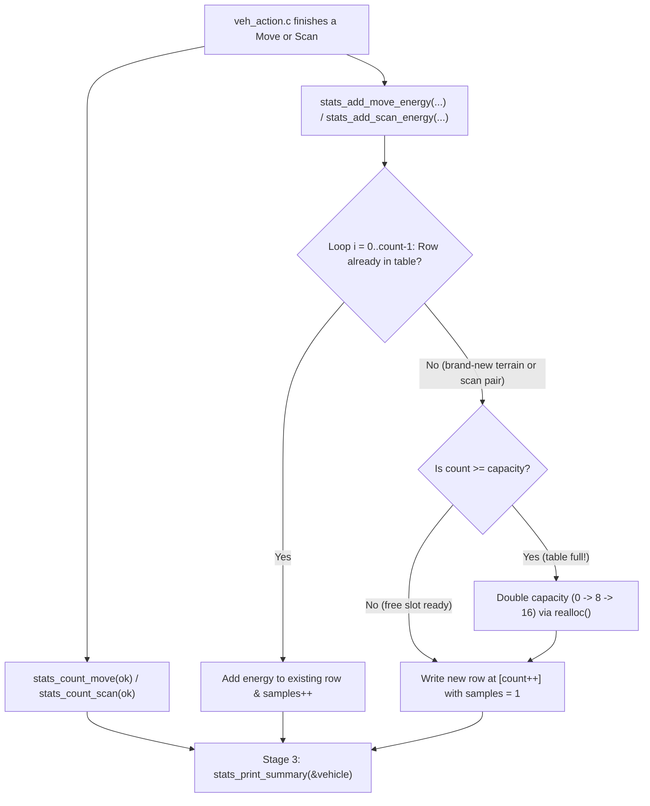

# v2 Student Deep-Dive Guide 6: `stats.h` & `stats.c`

> [!NOTE]
> **Beginner-Friendly Visual Edition (`nathan` branch):** Covers every single line (zero lines skipped!) of [stats.h](file:///c:/Users/nathanyu/Documents/GitHub/RSE1201_Group_Project/VehExplorer/inc/stats.h) (lines 1–38) and [stats.c](file:///c:/Users/nathanyu/Documents/GitHub/RSE1201_Group_Project/VehExplorer/src/stats.c) (lines 1–315), with **visual heap-array growth diagrams (`count` vs `capacity`)**, **`realloc` safety visuals**, and a **character-box ruler for `printf` column alignment**. Every C term is re-explained inline right inside each section.

---

## 1. Mental Imagery: The Mission Flight Recorder (`stats`)

Think of `stats.c` as an airplane's **black-box flight recorder**. Every time `veh_action.c` moves or scans, `stats.c` quietly updates three things in memory so it can print the full **Stage 3 Exploration Report** at the end:

1. **4 Simple Counters (`move_scan_counts`):** Moves issued vs succeeded, and scans issued vs succeeded.
2. **Dynamic Move-Energy Table (`terrain_energy_rows`):** One row per terrain character (`'.'`, `'h'`, `'s'`, `'w'`, `'?'`, ...) summing total battery and shield energy spent stepping onto that terrain.
3. **Dynamic Scan-Energy Table (`scan_energy_rows`):** One row per `(direction, radius)` pair summing radar energy spent scanning.



---

## 2. Visual Mental Model: How `count`, `capacity` & `realloc` Grow a Heap Array!

Why didn't we just hardcode `TerrainEnergyRow rows[5];`? Because different scenario files can invent any ASCII terrain characters! Using a **resizable heap array** means it starts at `0` bytes and grows automatically whenever needed:

```text
1) At Startup (after stats_reset):
   terrain_energy_rows = NULL     count = 0,  capacity = 0

2) First move onto '.' (count 0 >= capacity 0 --> realloc allocates 8 slots!):
   Index:    [0]    [1]    [2]    [3]    [4]    [5]    [6]    [7]
          +------+------+------+------+------+------+------+------+
   Heap:  | '.'  | free | free | free | free | free | free | free |
          +------+------+------+------+------+------+------+------+
           count = 1 (1 slot used)          capacity = 8 (8 slots allocated!)

3) Next 7 new terrains ('h','s','w','f','j','g','E') fill slots [1]..[7] WITHOUT realloc!
           count = 8,  capacity = 8  (Now full!)

4) 9th new terrain 'M' arrives (count 8 >= capacity 8 --> realloc DOUBLES to 16 slots!):
   realloc copies slots [0..7] into a 16-slot block and appends 'M' at [8]!
```

### Why Do Lines 120–125 Use Temporary Pointer `grown = realloc(...)`?
```text
DANGEROUS WAY:  terrain_energy_rows = realloc(terrain_energy_rows, ...);
  If RAM is full, realloc returns NULL — AND leaves the old 8 rows sitting in RAM!
  Overwriting terrain_energy_rows with NULL loses the address of the old 8 rows forever!

SAFE WAY (Used in stats.c):
  grown = realloc(terrain_energy_rows, new_cap * sizeof(*grown));
  if (grown == NULL) { return; }   // Old terrain_energy_rows pointer is STILL SAFE!
  terrain_energy_rows = grown;     // Only update pointer after realloc succeeded!
```

---

## 3. Header Walkthrough: `stats.h` (Lines 1–38)

### Full Header ([stats.h](file:///c:/Users/nathanyu/Documents/GitHub/RSE1201_Group_Project/VehExplorer/inc/stats.h#L1-L38))

```c
#ifndef STATS_H
#define STATS_H

#include "SatComRelay.h"
#include "mission_control.h"

#include <stdbool.h>

/* Running totals of move and scan commands attempted vs succeeded. */
typedef struct {
    unsigned long moves_issued;
    unsigned long moves_succeeded;
    unsigned long scans_issued;
    unsigned long scans_succeeded;
} StatsCounters;

void stats_reset(void);

void stats_count_move(bool success);
void stats_count_scan(bool success);

/* Record energy and shield deltas from a successful move onto terrain. */
void stats_add_move_energy(char terrain,
                           long move_energy,
                           long shield_energy);

/* Record energy and shield deltas from a scan attempt at (dir, radius). */
void stats_add_scan_energy(MissionControlScanDir dir,
                           int radius,
                           long scan_energy,
                           long shield_energy);

StatsCounters stats_get(void);

/* Stage 3 summary: final vehicle reserves, terrain counts, and energy tables. */
void stats_print_summary(const VehDataType *vehicle);

#endif /* STATS_H */
```

#### Every Term Explained Inline
- **`#ifndef STATS_H` / `#define STATS_H` / `#endif`:** Include guard preventing duplicate struct/function definitions.
- **`unsigned long` inside `StatsCounters`:** Whole numbers `>= 0` (formatted with `%lu`). Because `stats_get(void)` returns `StatsCounters` **by value** (a safe copy), `ui_cli.c` and `autopilot.c` can read the counters anytime without being able to overwrite `stats.c`'s private master copy!
- **`const VehDataType *vehicle`:** Read-only pointer (`const`) to `main()`'s vehicle struct for printing the final `[ Energy Report ]`.

---

## 4. Source Walkthrough: `stats.c` (Lines 1–315, Complete!)

### Chunk A: Private Structs, Module State & Counter Helpers ([stats.c](file:///c:/Users/nathanyu/Documents/GitHub/RSE1201_Group_Project/VehExplorer/src/stats.c#L1-L87))

```c
#include "stats.h"

#include "local_map.h"

#include <stdio.h>
#include <stdlib.h>
#include <string.h>

/* One row in the per-terrain movement energy table. */
typedef struct {
    char terrain;
    long move_energy;
    long shield_energy;
    unsigned long samples;
} TerrainEnergyRow;

/* One row in the per-direction/radius scan energy table. */
typedef struct {
    MissionControlScanDir dir;
    int radius;
    long scan_energy;
    long shield_energy;
    unsigned long samples;
} ScanEnergyRow;

/* Module state: command counters and dynamic energy tables. */
static StatsCounters move_scan_counts;
static TerrainEnergyRow *terrain_energy_rows;
static size_t terrain_energy_count;
static size_t terrain_energy_capacity;
static ScanEnergyRow *scan_energy_rows;
static size_t scan_energy_count;
static size_t scan_energy_capacity;

/* Convert a scan direction enum into its short compass label. */
static const char *scan_direction_name(MissionControlScanDir dir)
{
    static const char *names[MISSION_CONTROL_DIR_COUNT] = {
        "NW", "N", "NE", "W", "E", "SW", "S", "SE",
    };

    if (dir < 0 || dir >= MISSION_CONTROL_DIR_COUNT) {
        return "?";
    }
    return names[dir];
}

/* Free both dynamically allocated energy tables and reset their sizes. */
static void free_energy_tables(void)
{
    free(terrain_energy_rows);
    free(scan_energy_rows);
    terrain_energy_rows = NULL;
    scan_energy_rows = NULL;
    terrain_energy_count = 0;
    terrain_energy_capacity = 0;
    scan_energy_count = 0;
    scan_energy_capacity = 0;
}

/* Clear all counters and energy tables at session start. */
void stats_reset(void)
{
    free_energy_tables();
    move_scan_counts.moves_issued = 0;
    move_scan_counts.moves_succeeded = 0;
    move_scan_counts.scans_issued = 0;
    move_scan_counts.scans_succeeded = 0;
}

/* Increment move counters after a move attempt. */
void stats_count_move(bool success)
{
    move_scan_counts.moves_issued++;
    if (success) {
        move_scan_counts.moves_succeeded++;
    }
}

/* Increment scan counters after a scan attempt. */
void stats_count_scan(bool success)
{
    move_scan_counts.scans_issued++;
    if (success) {
        move_scan_counts.scans_succeeded++;
    }
}
```

#### Every Term Explained Inline
- **`#include <stdlib.h>`:** Provides heap memory functions `realloc` and `free`.
- **Why `TerrainEnergyRow` and `ScanEnergyRow` are in `stats.c` instead of `stats.h`:** Information hiding! Only `stats.c` touches these rows, so keeping them inside `stats.c` keeps `stats.h` clean.
- **File-scope `static` variables (Lines 27–33):** `static` outside a function makes all 7 variables **private to `stats.c`** AND **zero-initialized automatically** (`0` and `NULL`) when the program starts!
- **`free(ptr)` + `ptr = NULL`:** `free` returns heap memory to the OS (`free(NULL)` safely does nothing!). Setting the pointer back to `NULL` right away prevents ever reusing a freed ("dangling") address.

---

### Chunk B: Adding Move & Scan Energy (`stats_add_move_energy`, `stats_add_scan_energy`, `stats_get`) ([stats.c](file:///c:/Users/nathanyu/Documents/GitHub/RSE1201_Group_Project/VehExplorer/src/stats.c#L89-L196))

```c
/* Add observed movement energy cost to the matching terrain row (or append one). */
void stats_add_move_energy(char terrain, long move_energy, long shield_energy)
{
    size_t i;
    TerrainEnergyRow *row;

    if (terrain == '\0') {
        terrain = LOCAL_MAP_TERRAIN_UNKNOWN;
    }

    /* Update existing row if we have already stepped on this terrain symbol */
    for (i = 0; i < terrain_energy_count; i++) {
        if (terrain_energy_rows[i].terrain == terrain) {
            terrain_energy_rows[i].move_energy += move_energy;
            terrain_energy_rows[i].shield_energy += shield_energy;
            terrain_energy_rows[i].samples++;
            return;
        }
    }

    /* Grow table capacity when full */
    if (terrain_energy_count >= terrain_energy_capacity) {
        size_t new_cap;
        TerrainEnergyRow *grown;

        if (terrain_energy_capacity == 0) {
            new_cap = 8;
        } else {
            new_cap = terrain_energy_capacity * 2;
        }

        grown = realloc(terrain_energy_rows, new_cap * sizeof(*grown));
        if (grown == NULL) {
            fprintf(stderr, "stats: out of memory\n");
            return;
        }
        terrain_energy_rows = grown;
        terrain_energy_capacity = new_cap;
    }

    /* Append a new row for this newly seen terrain symbol */
    row = &terrain_energy_rows[terrain_energy_count++];
    row->terrain = terrain;
    row->move_energy = move_energy;
    row->shield_energy = shield_energy;
    row->samples = 1;
}

/* Add observed scan energy cost to the matching (dir, radius) row (or append one). */
void stats_add_scan_energy(MissionControlScanDir dir,
                           int radius,
                           long scan_energy,
                           long shield_energy)
{
    size_t i;
    ScanEnergyRow *row;

    if (dir < 0 || dir >= MISSION_CONTROL_DIR_COUNT) {
        return;
    }
    if (radius != 1 && radius != 2) {
        return;
    }

    /* Update existing row if this (dir, radius) pair was already recorded */
    for (i = 0; i < scan_energy_count; i++) {
        if (scan_energy_rows[i].dir == dir && scan_energy_rows[i].radius == radius) {
            scan_energy_rows[i].scan_energy += scan_energy;
            scan_energy_rows[i].shield_energy += shield_energy;
            scan_energy_rows[i].samples++;
            return;
        }
    }

    /* Grow table capacity when full */
    if (scan_energy_count >= scan_energy_capacity) {
        size_t new_cap;
        ScanEnergyRow *grown;

        if (scan_energy_capacity == 0) {
            new_cap = 8;
        } else {
            new_cap = scan_energy_capacity * 2;
        }

        grown = realloc(scan_energy_rows, new_cap * sizeof(*grown));
        if (grown == NULL) {
            fprintf(stderr, "stats: out of memory\n");
            return;
        }
        scan_energy_rows = grown;
        scan_energy_capacity = new_cap;
    }

    /* Append a new row for this (dir, radius) pair */
    row = &scan_energy_rows[scan_energy_count++];
    row->dir = dir;
    row->radius = radius;
    row->scan_energy = scan_energy;
    row->shield_energy = shield_energy;
    row->samples = 1;
}

/* Return a copy of the current move/scan counters. */
StatsCounters stats_get(void)
{
    return move_scan_counts;
}
```

#### Every Term Explained Inline
- **`+=` (compound addition):** `a += b` adds `b` into `a` (`a = a + b`).
- **`sizeof(*grown)`:** Computes the byte size of **one struct element** (`TerrainEnergyRow` or `ScanEnergyRow`), multiplied by `new_cap` to get total bytes for `realloc`.
- **`row = &terrain_energy_rows[terrain_energy_count++];`:**
  1. `terrain_energy_count++` (**post-increment**): Evaluates to the *old* `count` index first (say `0`), and then bumps `terrain_energy_count` to `1`!
  2. `&` (**address-of**): Points `row` at slot `[0]` so `row->terrain = ...` (`->` arrow operator) fills the new row cleanly.

---

### Chunk C: Printing Aligned Tables & Stage 3 `stats_print_summary` ([stats.c](file:///c:/Users/nathanyu/Documents/GitHub/RSE1201_Group_Project/VehExplorer/src/stats.c#L198-L315))

```c
/* Print issued vs successful move and scan counts. */
static void print_command_stats(void)
{
    printf("Moves issued : %lu, Successful moves : %lu\n",
           move_scan_counts.moves_issued,
           move_scan_counts.moves_succeeded);
    printf("Scans issued : %lu, Successful scans : %lu\n",
           move_scan_counts.scans_issued,
           move_scan_counts.scans_succeeded);
}

/* Print how many cells of each terrain symbol were scanned and explored. */
static void print_terrain_counts(void)
{
    LocalMapTerrainCount counts[64];
    unsigned max_entries = (unsigned)(sizeof(counts) / sizeof(counts[0]));
    unsigned n;
    unsigned i;

    printf("\n[ Terrain Types Scanned / Explored ]\n");
    n = local_map_terrain_counts(counts, max_entries);
    if (n == 0) {
        printf("(none recorded)\n");
        return;
    }

    printf("%-8s %10s %10s\n", "Terrain", "Scanned", "Explored");
    for (i = 0; i < n; i++) {
        printf("  '%c'    %10u %10u\n",
               counts[i].terrain,
               counts[i].scanned,
               counts[i].explored);
    }
}

/* Print observed movement and shield energy totals grouped by terrain. */
static void print_move_energy_by_terrain(void)
{
    size_t i;

    printf("\n[ Move / Shield Energy by Destination Terrain ]\n");
    if (terrain_energy_count == 0) {
        printf("(none recorded — need successful moves)\n");
        return;
    }

    printf("%-8s %12s %12s %8s\n",
           "Terrain",
           "MoveEnrg",
           "ShldEnrg",
           "Samples");
    for (i = 0; i < terrain_energy_count; i++) {
        printf("  '%c'    %12ld %12ld %8lu\n",
               terrain_energy_rows[i].terrain,
               terrain_energy_rows[i].move_energy,
               terrain_energy_rows[i].shield_energy,
               terrain_energy_rows[i].samples);
    }
}

/* Print observed scan and shield energy totals grouped by direction and radius. */
static void print_scan_energy(void)
{
    size_t i;

    printf("\n[ Scan Energy by Direction / Radius ]\n");
    if (scan_energy_count == 0) {
        printf("(none recorded — need scans that consumed energy)\n");
        return;
    }

    printf("%-4s %6s %12s %12s %8s\n",
           "Dir",
           "Radius",
           "ScanEnrg",
           "ShldEnrg",
           "Samples");
    for (i = 0; i < scan_energy_count; i++) {
        printf("%-4s %6d %12ld %12ld %8lu\n",
               scan_direction_name(scan_energy_rows[i].dir),
               scan_energy_rows[i].radius,
               scan_energy_rows[i].scan_energy,
               scan_energy_rows[i].shield_energy,
               scan_energy_rows[i].samples);
    }
}

/* Print the full Stage 3 Exploration Report at the end of the session. */
void stats_print_summary(const VehDataType *vehicle)
{
    printf("\n");
    printf("-------------------------------------\n");
    printf("-- Exploration Report --\n");
    printf("-------------------------------------\n");

    printf("\nTotal no. of scans taken : %lu\n", move_scan_counts.scans_succeeded);
    printf("Total no. of movements (steps) taken : %lu\n", move_scan_counts.moves_succeeded);

    if (vehicle != NULL) {
        printf("\n[ Energy Report ]\n");
        printf("Initial Energy : %ld\n", vehicle->initialEnergy);
        printf("Total Energy Used : %ld\n", vehicle->totEnergyUsed);
        printf("Total Shield Energy Used : %ld\n", vehicle->totShieldEnergyUsed);
        printf("Energy Left : %ld\n", vehicle->currEnergy);
        printf("Shield Energy Left : %ld\n", vehicle->currShieldEnergy);
    }

    printf("\n[ Command Counters ]\n");
    print_command_stats();

    print_terrain_counts();
    print_move_energy_by_terrain();
    print_scan_energy();

    printf("\n-------------------------------------\n");
    printf("-- End of Exploration Report --\n");
    printf("-------------------------------------\n");
}
```

#### Visual Character Ruler: How `printf("%-8s %12ld %8lu")` Lines Columns Up!
```text
Format:   %-8s      (space) %12s          (space) %8s
Header:  |T|e|r|r|a|i|n| | | | | | |M|o|v|e|E|n|r|g| | |S|a|m|p|l|e|s|
Row 1:   | | |'|h|'| | | | | | | | | | | | |1|7|8|8| | | | | | | | |3|
          ^--------------^   ^----------------------^   ^--------------^
          8 chars LEFT (-)     12 chars RIGHT             8 chars RIGHT
```

#### Every Term Explained Inline
- **`sizeof(counts) / sizeof(counts[0])` (Line 213):** Classic Lecture 4 formula! Total byte size of the 64-element array divided by the byte size of element `0` = **`64`**.
- **`%-8s` vs `%12ld` vs `%10u` vs `%8lu`:**
  - Minus sign `-` (`%-8s`, `%-4s`) **left-justifies** text labels.
  - Positive numbers without `-` (`%12ld`, `%10u`, `%8lu`) **right-justify** `long`, `unsigned int`, and `unsigned long` numbers so ones/tens/hundreds digits stack neatly!

---

## 5. Ready-to-Use Presentation Script & Likely Teacher Q&A

### 45-Second Walkthrough Script
> "`stats.c` tracks all mission statistics and prints the Stage 3 Exploration Report. It keeps four command counters in `move_scan_counts` plus two dynamically resized heap arrays—`terrain_energy_rows` keyed by terrain character and `scan_energy_rows` keyed by `(direction, radius)`. Whenever a new terrain symbol or scan setting is recorded and `count == capacity`, we double capacity starting at `8` via `realloc` through a temporary pointer `grown`. At program exit, `stats_print_summary` prints total scans and steps, final `VehDataType` reserves, command counters, `local_map` terrain tallies, and both energy tables formatted with `printf` width specifiers."

### Likely Questions From Your Lecturer
1. **Q: Why does `realloc(NULL, new_cap * sizeof(*grown))` work on the very first allocation when `terrain_energy_rows` is still `NULL`?**
   - **A:** By C standard definition, calling `realloc(NULL, size)` behaves identically to `malloc(size)`, so one single `realloc` code path handles both the initial allocation of `8` rows and future doublings to `16`, `32`, etc.
2. **Q: Why does `stats_get()` return `StatsCounters` by value instead of returning a pointer `&move_scan_counts`?**
   - **A:** Returning a struct copy by value keeps `move_scan_counts` encapsulated—callers can inspect the counts freely without any risk of accidentally modifying them.
