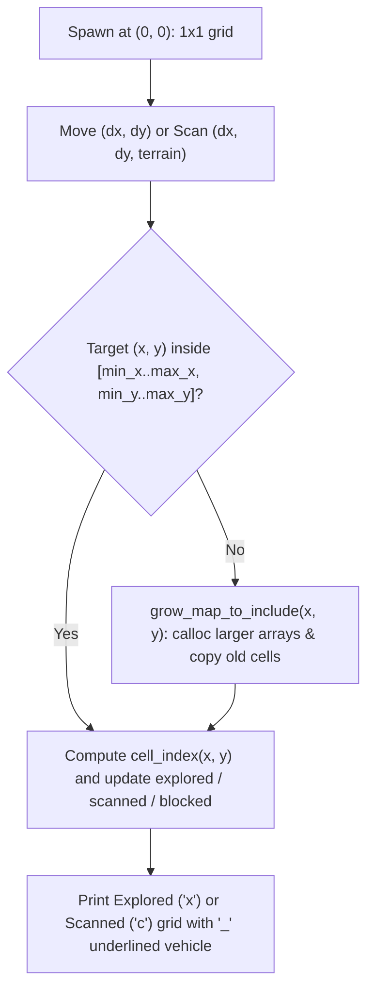

# v2 Student Deep-Dive Guide 7: `local_map.h` & `local_map.c`

> [!NOTE]
> **Updated v2 Guide (`nathan` branch):** Covers every single line of [local_map.h](file:///c:/Users/nathanyu/Documents/GitHub/RSE1201_Group_Project/VehExplorer/inc/local_map.h) (lines 1–53) and refactored [local_map.c](file:///c:/Users/nathanyu/Documents/GitHub/RSE1201_Group_Project/VehExplorer/src/local_map.c) (lines 1–614), with all ternaries expanded into `if / else` and current symbol names (`local_map`, `cell_index`, `grow_map_to_include`, `character_to_print`). Every C term is re-explained inline right inside each section.

---

## 1. Big-Picture Idea: How Do We Map an Unknown Arena Without Knowing Spawn?

When `SCRelay_Signal_Veh_Init` spawns our vehicle (especially with `randomizeStartPosition = true`), **`libsatcom.so` never tells us our absolute `(row, col)` or the size of the map!**

`local_map` solves this elegantly using **Vehicle-Relative Coordinates**:
- Wherever the vehicle spawns is defined as **`(0, 0)`**.
- Moving **West** makes `x` negative (`-1, -2, ...`); moving **East** makes `x` positive (`+1, +2, ...`).
- Moving **North** makes `y` negative (`-1, -2, ...`); moving **South** makes `y` positive (`+1, +2, ...`).
- Whenever a move or scan reaches outside the current rectangle `[min_x..max_x] × [min_y..max_y]`, [`grow_map_to_include`](file:///c:/Users/nathanyu/Documents/GitHub/RSE1201_Group_Project/VehExplorer/src/local_map.c#L57-L153) allocates a slightly bigger rectangle with `calloc` and copies existing cells across!



---

## 2. Header Walkthrough: `local_map.h` (Lines 1–53)

### Full Header ([local_map.h](file:///c:/Users/nathanyu/Documents/GitHub/RSE1201_Group_Project/VehExplorer/inc/local_map.h#L1-L53))

```c
#ifndef LOCAL_MAP_H
#define LOCAL_MAP_H

#include <stdbool.h>

/* Relative map grown from successful moves and scans.
 * Spawn starts at (0, 0); North decreases y and East increases x. */

#define LOCAL_MAP_TERRAIN_UNKNOWN '?'

typedef struct {
    char terrain;
    unsigned scanned;
    unsigned explored;
} LocalMapTerrainCount;

void local_map_init(void);
void local_map_reset(void);

int local_map_get_x(void);
int local_map_get_y(void);

/* Mark current cell explored (for example, at spawn). */
void local_map_mark_explored_here(void);

/* Step vehicle position by (dx, dy) and mark the destination explored. */
void local_map_move_success(int dx, int dy);

/* Store scanned terrain symbol at offset (dx, dy) from the vehicle. */
void local_map_record_scan(int dx, int dy, char terrain);

/* Return known terrain at (x, y) or offset (dx, dy), or '?'. */
char local_map_peek_terrain(int x, int y);
char local_map_peek_terrain_at_offset(int dx, int dy);

bool local_map_is_explored(int x, int y);
bool local_map_is_blocked(int x, int y);
void local_map_mark_blocked(int x, int y);
void local_map_mark_blocked_at_offset(int dx, int dy);

void local_map_get_bounds(int *min_x, int *max_x, int *min_y, int *max_y);
bool local_map_has_grid(void);

unsigned local_map_count_scanned(char terrain);

/* Fill out[] with scanned and explored counts per discovered terrain symbol. */
unsigned local_map_terrain_counts(LocalMapTerrainCount *out, unsigned capacity);

/* Print the explored ('x') or scanned ('c') map view. */
void local_map_print_explored(void);
void local_map_print_scanned(void);

#endif /* LOCAL_MAP_H */
```

#### Every Term Explained Inline
- **`#define LOCAL_MAP_TERRAIN_UNKNOWN '?'`:** Character returned when asking for terrain at a cell that has **not** been scanned yet.
- **`LocalMapTerrainCount`:** Struct used by Stage 3 (`stats.c`) to report how many cells of each terrain character were `scanned` vs physically stepped on (`explored`). Note `unsigned` is shorthand in C for `unsigned int`.
- **Two Coordinate Flavours in the API:**
  - **Absolute relative coordinates `(x, y)`** (relative to spawn `(0, 0)`): `local_map_peek_terrain(x, y)`, `local_map_is_explored(x, y)`, `local_map_is_blocked(x, y)` — used heavily by auto-pilot BFS!
  - **Vehicle-offset coordinates `(dx, dy)`** (relative to where the vehicle stands *right now*): `local_map_peek_terrain_at_offset(dx, dy)`, `local_map_record_scan(dx, dy, terrain)`, `local_map_mark_blocked_at_offset(dx, dy)` — used by `veh_action.c`!

---

## 3. Source Walkthrough: `local_map.c` (Lines 1–614)

### Chunk A: Constants, `LocalMap` Struct & Index Math ([local_map.c](file:///c:/Users/nathanyu/Documents/GitHub/RSE1201_Group_Project/VehExplorer/src/local_map.c#L1-L55))

```c
#include "local_map.h"

#include <stdio.h>
#include <stdlib.h>
#include <string.h>
#include <unistd.h>

#define LOCAL_MAP_NOT_SCANNED '\0'
#define LOCAL_MAP_VISITED_MARK '.'
#define LOCAL_MAP_VEHICLE_MARK '_'
#define LOCAL_MAP_CELL_WIDTH 3

/* Stores current vehicle coordinates, bounding box, and three cell layers. */
typedef struct {
    int x;
    int y;
    int min_x;
    int max_x;
    int min_y;
    int max_y;
    int width;
    int height;
    bool *explored;
    char *scanned;
    bool *blocked;
} LocalMap;

static LocalMap local_map;

/* Free the three heap arrays and clear grid dimensions. */
static void free_map_arrays(void)
{
    free(local_map.explored);
    free(local_map.scanned);
    free(local_map.blocked);
    local_map.explored = NULL;
    local_map.scanned = NULL;
    local_map.blocked = NULL;
    local_map.width = 0;
    local_map.height = 0;
}

/* Convert 2D map coordinates (x, y) into a 1D row-major array index. */
static int cell_index(int x, int y)
{
    return (y - local_map.min_y) * local_map.width + (x - local_map.min_x);
}

/* Check whether (x, y) falls inside the currently allocated rectangle. */
static bool in_bounds(int x, int y)
{
    return x >= local_map.min_x && x <= local_map.max_x &&
           y >= local_map.min_y && y <= local_map.max_y;
}
```

#### Every Term Explained Inline
- **Three Parallel Layers (`explored`, `scanned`, `blocked`):** Why three arrays instead of just one `char` array? Because a single cell `(x, y)` can be **explored without having been scanned** (`explored = true`, `scanned = '\0'`), OR **scanned without having been stepped on** (`explored = false`, `scanned = 'h'`), OR **marked blocked** after a failed scan/move (`blocked = true`)! Keeping 3 parallel arrays makes every state combination clean and bug-free.
- **`static LocalMap local_map;`:** Private file-scope struct holding our entire map state (automatically zero-initialized at startup).
- **The Row-Major Index Formula `cell_index(x, y)` (Key Formula to Know!):**
  $$\text{index} = (y - \text{min\_y}) \times \text{width} + (x - \text{min\_x})$$
  - Why subtract `min_x` and `min_y`? Because `x` and `y` can be **negative** (e.g., `min_x = -3`), whereas C array indices must start at **`0`**! Subtracting `min_x` shifts `min_x` to column `0`, and multiplying `(y - min_y) * width` skips full rows to flatten our 2D grid into a 1D heap array.

---

### Chunk B: `grow_map_to_include` — Dynamic Bounding-Box Expansion ([local_map.c](file:///c:/Users/nathanyu/Documents/GitHub/RSE1201_Group_Project/VehExplorer/src/local_map.c#L56-L153))

```c
/* Expand the map rectangle to include (x, y), copying existing cell values. */
static bool grow_map_to_include(int x, int y)
{
    /* ... local declarations (L59-69) ... */

    /* First cell ever recorded: allocate a 1x1 grid at (x, y) */
    if (local_map.explored == NULL) {
        local_map.min_x = x;
        local_map.max_x = x;
        local_map.min_y = y;
        local_map.max_y = y;
        local_map.width = 1;
        local_map.height = 1;
        local_map.explored = calloc(1, sizeof(*local_map.explored));
        local_map.scanned = calloc(1, sizeof(*local_map.scanned));
        local_map.blocked = calloc(1, sizeof(*local_map.blocked));
        return local_map.explored != NULL && local_map.scanned != NULL &&
               local_map.blocked != NULL;
    }

    /* Nothing to do if (x, y) is already within the current bounds */
    if (in_bounds(x, y)) {
        return true;
    }

    /* Compute expanded rectangle limits (L91-116) */
    if (x < local_map.min_x) {
        new_min_x = x;
    } else {
        new_min_x = local_map.min_x;
    }
    /* ... same if/else for new_max_x, new_min_y, new_max_y ... */
    new_w = new_max_x - new_min_x + 1;
    new_h = new_max_y - new_min_y + 1;

    /* Allocate zero-filled arrays for the expanded grid */
    new_explored = calloc((size_t)(new_w * new_h), sizeof(*new_explored));
    new_scanned = calloc((size_t)(new_w * new_h), sizeof(*new_scanned));
    new_blocked = calloc((size_t)(new_w * new_h), sizeof(*new_blocked));
    if (new_explored == NULL || new_scanned == NULL || new_blocked == NULL) {
        free(new_explored);
        free(new_scanned);
        free(new_blocked);
        return false;
    }

    /* Copy old cells from their old indices to their new indices */
    for (yy = local_map.min_y; yy <= local_map.max_y; yy++) {
        int xx;
        for (xx = local_map.min_x; xx <= local_map.max_x; xx++) {
            int old_i = cell_index(xx, yy);
            int new_i = (yy - new_min_y) * new_w + (xx - new_min_x);
            new_explored[new_i] = local_map.explored[old_i];
            new_scanned[new_i] = local_map.scanned[old_i];
            new_blocked[new_i] = local_map.blocked[old_i];
        }
    }

    /* Replace old arrays and bounds with the expanded ones */
    free_map_arrays();
    local_map.min_x = new_min_x;
    /* ... update max_x, min_y, max_y, width, height, and 3 pointers (L144-152) ... */
    return true;
}
```

#### Every Term Explained Inline
- **`calloc(count, element_size)` vs `malloc`:** `calloc` allocates `count * element_size` bytes on the heap **AND zeroes every single byte**! That guarantees every newly added cell starts with `explored = false`, `scanned = '\0'` (`LOCAL_MAP_NOT_SCANNED`), and `blocked = false` automatically!
- **`new_w = new_max_x - new_min_x + 1`:** Why `+ 1`? Fencepost math! If `min_x = -1` and `max_x = +1`, there are `1 - (-1) + 1 = 3` columns (`-1`, `0`, `+1`).
- **Why can't we just call `realloc` here like `stats.c` did?** Because in a 2D row-major grid, when `new_w` or `new_min_x` changes, **every row shifts to a different index** (`new_i = (yy - new_min_y) * new_w + (xx - new_min_x)`)! Allocating fresh zeroed arrays with `calloc` and copying `(xx, yy)` from `old_i` to `new_i` keeps every existing coordinate aligned properly.

---

### Chunk C: Map Updates, Queries & Stage 3 Terrain Tallies ([local_map.c](file:///c:/Users/nathanyu/Documents/GitHub/RSE1201_Group_Project/VehExplorer/src/local_map.c#L155-L380))

- **Init, Reset & Position (`L155–175`):** `memset(&local_map, 0, sizeof(local_map))` zeroes `(x, y)` back to `(0, 0)` after `free_map_arrays()`. `local_map_get_x()` and `local_map_get_y()` return current coordinates.
- **Updates (`L177–212`):**
  - [`local_map_mark_explored_here`](file:///c:/Users/nathanyu/Documents/GitHub/RSE1201_Group_Project/VehExplorer/src/local_map.c#L177-L184): Grows map if needed and sets `explored[...] = true`.
  - [`local_map_move_success`](file:///c:/Users/nathanyu/Documents/GitHub/RSE1201_Group_Project/VehExplorer/src/local_map.c#L187-L192): Adds `dx, dy` to `local_map.x, local_map.y` and marks the new tile explored.
  - [`local_map_record_scan`](file:///c:/Users/nathanyu/Documents/GitHub/RSE1201_Group_Project/VehExplorer/src/local_map.c#L195-L212): Stores `terrain` at `(x + dx, y + dy)`, and if `terrain == '#'`, immediately sets `blocked[...] = true` so auto-pilot treats walls as impassable!
- **Queries & Bounds (`L215–307`):**
  - [`local_map_peek_terrain`](file:///c:/Users/nathanyu/Documents/GitHub/RSE1201_Group_Project/VehExplorer/src/local_map.c#L215-L228): Safely returns `'?'` if out-of-bounds or unscanned (`'\0'`), otherwise returns the scanned character.
  - [`local_map_get_bounds`](file:///c:/Users/nathanyu/Documents/GitHub/RSE1201_Group_Project/VehExplorer/src/local_map.c#L267-L281): Checks each pointer (`!= NULL`) before dereferencing `*min_x = local_map.min_x;`.
  - [`local_map_count_scanned`](file:///c:/Users/nathanyu/Documents/GitHub/RSE1201_Group_Project/VehExplorer/src/local_map.c#L289-L307): Counts how many cells match `terrain` (e.g., `'E'` end points or `'#'` walls for Mission 2 and Mission 7).
- **Stage 3 Tallies (`add_terrain_count` & `local_map_terrain_counts`, `L310–380`):**
  - Loops across every `(x, y)` in the map. Notice `*used` (`unsigned *used`): because `add_terrain_count` modifies the caller's entry count `used`, we pass `&used` (`&` address-of) and increment `(*used)++` (parentheses required because `++` binds tighter than `*`!). Cells explored *without* ever being scanned are tallied under `'?'` (`LOCAL_MAP_TERRAIN_UNKNOWN`).

---

### Chunk D: ANSI Colours, Tight Cropping & Grid Rendering ([local_map.c](file:///c:/Users/nathanyu/Documents/GitHub/RSE1201_Group_Project/VehExplorer/src/local_map.c#L382-L614))

```c
/* Pick which character to draw at (x, y) for either the explored or scanned map. */
static char character_to_print(int x, int y, bool explored_view)
{
    int i;

    if (local_map.explored == NULL || !in_bounds(x, y)) {
        return ' ';
    }

    i = cell_index(x, y);

    if (explored_view) {
        if (!local_map.explored[i]) {
            return ' ';
        }
        if (local_map.scanned[i] != LOCAL_MAP_NOT_SCANNED) {
            return local_map.scanned[i];
        }
        return LOCAL_MAP_VISITED_MARK;
    }

    if (local_map.scanned[i] != LOCAL_MAP_NOT_SCANNED) {
        return local_map.scanned[i];
    }
    return ' ';
}
```
*(Followed by `terrain_color` L410–434, `stdout_is_terminal` L437–449, `print_green_line` / `print_map_banner` L452–470, `bounds_of_known_cells` L473–529, `print_map_cell` L532–563, `print_grid` L566–598, and `local_map_print_explored` / `local_map_print_scanned` L600–614.)*

#### Every Term Explained Inline
- **Explored View (`'x'`) vs Scanned View (`'c'`) in [`character_to_print`](file:///c:/Users/nathanyu/Documents/GitHub/RSE1201_Group_Project/VehExplorer/src/local_map.c#L383-L407):**
  - **Explored (`explored_view == true`):** Hides unvisited cells (`' '`). For visited cells, shows the known terrain symbol if scanned, or `'.'` (`LOCAL_MAP_VISITED_MARK`) if walked onto blindly without scanning.
  - **Scanned (`explored_view == false`):** Shows every scanned cell regardless of whether we walked there yet!
- **`isatty(STDOUT_FILENO)` inside `stdout_is_terminal` (`L437–449`):** `<unistd.h>` check returning `1` when `stdout` is an interactive terminal screen, or `0` if output is redirected to a `.txt` log file! Notice `static int cached = -1;` inside the function: `static` on a local variable makes it remember `0` or `1` across future calls so `isatty` only runs once!
- **ANSI Escape Codes (`\033[36;1;4m%c\033[0m` in `print_map_cell`, `L546`):**
  - `\033[` starts a terminal style sequence: `36` = cyan, `1` = bold, `4` = **underline** (marking the vehicle's current tile, matching the instructions!), and `\033[0m` resets colour back to normal.
- **`printf("%*c", LOCAL_MAP_CELL_WIDTH, ch)` (`*` dynamic width specifier!):** In `printf`, `*` inside `%*c` reads `LOCAL_MAP_CELL_WIDTH` (`3`) as the column width argument, printing 2 spaces + `ch` so every map column is evenly 3 characters wide!
- **Why `bounds_of_known_cells` (`L473–529`)?** Failed out-of-bounds scans mark cells `blocked` outside the arena walls, expanding `local_map.min_x..max_x`. Computing tight bounds around *actual* explored/scanned cells keeps printed maps compact without empty border padding!

---

## 4. Ready-to-Use Presentation Script & Likely Teacher Q&A

### 45-Second Walkthrough Script
> "`local_map.c` builds our vehicle's memory of the arena even when spawn is randomized and map dimensions are hidden. We treat spawn as `(0, 0)`, with East as `+x` and South as `+y`, and store three heap-allocated layers—`explored`, `scanned`, and `blocked`—flattened via row-major indexing `(y - min_y) * width + (x - min_x)`. Whenever a scan or move steps outside our current rectangle, `grow_map_to_include` allocates zero-initialized arrays with `calloc` and copies existing cells to their new indices. Finally, `local_map_print_explored` and `local_map_print_scanned` crop to known cells and print 3-column aligned tiles, underlining the vehicle's live position and disabling ANSI colour codes automatically via `isatty` if output is piped to a file."

### Likely Questions From Your Lecturer
1. **Q: Why did you need `(y - local_map.min_y)` in `cell_index` instead of just `y * width + x`?**
   - **A:** Because spawn is `(0, 0)`, moving North or West produces negative `x` and `y` coordinates (`-1`, `-2`, ...). Subtracting `min_x` and `min_y` shifts the minimum coordinate to `0` so every valid cell maps to a non-negative C array index.
2. **Q: Why write `(*used)++` with parentheses in `add_terrain_count`?**
   - **A:** Postfix `++` has higher operator precedence than pointer dereference `*`. Without parentheses, `*used++` would advance the *pointer address* instead of incrementing the `unsigned` integer pointed to by `used`!
