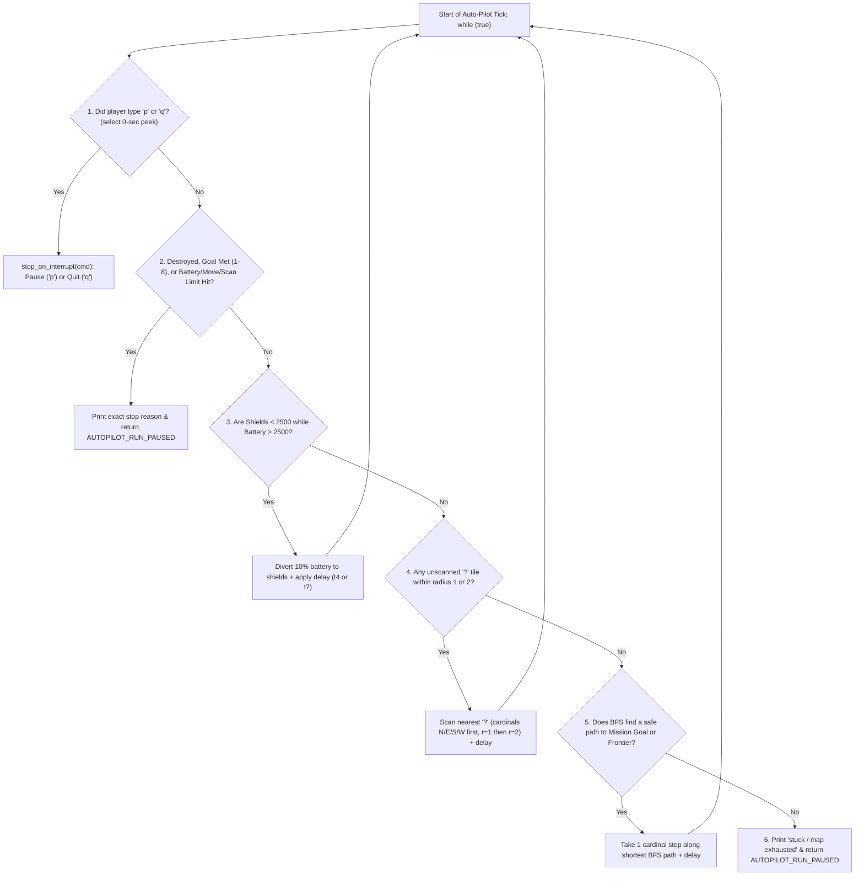
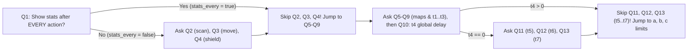

# v2 Student Deep-Dive Guide 8: `autopilot.h` & `autopilot.c`

> [!NOTE]
> **Beginner-Friendly Visual Edition (`nathan` branch):** Covers [autopilot.h](file:///c:/Users/nathanyu/Documents/GitHub/RSE1201_Group_Project/VehExplorer/inc/autopilot.h) (lines 1–44) and all 816 lines of [autopilot.c](file:///c:/Users/nathanyu/Documents/GitHub/RSE1201_Group_Project/VehExplorer/src/autopilot.c), with a **4-panel visual trace of Breadth-First Search (`queue`, `visited`, `came_from`, `step_index`)**, an **Appendix A skip-rule flowchart**, and a **non-blocking `select()` polling diagram**! Every C term is re-explained inline right inside each section.

---

## 1. Mental Imagery: The 6-Rule Brain Inside `autopilot_run`

Think of `autopilot.c` as a cautious self-driving rover with **one golden safety law**:
> **"Never step onto a tile unless radar has ALREADY scanned it AND confirmed it is neither a wall `'#'` nor a danger trap `'X'`!"**

Every single tick of `while (true)` inside [`autopilot_run`](file:///c:/Users/nathanyu/Documents/GitHub/RSE1201_Group_Project/VehExplorer/src/autopilot.c#L717-L816) runs this exact 6-step priority ladder from top to bottom:



Notice **why Step 4 (Scan) comes BEFORE Step 5 (Move)**: whenever the rover reaches a new spot, it scans its surroundings *first* before deciding where to walk next!

---

## 2. Visual Mental Model: How Breadth-First Search (`autopilot_bfs_step`) Finds the Shortest Safe Path!

BFS sounds fancy, so picture **water ripples spreading 1 step at a time** from the rover `[S]` at `(0, 0)` trying to reach End Point `'E'` at `(2, 0)` while avoiding Danger `'X'` at `(1, -1)` and Wall `'#'` at `(1, 0)`:

```text
STAGE A — Known Scanned Map:          STAGE B — BFS Ripples Spreading in queue[]:
      x=0   x=1   x=2                       x=0   x=1   x=2
y=-1 [ . ] [ X ] [ . ]                y=-1 [w=1] [ X ] [   ]   ('X' & '#' are skipped by
y= 0 [ S ] [ # ] [ E ]                y= 0 [w=0] [ # ] [w=4!]   autopilot_cell_is_passable!)
y=+1 [ . ] [ . ] [ . ]                y=+1 [w=1] [w=2] [w=3]
                                      Ripple hits 'E' at (2,0) on Wave 4 — SHORTEST safe path!

STAGE C — came_from[] Breadcrumbs:    STAGE D — Tracing Back ONLY the First Step (Lines 600-617):
  Each cell remembers which parent      Start at goal 'E' (2,0) and follow arrows BACKWARD
  cell discovered it!                   until came_from[step_index] == start (0,0):
      x=0   x=1   x=2
y=-1 [ | ] [ X ] [   ]                  (2,0) ---> (2,1) ---> (1,1) ---> (0,1)  [STOP! Parent is S!]
y= 0 [ S ] [ # ] [ | ]                                                     ^
       ^           v                                                       |
y=+1 [ ^ ]<-[ < ]<-[ < ]                First step px=0, py=+1  -->  out_dx = 0, out_dy = +1 (Move South!)
```

Why output **only the first step `(0, +1)`** instead of walking all 4 steps blindly?
Because as soon as the rover steps South to `(0, +1)`, **Step 4 (Scan)** runs again on the next tick and scans newly reachable tiles—reacting immediately if a closer `'E'` or hazard appears!

---

## 3. Header Walkthrough: `autopilot.h` (Lines 1–44)

### Full Header ([autopilot.h](file:///c:/Users/nathanyu/Documents/GitHub/RSE1201_Group_Project/VehExplorer/inc/autopilot.h#L1-L44))

```c
#ifndef AUTOPILOT_H
#define AUTOPILOT_H

#include "SatComRelay.h"

#include <stdbool.h>

/* User-configurable display, delay, and limit settings from the 'o' menu. */
typedef struct {
    bool configured;
    bool stats_every;
    bool stats_scan;
    bool stats_move;
    bool stats_shield;
    bool map_scan;
    bool map_move;
    long t1;
    long t2;
    long t3;
    long t4;
    long t5;
    long t6;
    long t7;
    long energy_floor;
    unsigned long max_moves; /* 0 = disabled */
    unsigned long max_scans; /* 0 = disabled */
} AutopilotOptions;

/* Tells the Stage 2 command loop whether auto-pilot paused or quit the game. */
typedef enum {
    AUTOPILOT_RUN_PAUSED = 0, /* return to manual command loop */
    AUTOPILOT_RUN_QUIT        /* leave Stage 2 and print final report */
} AutopilotRunResult;

void autopilot_options_set_defaults(AutopilotOptions *opt);
bool autopilot_prompt_options(AutopilotOptions *opt);
void autopilot_print_options(const AutopilotOptions *opt);

/* Run autonomous exploration until paused, quit, goal met, or stuck. */
AutopilotRunResult autopilot_run(VehDataType *vehicle,
                                 int mission_type,
                                 AutopilotOptions *opt);

#endif /* AUTOPILOT_H */
```

#### Every Term Explained Inline
- **`#ifndef AUTOPILOT_H` / `#define AUTOPILOT_H` / `#endif`:** Include guard preventing duplicate type declarations.
- **`AutopilotOptions` (`typedef struct`):** Holds all user answers from the `'o'` configuration menu:
  - `configured`: Starts `false`; becomes `true` once `'o'` finishes so pressing `'p'` again reuses your saved settings without re-asking 16 questions!
  - `t1..t7` (`long`): Pause delays in seconds after stats/maps/actions.
  - `energy_floor` (`long`), `max_moves` / `max_scans` (`unsigned long`): Safety auto-pause thresholds (`0` disables move/scan caps).
- **`AutopilotRunResult` (`typedef enum`):** Lets `ui_cli.c` distinguish between **Pausing** (`AUTOPILOT_RUN_PAUSED` → stay in manual Stage 2) and **Quitting** (`AUTOPILOT_RUN_QUIT` → jump straight to Stage 3 report).

---

## 4. Source Walkthrough: `autopilot.c` (Lines 1–816)

### Chunk A: Constants, Scan/Move Tables & Map Helpers ([autopilot.c](file:///c:/Users/nathanyu/Documents/GitHub/RSE1201_Group_Project/VehExplorer/src/autopilot.c#L1-L187))

```c
#define _DEFAULT_SOURCE

#include "autopilot.h"

#include "local_map.h"
#include "mission_control.h"
#include "stats.h"
#include "util_input.h"
#include "veh_action.h"

#include <stdio.h>
#include <stdlib.h>
#include <string.h>
#include <sys/select.h>
#include <unistd.h>

#define AUTOPILOT_SHIELD_RESERVE 2500L
#define AUTOPILOT_END 'E'
#define AUTOPILOT_DANGER 'X'
#define AUTOPILOT_WALL '#'

/* Compass labels matching MissionControlScanDir enum order. */
static const char *scan_direction_labels[MISSION_CONTROL_DIR_COUNT] = {
    "NW", "N", "NE", "W", "E", "SW", "S", "SE"
};

/* Check cheaper cardinal scans (N, E, S, W) before diagonal scans. */
static const MissionControlScanDir scan_order[MISSION_CONTROL_DIR_COUNT] = {
    MISSION_CONTROL_DIR_NORTH,     MISSION_CONTROL_DIR_EAST,
    MISSION_CONTROL_DIR_SOUTH,     MISSION_CONTROL_DIR_WEST,
    MISSION_CONTROL_DIR_NORTHEAST, MISSION_CONTROL_DIR_NORTHWEST,
    MISSION_CONTROL_DIR_SOUTHEAST, MISSION_CONTROL_DIR_SOUTHWEST
};

/* Pairs a direction character ('N', 'E', 'S', 'W') with its (dx, dy) step. */
typedef struct {
    char direction;
    int dx;
    int dy;
} AutopilotMove;

static const AutopilotMove cardinal_moves[4] = {
    { 'N', 0, -1 },
    { 'E', 1, 0 },
    { 'S', 0, 1 },
    { 'W', -1, 0 },
};

/* Eight surrounding neighbour offsets at radius 1. */
static const int neighbor_dx[MISSION_CONTROL_DIR_COUNT] = { -1, 0, 1, -1, 1, -1, 0, 1 };
static const int neighbor_dy[MISSION_CONTROL_DIR_COUNT] = { -1, -1, -1, 0, 0, 1, 1, 1 };
```

#### Map Inspection Helpers (`L57–187`) Explained Inline:
- **[`autopilot_cell_is_passable(x, y)`](file:///c:/Users/nathanyu/Documents/GitHub/RSE1201_Group_Project/VehExplorer/src/autopilot.c#L68-L86):** Returns `false` if `(x, y)` is `blocked`, unscanned (`'?'`), a wall (`'#'`), or danger (`'X'`); returns `true` only for scanned, safe tiles!
- **[`autopilot_unknown_at(x, y)`](file:///c:/Users/nathanyu/Documents/GitHub/RSE1201_Group_Project/VehExplorer/src/autopilot.c#L89-L93):** Returns `true` if `(x, y)` is **not** marked `blocked` AND `local_map_peek_terrain(x, y) == '?'`.
- **[`autopilot_unknown_cell_remains()`](file:///c:/Users/nathanyu/Documents/GitHub/RSE1201_Group_Project/VehExplorer/src/autopilot.c#L96-L127) ("Is there still a frontier?"):**
  ```text
  Known floor '.' next to '?':   [ . ][ ? ]  --> Frontier EXISTS (returns true — keep exploring!)
  Surrounded by walls '#':       [ . ][ # ]  --> Walls block outward vision; when zero non-wall
                                                 cells touch '?', the WHOLE interior is mapped!
  ```
- **[`autopilot_has_unvisited_passable()`](file:///c:/Users/nathanyu/Documents/GitHub/RSE1201_Group_Project/VehExplorer/src/autopilot.c#L130-L152):** Checks if any safe scanned tile has `!local_map_is_explored(x, y)` (needed for Mission 8).
- **[`autopilot_all_known_ends_visited()`](file:///c:/Users/nathanyu/Documents/GitHub/RSE1201_Group_Project/VehExplorer/src/autopilot.c#L155-L182):** Checks that at least one `'E'` was found (`any = true`) and every `'E'` on the map has `local_map_is_explored(x, y) == true` (needed for Mission 5).

---

### Chunk B: All 8 Mission Goals & Safety Limit Checks ([autopilot.c](file:///c:/Users/nathanyu/Documents/GitHub/RSE1201_Group_Project/VehExplorer/src/autopilot.c#L189-L245))

```c
/* Check whether the goal condition for mission_type (1-8) has been met. */
static bool autopilot_goal_met(int mission_type)
{
    char here = local_map_peek_terrain(local_map_get_x(), local_map_get_y());
    bool frontier = autopilot_unknown_cell_remains();
    bool unvisited = autopilot_has_unvisited_passable();

    switch (mission_type) {
    case 1: return false;                                              /* Casual Explore */
    case 2: return autopilot_end_count() >= 1;                         /* Find 1 End Point */
    case 3: return autopilot_is_end(here);                             /* Reach 1 End Point */
    case 4: return !frontier;                                          /* Find ALL End Points */
    case 5: return !frontier && autopilot_all_known_ends_visited();    /* Reach ALL End Points */
    case 6: return !frontier;                                          /* Find ALL Danger Points */
    case 7: return !frontier && local_map_count_scanned(AUTOPILOT_WALL) > 0; /* Boundaries */
    case 8: return !frontier && !unvisited;                            /* Explore Everything */
    default: return false;
    }
}

/* Check battery floor and move/scan action limits, printing the stop reason. */
static bool autopilot_stop_limit_hit(const VehDataType *vehicle,
                                     const AutopilotOptions *opt)
{
    StatsCounters s = stats_get();

    if (vehicle->currEnergy <= 0) {
        printf("Auto-pilot stopped: energy depleted.\n");
        return true;
    }
    if (vehicle->currEnergy < opt->energy_floor) {
        printf("Auto-pilot stopped: energy below limit.\n");
        return true;
    }
    if (opt->max_moves > 0 && s.moves_issued >= opt->max_moves) {
        printf("Auto-pilot stopped: move limit reached.\n");
        return true;
    }
    if (opt->max_scans > 0 && s.scans_issued >= opt->max_scans) {
        printf("Auto-pilot stopped: scan limit reached.\n");
        return true;
    }
    return false;
}
```

#### Every Term Explained Inline
- **`!frontier` (`!` logical NOT):** Means `autopilot_unknown_cell_remains()` returned `false`—every reachable room inside the `'#'` walls has been 100% scanned! That's how Missions 4, 5, 6, 7, and 8 know for sure no hidden `'E'` or `'X'` tiles remain anywhere in the arena!
- **`const VehDataType *vehicle` & `const AutopilotOptions *opt`:** Read-only single pointers (`->` arrow reads fields without modifying them). Notice `opt->max_moves > 0` checks whether the user enabled a cap (`0` means unlimited).

---

### Chunk C: Appendix A `'o'` Configuration & Skip Rules ([autopilot.c](file:///c:/Users/nathanyu/Documents/GitHub/RSE1201_Group_Project/VehExplorer/src/autopilot.c#L247-L395))



- **[`autopilot_options_set_defaults`](file:///c:/Users/nathanyu/Documents/GitHub/RSE1201_Group_Project/VehExplorer/src/autopilot.c#L248-L257):** Zeroes `*opt` with `memset(opt, 0, sizeof(*opt))`, then sets `map_scan = true`, `map_move = true`, and `energy_floor = 1`.
- **[`yes_no_text`](file:///c:/Users/nathanyu/Documents/GitHub/RSE1201_Group_Project/VehExplorer/src/autopilot.c#L260-L266) & [`autopilot_print_options`](file:///c:/Users/nathanyu/Documents/GitHub/RSE1201_Group_Project/VehExplorer/src/autopilot.c#L269-L290):** Prints the active summary table after `'o'` finishes.
- **[`autopilot_prompt_options`](file:///c:/Users/nathanyu/Documents/GitHub/RSE1201_Group_Project/VehExplorer/src/autopilot.c#L293-L395):** Uses `util_prompt_yes_no_default` and `util_prompt_long_default` (passing `&opt->...` addresses so answers write straight into `*opt`), enforces both Appendix A skip rules (`if (!opt->stats_every)` and `if (opt->t4 == 0)`), and sets `opt->configured = true;`.

---

### Chunk D: Non-Blocking `'p'`/`'q'` Interrupts with `select()` ([autopilot.c](file:///c:/Users/nathanyu/Documents/GitHub/RSE1201_Group_Project/VehExplorer/src/autopilot.c#L397-L469))

```c
/* Peek at stdin without blocking to see if the user entered 'p' or 'q'. */
static bool autopilot_poll_interrupt(char *cmd)
{
    fd_set rfds;
    struct timeval tv;
    int n;

    /* Ignore piped input so scripted commands after 'p' are not consumed early */
    if (!isatty(STDIN_FILENO)) {
        return false;
    }

    FD_ZERO(&rfds);
    FD_SET(STDIN_FILENO, &rfds);
    tv.tv_sec = 0;
    tv.tv_usec = 0;
    n = select(STDIN_FILENO + 1, &rfds, NULL, NULL, &tv);
    if (n <= 0) {
        return false;
    }

    *cmd = util_read_command_char();
    return *cmd == 'p' || *cmd == 'q';
}
```

#### Visual Comparison: Why Can't Auto-Pilot Just Call `fgets()` Directly?
```text
Calling fgets() directly:
  Rover scans N --> calls fgets() --> FREEZES FOREVER waiting for human to press Enter!

Calling select() with timeout tv = {0 sec, 0 usec} (What autopilot_poll_interrupt does!):
  Rover scans N --> select() peeks at keyboard in 0.000s:
     - Human typed nothing?  n == 0 --> returns false INSTANTLY, rover keeps driving!
     - Human typed 'p'+'\n'? n == 1 --> reads 'p' and pauses IMMEDIATELY!
```

- **[`autopilot_sleep_secs`](file:///c:/Users/nathanyu/Documents/GitHub/RSE1201_Group_Project/VehExplorer/src/autopilot.c#L423-L437):** Instead of calling `sleep(10)` (which would ignore `'p'`/`'q'` for 10 whole seconds!), it loops `for (i = 0; i < secs; i++) { sleep(1); if (autopilot_poll_interrupt(cmd)) return true; }` so interrupts respond within 1 second!
- **[`autopilot_show_action_result`](file:///c:/Users/nathanyu/Documents/GitHub/RSE1201_Group_Project/VehExplorer/src/autopilot.c#L440-L469):** Applies post-stats delay `t1`, post-map delays `t2`/`t3`, and either global action delay `t4` (when `t4 > 0`) or specific delay `t5` (scan `'s'`), `t6` (move `'m'`), or `t7` (shield `'i'`).

---

### Chunk E: `autopilot_bfs_step` Code Walkthrough ([autopilot.c](file:///c:/Users/nathanyu/Documents/GitHub/RSE1201_Group_Project/VehExplorer/src/autopilot.c#L471-L624))

- **Lines 509–530 (Search Window & Heap Arrays):** Reads map bounds, adds a 1-cell border (`min_x--`, `max_x++`, etc.), computes `cap = w * h`, and allocates 3 heap arrays:
  - `queue = malloc((size_t)cap * sizeof(*queue));` — FIFO ripple queue (`head` pops front, `tail` pushes back).
  - `came_from = malloc((size_t)cap * sizeof(*came_from));` — stores parent 1D index for each discovered cell.
  - `visited = calloc((size_t)cap, sizeof(*visited));` — `calloc` zeroes all flags to `false`.
- **Lines 533–597 (Ripple Expansion Loop `while (head < tail)`):**
  - Pops `AutopilotPoint cur = queue[head++];`.
  - Checks if `cur` satisfies our goal (`any_unvisited_end` → unvisited `'E'`, `any_end` → any `'E'`, `any_unvisited` → unvisited safe tile, or `any_frontier` → tile adjacent to `'?'`). If so (and `cur` isn't start `(sx, sy)`), sets `found = true; fx = cur.x; fy = cur.y; break;`!
  - Otherwise loops `i = 0..3` over `cardinal_moves`, pushing passable unvisited neighbours onto `queue[tail++]` and recording `came_from[ni] = ci;`.
- **Lines 600–624 (Breadcrumb Backtrack & Cleanup):**
  - Walks `step_index` backward from goal `gi` (`while (came_from[step_index] != si && came_from[step_index] != -1) step_index = came_from[step_index];`) until `step_index` is the immediate neighbour of start `si`.
  - Converts 1D `step_index` back into 2D `(px, py)` using **modulo `% w`** (`px = min_x + (step_index % w)`) and **integer division `/ w`** (`py = min_y + (step_index / w)`), writes `*out_dx = px - sx` and `*out_dy = py - sy`, calls `free()` on all 3 arrays, and returns `true`!

---

### Chunk F: Scan Picker, Move Picker, Shield Chunk & `autopilot_run` ([autopilot.c](file:///c:/Users/nathanyu/Documents/GitHub/RSE1201_Group_Project/VehExplorer/src/autopilot.c#L626-L816))

- **[`autopilot_pick_scan`](file:///c:/Users/nathanyu/Documents/GitHub/RSE1201_Group_Project/VehExplorer/src/autopilot.c#L627-L652):** Checks `r = 1` first, then `r = 2`, looping through `scan_order` (N, E, S, W before diagonals) to pick the cheapest nearby `'?'` cell.
- **[`autopilot_pick_move`](file:///c:/Users/nathanyu/Documents/GitHub/RSE1201_Group_Project/VehExplorer/src/autopilot.c#L655-L686):**
  - Mission 3 → `autopilot_bfs_step` toward any known `'E'`.
  - Mission 5 → `autopilot_bfs_step` toward any unvisited `'E'`.
  - Mission 8 → `autopilot_bfs_step` toward any unvisited passable cell.
  - **Fallback (`if (!step_found)`):** If no `'E'` has been discovered yet (or for Missions 1, 2, 4, 6, 7), walks toward the nearest **frontier** cell (`any_frontier = true`) to uncover new map territory!
- **[`autopilot_shield_amount`](file:///c:/Users/nathanyu/Documents/GitHub/RSE1201_Group_Project/VehExplorer/src/autopilot.c#L689-L703):** Transfers `10%` of `currEnergy` (or `50%` if `10% < 1000`) whenever `currShieldEnergy < 2500` and `currEnergy > 2500`.
- **[`stop_on_interrupt`](file:///c:/Users/nathanyu/Documents/GitHub/RSE1201_Group_Project/VehExplorer/src/autopilot.c#L706-L714) & [`autopilot_run`](file:///c:/Users/nathanyu/Documents/GitHub/RSE1201_Group_Project/VehExplorer/src/autopilot.c#L717-L816):** Executes the 6-step `while (true)` loop diagrammed in Section 1, calling `veh_action_allocate`, `veh_action_scan`, and `veh_action_move(vehicle, cardinal_moves[move_i].direction, ...)`!

---

## 5. Ready-to-Use Presentation Script & Likely Teacher Q&A

### 45-Second Walkthrough Script
> "`autopilot.c` implements our `'o'` option menu and `'p'` autonomous explorer. `autopilot_prompt_options` implements all Appendix A prompts and skip rules—skipping individual stats questions when Q1 is `'y'` and individual delays `t5..t7` when global delay `t4 > 0`. Inside `autopilot_run`, each iteration of `while (true)` polls `stdin` without blocking using `select()`, checks mission completion across all 8 mission types in `autopilot_goal_met` plus battery and action limits in `autopilot_stop_limit_hit`, tops up shields whenever below `2500`, scans any unknown cell within radius `1` or `2` prioritizing cheaper cardinal scans, and otherwise runs Breadth-First Search in `autopilot_bfs_step` over scanned safe cells to take one step toward the mission target or nearest frontier."

### Likely Questions From Your Lecturer
1. **Q: Why is Breadth-First Search (BFS) guaranteed to find the shortest step count to `'E'` or the nearest frontier?**
   - **A:** Because `queue` is First-In-First-Out (FIFO), BFS explores all cells 1 step away before any cell 2 steps away, and all cells 2 steps away before 3 steps away. So the very first goal cell popped from `queue` is mathematically guaranteed to have the minimum number of steps.
2. **Q: How did you convert the 1D array index `step_index` back into 2D coordinates `(px, py)` at the end of `autopilot_bfs_step`?**
   - **A:** Since forward indexing is `index = (y - min_y) * w + (x - min_x)`, the remainder `step_index % w` recovers `(x - min_x)` and integer division `step_index / w` recovers `(y - min_y)`. Adding `min_x` and `min_y` back gives `(px, py)`.
3. **Q: Why check `if (!isatty(STDIN_FILENO)) return false;` inside `autopilot_poll_interrupt`?**
   - **A:** If someone pipes a scripted input file (`./bin/VehExplorer.run < commands.txt`), all lines in the file are immediately readable in `stdin`. Checking `isatty` ensures auto-pilot doesn't prematurely swallow scripted post-autopilot commands while running!
