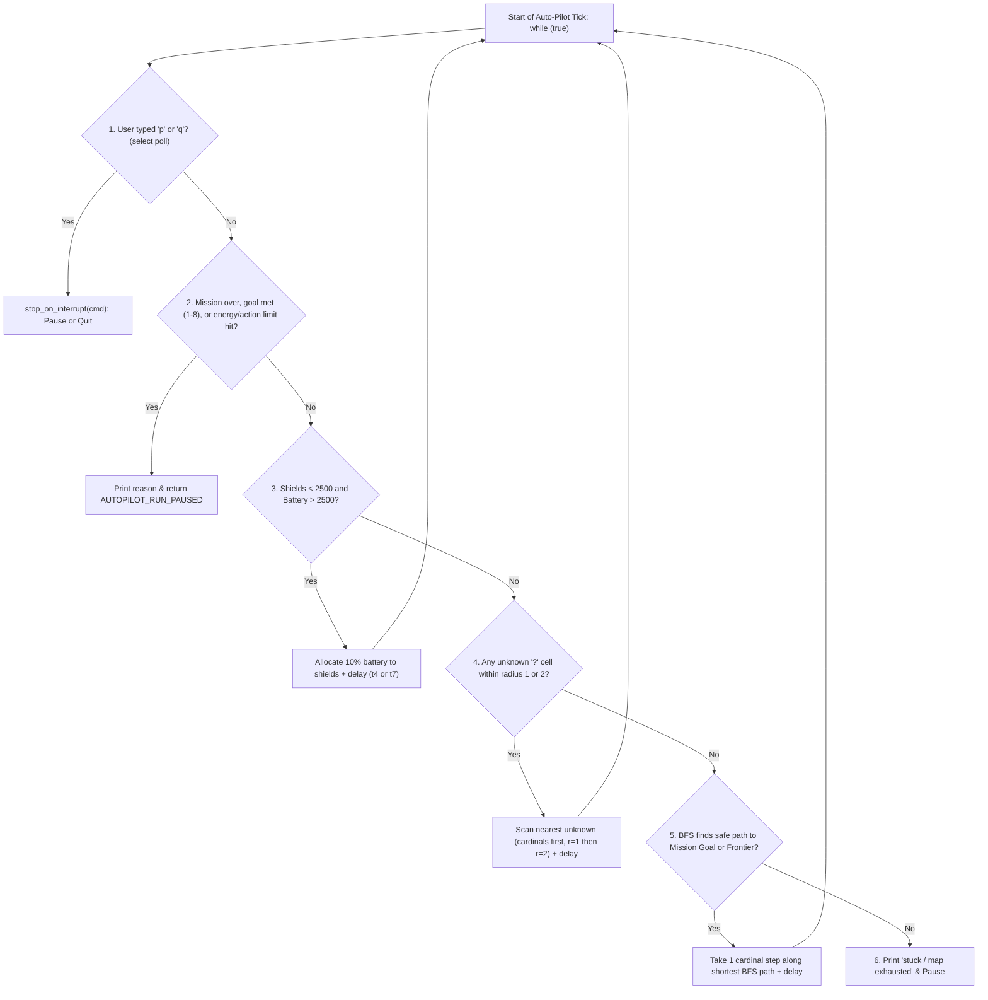

# v2 Student Deep-Dive Guide 8: `autopilot.h` & `autopilot.c`

> [!NOTE]
> **Updated v2 Guide (`nathan` branch):** Covers every single line of [autopilot.h](file:///c:/Users/nathanyu/Documents/GitHub/RSE1201_Group_Project/VehExplorer/inc/autopilot.h) (lines 1–44) and refactored [autopilot.c](file:///c:/Users/nathanyu/Documents/GitHub/RSE1201_Group_Project/VehExplorer/src/autopilot.c) (lines 1–816). All function pointers, `**why` double pointers, `(void)` casts, ternaries, and `goto` labels have been replaced with straightforward student C (`char direction`, [`autopilot_stop_limit_hit`](file:///c:/Users/nathanyu/Documents/GitHub/RSE1201_Group_Project/VehExplorer/src/autopilot.c#L223-L245), [`stop_on_interrupt`](file:///c:/Users/nathanyu/Documents/GitHub/RSE1201_Group_Project/VehExplorer/src/autopilot.c#L706-L714), and readable BFS names `queue`, `came_from`, `visited`, `step_index`). Every C term is re-explained inline right inside each section.

---

## 1. Big-Picture Architecture: How Auto-Pilot Thinks

Every turn inside [`autopilot_run`](file:///c:/Users/nathanyu/Documents/GitHub/RSE1201_Group_Project/VehExplorer/src/autopilot.c#L717-L816), the vehicle runs a strict **6-step priority checklist** so it **never** steps onto an unscanned tile `'?'`, a wall `'#'`, or a danger trap `'X'`, and never lets shields drop to `0`:



---

## 2. Header Walkthrough: `autopilot.h` (Lines 1–44)

### Full Header ([autopilot.h](file:///c:/Users/nathanyu/Documents/GitHub/RSE1201_Group_Project/VehExplorer/inc/autopilot.h#L1-L44))

```c
#ifndef AUTOPILOT_H
#define AUTOPILOT_H

#include "SatComRelay.h"

#include <stdbool.h>

/* User-configurable display, delay, and limit settings from the 'o' menu. */
typedef struct {
    bool configured;
    bool stats_every;
    bool stats_scan;
    bool stats_move;
    bool stats_shield;
    bool map_scan;
    bool map_move;
    long t1;
    long t2;
    long t3;
    long t4;
    long t5;
    long t6;
    long t7;
    long energy_floor;
    unsigned long max_moves; /* 0 = disabled */
    unsigned long max_scans; /* 0 = disabled */
} AutopilotOptions;

/* Tells the Stage 2 command loop whether auto-pilot paused or quit the game. */
typedef enum {
    AUTOPILOT_RUN_PAUSED = 0, /* return to manual command loop */
    AUTOPILOT_RUN_QUIT        /* leave Stage 2 and print final report */
} AutopilotRunResult;

void autopilot_options_set_defaults(AutopilotOptions *opt);
bool autopilot_prompt_options(AutopilotOptions *opt);
void autopilot_print_options(const AutopilotOptions *opt);

/* Run autonomous exploration until paused, quit, goal met, or stuck. */
AutopilotRunResult autopilot_run(VehDataType *vehicle,
                                 int mission_type,
                                 AutopilotOptions *opt);

#endif /* AUTOPILOT_H */
```

#### Every Term Explained Inline
- **`#ifndef AUTOPILOT_H` / `#define AUTOPILOT_H` / `#endif`:** Include guard preventing duplicate struct/enum definitions.
- **`AutopilotOptions` (`typedef struct`):** Stores every Appendix A `'o'` menu answer:
  - `configured`: `false` until the user completes `'o'` at least once (so pressing `'p'` first triggers `'o'` automatically).
  - `stats_every`, `stats_scan`, `stats_move`, `stats_shield`, `map_scan`, `map_move`: Display toggles.
  - `t1..t7`: Delay timers in seconds (`long`).
  - `energy_floor`, `max_moves`, `max_scans`: Safety stop thresholds (`0` means uncapped for `max_moves`/`max_scans`).
- **`AutopilotRunResult` (`typedef enum`):** Clean two-value return code so [`ui_run_command_loop`](file:///c:/Users/nathanyu/Documents/GitHub/RSE1201_Group_Project/VehExplorer/src/ui_cli.c#L241-L243) knows whether to stay in Stage 2 (`AUTOPILOT_RUN_PAUSED`) or exit straight to Stage 3 (`AUTOPILOT_RUN_QUIT`).

---

## 3. Source Walkthrough: `autopilot.c` (Lines 1–816)

### Chunk A: Constants, Lookup Tables & Map Passability Helpers ([autopilot.c](file:///c:/Users/nathanyu/Documents/GitHub/RSE1201_Group_Project/VehExplorer/src/autopilot.c#L1-L187))

```c
#define _DEFAULT_SOURCE

#include "autopilot.h"
/* ... project & system includes (<sys/select.h>, <unistd.h>) (L5-15) ... */

#define AUTOPILOT_SHIELD_RESERVE 2500L
#define AUTOPILOT_END 'E'
#define AUTOPILOT_DANGER 'X'
#define AUTOPILOT_WALL '#'

/* Compass labels matching MissionControlScanDir enum order. */
static const char *scan_direction_labels[MISSION_CONTROL_DIR_COUNT] = {
    "NW", "N", "NE", "W", "E", "SW", "S", "SE"
};

/* Check cheaper cardinal scans (N, E, S, W) before diagonal scans. */
static const MissionControlScanDir scan_order[MISSION_CONTROL_DIR_COUNT] = {
    MISSION_CONTROL_DIR_NORTH,
    MISSION_CONTROL_DIR_EAST,
    MISSION_CONTROL_DIR_SOUTH,
    MISSION_CONTROL_DIR_WEST,
    MISSION_CONTROL_DIR_NORTHEAST,
    MISSION_CONTROL_DIR_NORTHWEST,
    MISSION_CONTROL_DIR_SOUTHEAST,
    MISSION_CONTROL_DIR_SOUTHWEST
};

/* Pairs a direction character ('N', 'E', 'S', 'W') with its (dx, dy) step. */
typedef struct {
    char direction;
    int dx;
    int dy;
} AutopilotMove;

static const AutopilotMove cardinal_moves[4] = {
    { 'N', 0, -1 },
    { 'E', 1, 0 },
    { 'S', 0, 1 },
    { 'W', -1, 0 },
};
```

#### Every Term Explained Inline
- **`2500L` (`L` integer suffix):** Marks `2500` explicitly as a `long` constant matching `vehicle->currShieldEnergy`.
- **Why `scan_order` checks N, E, S, W before diagonals (`L28–37`):** Smart energy optimization! Cardinal scans cost less energy than diagonal scans and directly reveal tiles the vehicle can walk onto in 1 cardinal step.
- **`AutopilotMove` & `cardinal_moves[4]` (`L40–51`):** Pairs each direction character (`'N'`, `'E'`, `'S'`, `'W'`) with its `(dx, dy)` step—passed directly to [`veh_action_move`](file:///c:/Users/nathanyu/Documents/GitHub/RSE1201_Group_Project/VehExplorer/src/veh_action.c#L10-L80) with zero function pointers!
- **Passability & Frontier Helpers (`L57–187`):**
  - [`autopilot_cell_is_passable(x, y)`](file:///c:/Users/nathanyu/Documents/GitHub/RSE1201_Group_Project/VehExplorer/src/autopilot.c#L68-L86): Returns `true` **only** if `(x, y)` is not `blocked`, HAS been scanned (`!= '?'`), is not `'#'`, and is not `'X'`! That single rule is why auto-pilot **never walks blindly into danger**.
  - [`autopilot_unknown_cell_remains()`](file:///c:/Users/nathanyu/Documents/GitHub/RSE1201_Group_Project/VehExplorer/src/autopilot.c#L96-L127): Checks whether any known non-wall cell still touches an unscanned `'?'` neighbour ("frontier"). When this returns `false`, the entire reachable interior inside the walls has been 100% scanned!
  - [`autopilot_has_unvisited_passable()`](file:///c:/Users/nathanyu/Documents/GitHub/RSE1201_Group_Project/VehExplorer/src/autopilot.c#L130-L152): Checks if any safe cell hasn't been physically stepped on yet (for Mission 8).
  - [`autopilot_all_known_ends_visited()`](file:///c:/Users/nathanyu/Documents/GitHub/RSE1201_Group_Project/VehExplorer/src/autopilot.c#L155-L182): Checks if at least one `'E'` exists and every known `'E'` has been stepped on (for Mission 5).

---

### Chunk B: All 8 Mission Goals & Limit Checks ([autopilot.c](file:///c:/Users/nathanyu/Documents/GitHub/RSE1201_Group_Project/VehExplorer/src/autopilot.c#L189-L245))

```c
/* Check whether the goal condition for mission_type (1-8) has been met. */
static bool autopilot_goal_met(int mission_type)
{
    char here;
    bool frontier;
    bool unvisited;

    here = local_map_peek_terrain(local_map_get_x(), local_map_get_y());
    frontier = autopilot_unknown_cell_remains();
    unvisited = autopilot_has_unvisited_passable();

    switch (mission_type) {
    case 1:
        return false;
    case 2:
        return autopilot_end_count() >= 1;
    case 3:
        return autopilot_is_end(here);
    case 4:
        return !frontier;
    case 5:
        return !frontier && autopilot_all_known_ends_visited();
    case 6:
        return !frontier;
    case 7:
        return !frontier && local_map_count_scanned(AUTOPILOT_WALL) > 0;
    case 8:
        return !frontier && !unvisited;
    default:
        return false;
    }
}

/* Check battery floor and move/scan action limits, printing the stop reason. */
static bool autopilot_stop_limit_hit(const VehDataType *vehicle,
                                     const AutopilotOptions *opt)
{
    StatsCounters s = stats_get();

    if (vehicle->currEnergy <= 0) {
        printf("Auto-pilot stopped: energy depleted.\n");
        return true;
    }
    if (vehicle->currEnergy < opt->energy_floor) {
        printf("Auto-pilot stopped: energy below limit.\n");
        return true;
    }
    if (opt->max_moves > 0 && s.moves_issued >= opt->max_moves) {
        printf("Auto-pilot stopped: move limit reached.\n");
        return true;
    }
    if (opt->max_scans > 0 && s.scans_issued >= opt->max_scans) {
        printf("Auto-pilot stopped: scan limit reached.\n");
        return true;
    }
    return false;
}
```

#### Every Term Explained Inline
- **How all 8 Mission Types (`switch (mission_type)`) work:**
  1. **Casual Explore:** Never auto-stops on a goal (`return false;`)—explores until map exhausted or user cap hit.
  2. **Find 1 End Point:** Stops as soon as at least 1 `'E'` is scanned (`autopilot_end_count() >= 1`).
  3. **Reach 1 End Point:** Stops once the vehicle is standing on `'E'` (`autopilot_is_end(here)`).
  4. **Find ALL End Points:** Since we don't know how many `'E'`s exist beforehand, we only know we found *all* of them once zero unknown frontier cells remain (`!frontier`)!
  5. **Reach ALL End Points:** Zero frontier left (`!frontier`) AND every discovered `'E'` was visited.
  6. **Find ALL Danger Points:** Zero frontier left (`!frontier`), guaranteeing every reachable `'X'` was scanned without stepping on it.
  7. **Find Map Boundaries:** Zero frontier left (`!frontier`) AND walls `'#'` scanned around the perimeter.
  8. **Explore Everything:** Zero frontier left (`!frontier`) AND every passable cell physically visited (`!unvisited`).
- **[`autopilot_stop_limit_hit`](file:///c:/Users/nathanyu/Documents/GitHub/RSE1201_Group_Project/VehExplorer/src/autopilot.c#L223-L245):** Uses `const` single pointers (`const VehDataType *vehicle`, `const AutopilotOptions *opt`) and `->` arrow access to check battery depletion, `energy_floor`, `max_moves`, and `max_scans` in one clean place.

---

### Chunk C: `'o'` Menu Configuration & Non-Blocking `'p'`/`'q'` Polling ([autopilot.c](file:///c:/Users/nathanyu/Documents/GitHub/RSE1201_Group_Project/VehExplorer/src/autopilot.c#L247-L469))

- **Defaults & Printing (`L248–290`):** [`autopilot_options_set_defaults`](file:///c:/Users/nathanyu/Documents/GitHub/RSE1201_Group_Project/VehExplorer/src/autopilot.c#L248-L257) zeroes `*opt` with `memset(opt, 0, sizeof(*opt))`, sets `map_scan = true`, `map_move = true`, `energy_floor = 1`. [`yes_no_text`](file:///c:/Users/nathanyu/Documents/GitHub/RSE1201_Group_Project/VehExplorer/src/autopilot.c#L260-L266) returns `"y"` or `"n"` with a simple `if` for [`autopilot_print_options`](file:///c:/Users/nathanyu/Documents/GitHub/RSE1201_Group_Project/VehExplorer/src/autopilot.c#L269-L290).
- **Appendix A Skip Rules in [`autopilot_prompt_options`](file:///c:/Users/nathanyu/Documents/GitHub/RSE1201_Group_Project/VehExplorer/src/autopilot.c#L293-L395):**
  - **Skip Rule 1 (`if (!opt->stats_every)` at `L315`):** If Question 1 ("show energy stats after *every* action?") is `'y'`, Questions 2, 3, and 4 (per-scan/move/shield stats) are automatically skipped!
  - **Skip Rule 2 (`if (opt->t4 == 0)` at `L360`):** If Question 10 (`t4` global delay after *any* action) is `> 0`, Questions 11, 12, and 13 (`t5`, `t6`, `t7` individual delays) are automatically skipped!
- **Non-Blocking Interrupt Check in [`autopilot_poll_interrupt`](file:///c:/Users/nathanyu/Documents/GitHub/RSE1201_Group_Project/VehExplorer/src/autopilot.c#L398-L420):**

```c
static bool autopilot_poll_interrupt(char *cmd)
{
    fd_set rfds;
    struct timeval tv;
    int n;

    /* Ignore piped input so scripted commands after 'p' are not consumed early */
    if (!isatty(STDIN_FILENO)) {
        return false;
    }

    FD_ZERO(&rfds);
    FD_SET(STDIN_FILENO, &rfds);
    tv.tv_sec = 0;
    tv.tv_usec = 0;
    n = select(STDIN_FILENO + 1, &rfds, NULL, NULL, &tv);
    if (n <= 0) {
        return false;
    }

    *cmd = util_read_command_char();
    return *cmd == 'p' || *cmd == 'q';
}
```
  - **Why `select(...)` with `tv_sec = 0, tv_usec = 0`?** Calling `fgets` directly during auto-pilot would **freeze** the vehicle waiting for the user to press Enter! `select` from `<sys/select.h>` peeks at `STDIN_FILENO` (`0`, standard input) with a **zero-second timeout**: if the user hasn't pressed a key, `select` returns `0` immediately so auto-pilot keeps driving; if the user *did* type `'p'` or `'q'` + Enter, `n > 0` and we read it with `util_read_command_char()`!
  - **[`autopilot_sleep_secs`](file:///c:/Users/nathanyu/Documents/GitHub/RSE1201_Group_Project/VehExplorer/src/autopilot.c#L423-L437):** Sleeps 1 second at a time (`sleep(1)`) in a `for` loop, polling `autopilot_poll_interrupt` every second so pressing `'p'` or `'q'` during a 10-second delay responds within 1 second instead of making the user wait!

---

### Chunk D: `autopilot_bfs_step` — Breadth-First Search Pathfinding ([autopilot.c](file:///c:/Users/nathanyu/Documents/GitHub/RSE1201_Group_Project/VehExplorer/src/autopilot.c#L471-L624))

```c
/* Find the shortest safe path to a goal cell using Breadth-First Search (BFS)
 * and output only the immediate first step (out_dx, out_dy). */
static bool autopilot_bfs_step(bool any_frontier,
                               bool any_unvisited,
                               bool any_unvisited_end,
                               bool any_end,
                               int *out_dx,
                               int *out_dy)
```

#### Every Term Explained Inline (How BFS Works in Plain English!)
Think of BFS like **ripples spreading outward in a pond** from the vehicle's current tile `(sx, sy)`:
1. **3 Heap Arrays (`malloc` / `calloc` at `L522–524`, freed with `free` before returning):**
   - **`queue` (`AutopilotPoint *`):** First-In-First-Out waiting line of `(x, y)` tiles to inspect (`head` reads from the front; `tail` adds to the back). Because ripples expand 1 step, then 2 steps, then 3 steps, the **first goal cell we hit is guaranteed to be the closest safe goal!**
   - **`visited` (`bool *`, zeroed by `calloc`):** Marks tiles already added to `queue` so we never walk in circles.
   - **`came_from` (`int *`):** Breadcrumb trail! `came_from[ni] = ci` remembers *"to reach cell `ni`, we stepped here from parent cell `ci`."*
2. **Goal Check (`L549–573`):** Checks whether `cur` is our target (an unvisited `'E'`, any `'E'`, an unvisited safe tile, or a tile next to an unscanned `'?'` frontier). When found, sets `found = true; fx = cur.x; fy = cur.y; break;` (clean `break` out of `while (head < tail)`—no `goto`!).
3. **Tracing Back the First Step (`L600–618`):**
   - Starting at goal index `step_index = gi`, `while (came_from[step_index] != si && came_from[step_index] != -1)` walks backward along `came_from` until `step_index` is the tile **one single step away from start `si`**!
   - Converts `step_index` back into `(px, py)` using modulo `% w` (column offset) and integer division `/ w` (row offset), sets `*out_dx = px - sx` and `*out_dy = py - sy`, frees all 3 arrays, and returns `true`!

---

### Chunk E: Scan Picker, Move Picker, Shield Top-Up & `autopilot_run` ([autopilot.c](file:///c:/Users/nathanyu/Documents/GitHub/RSE1201_Group_Project/VehExplorer/src/autopilot.c#L626-L816))

- **[`autopilot_pick_scan`](file:///c:/Users/nathanyu/Documents/GitHub/RSE1201_Group_Project/VehExplorer/src/autopilot.c#L627-L652):** Loops `r = 1` then `r = 2`, checking `scan_order[0..7]` (cardinals first, diagonals second) for any `autopilot_unknown_at(x, y)`.
- **[`autopilot_pick_move`](file:///c:/Users/nathanyu/Documents/GitHub/RSE1201_Group_Project/VehExplorer/src/autopilot.c#L655-L686):** Calls `autopilot_bfs_step` for Mission 3 (`any_end`), Mission 5 (`any_unvisited_end`), or Mission 8 (`any_unvisited`); if that goal isn't visible yet (`!step_found`), falls back to `any_frontier` (`true`) to walk toward the nearest unscanned area! Matches `(dx, dy)` to `cardinal_moves[0..3]`.
- **[`autopilot_shield_amount`](file:///c:/Users/nathanyu/Documents/GitHub/RSE1201_Group_Project/VehExplorer/src/autopilot.c#L689-L703):** Diverts `currEnergy / 10` (or `currEnergy / 2` when battery is small) whenever shields dip below `2500` while battery is above `2500`.
- **[`stop_on_interrupt`](file:///c:/Users/nathanyu/Documents/GitHub/RSE1201_Group_Project/VehExplorer/src/autopilot.c#L706-L714) & [`autopilot_run`](file:///c:/Users/nathanyu/Documents/GitHub/RSE1201_Group_Project/VehExplorer/src/autopilot.c#L717-L816):** Runs the 6-step `while (true)` loop—poll interrupt → check mission/goal/limits → top up shields → scan nearby `'?'` → take 1 BFS move (`veh_action_move(vehicle, cardinal_moves[move_i].direction, ...)`) → or pause when the map is exhausted.

---

## 4. Ready-to-Use Presentation Script & Likely Teacher Q&A

### 45-Second Walkthrough Script
> "`autopilot.c` implements our `'o'` configuration menu and `'p'` autonomous explorer. `autopilot_prompt_options` implements all Appendix A prompts including both skip rules—skipping per-action stats if Q1 is `'y'` and per-action delays if `t4 > 0`. During `autopilot_run`, each loop iteration checks non-blocking `select()` input for `'p'` or `'q'`, checks `autopilot_goal_met` across all 8 mission types plus battery and move/scan caps in `autopilot_stop_limit_hit`, tops up shields if below `2500`, scans any unknown neighbour at radius `1` then `2` (cardinals first), and otherwise uses Breadth-First Search (`autopilot_bfs_step`) over scanned passable tiles to step along the shortest safe path toward the mission target or nearest frontier—never stepping onto `'?'`, `'#'`, or `'X'`."

### Likely Questions From Your Lecturer
1. **Q: How does auto-pilot know when Mission 4 ("Find ALL End Points") or Mission 6 ("Find ALL Danger Points") is finished if it doesn't know how many `'E'` or `'X'` tiles exist in the file?**
   - **A:** `autopilot_unknown_cell_remains()` checks whether any reachable non-wall cell still has an unscanned `'?'` neighbour. Once no reachable frontier cells remain (`!frontier`), every reachable tile inside the map boundaries has been scanned, guaranteeing all `'E'` or `'X'` tiles have been discovered!
2. **Q: Why re-run `autopilot_bfs_step` for just one step at a time instead of following a whole pre-planned path blindly?**
   - **A:** After taking a single step, new unknown cells come within scan radius `1` or `2`—which might reveal an `'E'` end point or a shorter corridor! Re-evaluating scan-before-move on every tick lets the vehicle react immediately to newly discovered terrain and check `'p'`/`'q'` and energy limits after every single action.
