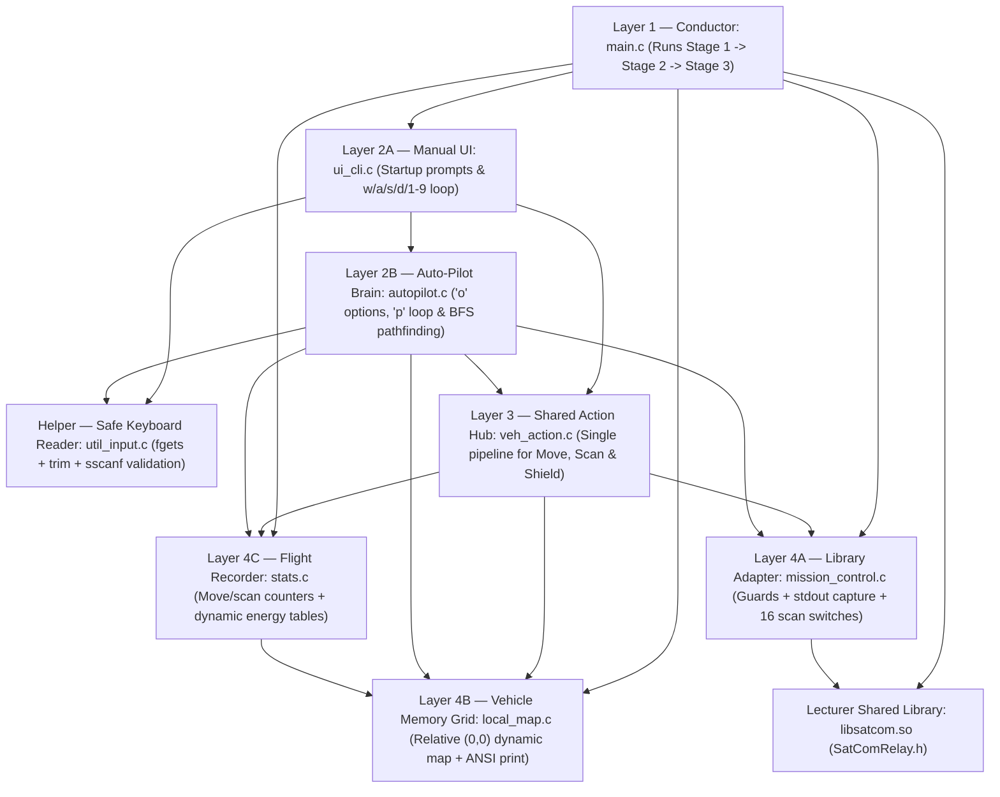
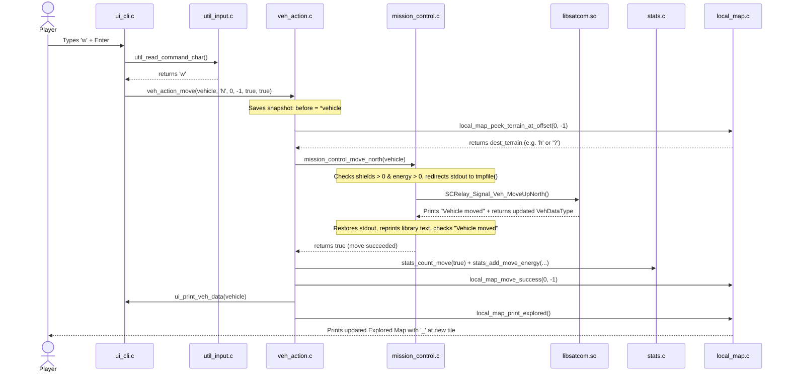

# VehExplorer Student-Style Refactor & Visual Architecture Map (`nathan` Branch)

This guide gives you and your teammates **two things in one place**:
1. **A Visual Mental Map of the Entire Program** (how all 8 `.c`/`.h` modules connect and talk to each other when a player presses a key).
2. **A Clear Summary of the Student-Style C Updates** made on the `nathan` branch so every file aligns with **RSE1201 Lectures 1–5** and is easy to explain live during presentation.

> [!IMPORTANT]
> **What Stayed 100% Identical**
> - **Same 8 modules (`.h` + `.c`):** Zero files were deleted, merged, or renamed, so everyone's presentation parts stay intact.
> - **Same runtime behaviour & terminal text:** Every Stage 1 prompt, Stage 2 manual key, map view, auto-pilot rule, and Stage 3 report prints the exact same output.
> - **Same Linux build command:** Compiles with the exact same `gcc` command against `libsatcom.so`.

---

## 1. Whole-Project Visual Mental Map (Read This First!)

Think of `VehExplorer` like a **4-layer robot control station**. Each `.c` file has **one clear job**, and upper layers call lower layers rather than tangling everything together:



### What Happens Inside the Code When You Press `'w'` (Move North)?

Follow one single keypress from your keyboard all the way to the printed map and back:



### Recommended Study Order for the `v2_student_*` Guides
If you are learning the project from scratch, read the 8 guides in this exact order (each builds naturally on the previous one):
1. `v2_student_1_main_guide.md` — 83-line big-picture entry point (`main.c`).
2. `v2_student_2_util_input_guide.md` — How keyboard lines are read and validated safely (`util_input.c`).
3. `v2_student_3_mission_control_guide.md` — How we talk to `libsatcom.so` and capture move output (`mission_control.c`).
4. `v2_student_4_veh_action_guide.md` — How one move/scan updates `mission_control`, `stats`, and `local_map` (`veh_action.c`).
5. `v2_student_5_ui_cli_guide.md` — Stage 1 prompts and Stage 2 keyboard command `switch` (`ui_cli.c`).
6. `v2_student_6_stats_guide.md` — Dynamic `realloc` energy tables and Stage 3 report (`stats.c`).
7. `v2_student_7_local_map_guide.md` — Relative `(0, 0)` dynamic 2D grid and map printing (`local_map.c`).
8. `v2_student_8_autopilot_guide.md` — Appendix A `'o'` options and Breadth-First Search auto-pilot (`autopilot.c`).

---

## 2. The 7 Student-Style Simplifications Made Across the Codebase

### 1) Replaced Function Pointers with `char direction` + `switch`
Function-pointer syntax (`bool (*move_fn)(VehDataType *)` and arrays of `SCRelay_Signal_Veh_SCAN_Fn_Ptr`) is an advanced C topic beyond Lectures 1–5 and is tricky to explain live. We replaced all three places that used function pointers with plain `'N'`, `'S'`, `'E'`, `'W'` characters and `switch` statements:

````carousel
```c
/* BEFORE (veh_action.h & mission_control.c) — Function Pointers */
void veh_action_move(VehDataType *vehicle,
                     bool (*move_fn)(VehDataType *),
                     int dx, int dy, ...);

static const SCRelay_Signal_Veh_SCAN_Fn_Ptr scan_r1[8] = {
    SCRelay_Signal_Veh_ScanNorthWest, ...
};
return scan_r1[dir](vehicle);
```
<!-- slide -->
```c
/* AFTER (veh_action.h & mission_control.c) — Plain char + switch */
void veh_action_move(VehDataType *vehicle,
                     char direction,
                     int dx, int dy, ...);

if (scan_radius == 2) {
    switch (dir) {
    case MISSION_CONTROL_DIR_NORTHWEST:
        return SCRelay_Signal_Veh_ScanNorthWest2(vehicle);
    /* ... */
    }
}
```
````

---

### 2) Removed Double Pointers (`const char **why`)
In [autopilot.c](file:///c:/Users/nathanyu/Documents/GitHub/RSE1201_Group_Project/VehExplorer/src/autopilot.c), two helpers previously took a pointer-to-a-pointer (`const char **why`) just to pass back a stop-reason string. We merged them into one clear helper [`autopilot_stop_limit_hit`](file:///c:/Users/nathanyu/Documents/GitHub/RSE1201_Group_Project/VehExplorer/src/autopilot.c#L223-L245) that checks the battery floor and move/scan caps and prints the stop message directly:

```c
/* AFTER: Single single-pointer check in autopilot.c */
static bool autopilot_stop_limit_hit(const VehDataType *vehicle,
                                     const AutopilotOptions *opt)
{
    StatsCounters s = stats_get();

    if (vehicle->currEnergy <= 0) {
        printf("Auto-pilot stopped: energy depleted.\n");
        return true;
    }
    if (vehicle->currEnergy < opt->energy_floor) {
        printf("Auto-pilot stopped: energy below limit.\n");
        return true;
    }
    /* ... move & scan cap checks ... */
    return false;
}
```

---

### 3) Removed `goto` Jump Labels
[autopilot.c](file:///c:/Users/nathanyu/Documents/GitHub/RSE1201_Group_Project/VehExplorer/src/autopilot.c) previously used two `goto` labels (`goto found;` inside BFS and `goto interrupted;` inside [`autopilot_run`](file:///c:/Users/nathanyu/Documents/GitHub/RSE1201_Group_Project/VehExplorer/src/autopilot.c#L717-L816)):
- `goto found;` was replaced with a normal `bool found = false;` flag + `break;` out of the `while (head < tail)` loop.
- `goto interrupted;` was replaced with a small helper [`stop_on_interrupt`](file:///c:/Users/nathanyu/Documents/GitHub/RSE1201_Group_Project/VehExplorer/src/autopilot.c#L706-L714) that prints the quit/pause message and returns `AUTOPILOT_RUN_QUIT` or `AUTOPILOT_RUN_PAUSED`.

---

### 4) Removed `(void)param;` Warning-Suppression Casts
Casting unused parameters to `(void)` (such as `(void)goal_x;` and `(void)goal_y;`) is a senior C idiom that often prompts lecturers to ask *"Why did you cast a variable to `void`?"* We removed the unused `goal_x` and `goal_y` parameters from [`autopilot_bfs_step`](file:///c:/Users/nathanyu/Documents/GitHub/RSE1201_Group_Project/VehExplorer/src/autopilot.c#L478-L483) completely.

---

### 5) Expanded `? :` Ternary Expressions into Clear `if / else` Blocks
Compact inline `? :` expressions across [main.c](file:///c:/Users/nathanyu/Documents/GitHub/RSE1201_Group_Project/VehExplorer/src/main.c), [mission_control.c](file:///c:/Users/nathanyu/Documents/GitHub/RSE1201_Group_Project/VehExplorer/src/mission_control.c), [ui_cli.c](file:///c:/Users/nathanyu/Documents/GitHub/RSE1201_Group_Project/VehExplorer/src/ui_cli.c), [stats.c](file:///c:/Users/nathanyu/Documents/GitHub/RSE1201_Group_Project/VehExplorer/src/stats.c), [local_map.c](file:///c:/Users/nathanyu/Documents/GitHub/RSE1201_Group_Project/VehExplorer/src/local_map.c), and [autopilot.c](file:///c:/Users/nathanyu/Documents/GitHub/RSE1201_Group_Project/VehExplorer/src/autopilot.c) were expanded into readable `if / else` statements (plus [`yes_no_text`](file:///c:/Users/nathanyu/Documents/GitHub/RSE1201_Group_Project/VehExplorer/src/autopilot.c#L260-L266) in `autopilot.c` for printing `"y"` or `"n"`).

---

### 6) Standardized `while (true)` and `sizeof(...)`
- Replaced all `for (;;)` infinite loops in [util_input.c](file:///c:/Users/nathanyu/Documents/GitHub/RSE1201_Group_Project/VehExplorer/src/util_input.c), [ui_cli.c](file:///c:/Users/nathanyu/Documents/GitHub/RSE1201_Group_Project/VehExplorer/src/ui_cli.c), and [autopilot.c](file:///c:/Users/nathanyu/Documents/GitHub/RSE1201_Group_Project/VehExplorer/src/autopilot.c) with `while (true)` (Lecture 2 `<stdbool.h>` + Lecture 3 `while` loops).
- Added parentheses around every `sizeof(...)` expression (`sizeof(line)`, `sizeof(*cfg)`, `sizeof(*grown)`) to match Lecture 4 syntax.

---

### 7) Cleaned Leftover Rename Notes & Added Short Segment Comments
- Removed leftover `/* was vdt */` / `/* was mc_move_fn */` rename comments so headers and source files look clean for submission.
- Improved the remaining cryptic BFS local names in [autopilot.c](file:///c:/Users/nathanyu/Documents/GitHub/RSE1201_Group_Project/VehExplorer/src/autopilot.c) (`q` → `queue`, `came` → `came_from`, `seen` → `visited`, `prev` → `step_index`) and `total` → `captured_len` in [mission_control.c](file:///c:/Users/nathanyu/Documents/GitHub/RSE1201_Group_Project/VehExplorer/src/mission_control.c).
- Added concise, natural one-line comments above each code block in all 8 `.c` files explaining what each segment does.

---

### 8) What Was Affected in the Header (`.h`) Files?
Beginners often ask whether refactoring broke any shared interfaces. Across all 7 headers:
- **Zero struct layouts changed:** (`UiStartupConfig`, `AutopilotOptions`, `StatsCounters`, `LocalMapTerrainCount` are 100% identical).
- **Zero function names or return types changed.**
- **The ONLY prototype signature change:** In [veh_action.h](file:///c:/Users/nathanyu/Documents/GitHub/RSE1201_Group_Project/VehExplorer/inc/veh_action.h), `veh_action_move` changed its second argument from `bool (*move_fn)(VehDataType *)` to `char direction` (`'N'`, `'S'`, `'E'`, `'W'`).
- **All other `.h` edits** were purely removing leftover `/* was vdt */` rename breadcrumbs and formatting comments!

---

## 3. File-by-File Summary

| Module | Files | Key Updates |
| :--- | :--- | :--- |
| **1. Entry Point** | [main.c](file:///c:/Users/nathanyu/Documents/GitHub/RSE1201_Group_Project/VehExplorer/src/main.c) | Removed `/* was vdt */`, expanded `enc_flag` ternary to `if`, added Stage 1–3 comments. |
| **2. Safe Input** | [util_input.h](file:///c:/Users/nathanyu/Documents/GitHub/RSE1201_Group_Project/VehExplorer/inc/util_input.h), [util_input.c](file:///c:/Users/nathanyu/Documents/GitHub/RSE1201_Group_Project/VehExplorer/src/util_input.c) | Replaced `for (;;)` with `while (true)`, standardized `sizeof(line)`, added segment comments. |
| **3. Mission Control** | [mission_control.h](file:///c:/Users/nathanyu/Documents/GitHub/RSE1201_Group_Project/VehExplorer/inc/mission_control.h), [mission_control.c](file:///c:/Users/nathanyu/Documents/GitHub/RSE1201_Group_Project/VehExplorer/src/mission_control.c) | Replaced move & scan function pointers with [`call_relay_move`](file:///c:/Users/nathanyu/Documents/GitHub/RSE1201_Group_Project/VehExplorer/src/mission_control.c#L35-L49) and `if (scan_radius == 2)` + `switch (dir)`; renamed `captured_len` and `radius`; expanded toggle ternary. |
| **4. Shared Actions** | [veh_action.h](file:///c:/Users/nathanyu/Documents/GitHub/RSE1201_Group_Project/VehExplorer/inc/veh_action.h), [veh_action.c](file:///c:/Users/nathanyu/Documents/GitHub/RSE1201_Group_Project/VehExplorer/src/veh_action.c) | Changed [`veh_action_move`](file:///c:/Users/nathanyu/Documents/GitHub/RSE1201_Group_Project/VehExplorer/src/veh_action.c#L10-L80) to accept `char direction` (`'N'`, `'S'`, `'E'`, `'W'`) dispatched via `switch`. |
| **5. Terminal UI** | [ui_cli.h](file:///c:/Users/nathanyu/Documents/GitHub/RSE1201_Group_Project/VehExplorer/inc/ui_cli.h), [ui_cli.c](file:///c:/Users/nathanyu/Documents/GitHub/RSE1201_Group_Project/VehExplorer/src/ui_cli.c) | Updated `w`/`s`/`a`/`d` calls to pass `'N'`/`'S'`/`'W'`/`'E'`, replaced `for (;;)` with `while (true)`, expanded startup `1 : 0` ternaries, standardized `sizeof(...)`. |
| **6. Statistics** | [stats.h](file:///c:/Users/nathanyu/Documents/GitHub/RSE1201_Group_Project/VehExplorer/inc/stats.h), [stats.c](file:///c:/Users/nathanyu/Documents/GitHub/RSE1201_Group_Project/VehExplorer/src/stats.c) | Expanded `realloc` capacity-doubling ternaries into `if / else`, standardized `sizeof(*grown)` and `sizeof(counts) / sizeof(counts[0])`. |
| **7. Local Map** | [local_map.h](file:///c:/Users/nathanyu/Documents/GitHub/RSE1201_Group_Project/VehExplorer/inc/local_map.h), [local_map.c](file:///c:/Users/nathanyu/Documents/GitHub/RSE1201_Group_Project/VehExplorer/src/local_map.c) | Expanded 7 ternaries into `if / else` (bounds expansion, terrain tallying, `isatty` check), flattened anonymous inner `{ ... }` blocks, standardized `sizeof(...)`. |
| **8. Auto-Pilot** | [autopilot.h](file:///c:/Users/nathanyu/Documents/GitHub/RSE1201_Group_Project/VehExplorer/inc/autopilot.h), [autopilot.c](file:///c:/Users/nathanyu/Documents/GitHub/RSE1201_Group_Project/VehExplorer/src/autopilot.c) | Replaced `AutopilotMove` function pointer with `char direction`, replaced `**why` double pointers with [`autopilot_stop_limit_hit`](file:///c:/Users/nathanyu/Documents/GitHub/RSE1201_Group_Project/VehExplorer/src/autopilot.c#L223-L245), removed both `goto`s, removed unused BFS params, renamed BFS arrays (`queue`, `came_from`, `visited`, `step_index`). |

---

## 4. Linux Build & Smoke-Test Checklist

Always compile and run from inside the `VehExplorer/` folder (because `-Wl,-rpath=.` resolves `./libsatcom.so` relative to `VehExplorer/`):

```bash
cd VehExplorer

# 1. Compile all 8 source files against libsatcom.so
gcc -Wall -Wextra -Iinc -I../MS_1_files \
    src/autopilot.c src/local_map.c src/main.c src/mission_control.c \
    src/stats.c src/ui_cli.c src/util_input.c src/veh_action.c \
    ./libsatcom.so -o bin/VehExplorer.run -Wl,-rpath=.

# 2. Launch the simulator
./bin/VehExplorer.run
```

**Quick 60-second test once `./bin/VehExplorer.run` starts:**
1. Scenario path: `input-files/New_2026_Basic_Scenario_MS_1.dat` (or `../MS_1_files/2026_Basic_Scenario_MS_1.dat`), **Encrypted: `y`** (the `.dat` files are hex-encoded!), Randomize: `n`, Mission Type: `3` (Reach 1 End Point).
2. Press `y` + Enter to start Stage 2.
3. Try manual keys: `2` (scan South), `6` (scan East), `i` (allocate `5000` to shields), `s` (move South), `c` (scanned map), `x` (explored map), `z` (vehicle status).
4. Press `p`, hit Enter through all defaults to watch auto-pilot reach `'E'`, then press `q` to verify the Stage 3 Exploration Report and clean shutdown.
